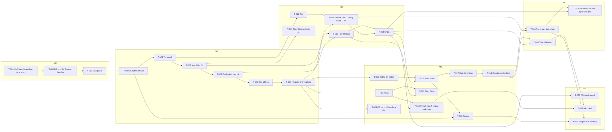

# Backlog

> Cập nhật: 2026-11-13 · Nguồn: `specs/` (Phase 3 chốt ngày 2026-11-12) · Phạm vi chi tiết từng task: `backlog/_draft/slices.md`

## 1. Thiết lập
| Mục | Giá trị |
|---|---|
| Thang story point | Fibonacci `1, 2, 3, 5, 8` — 8 là trần, task 8 cân nhắc tách (Q-045) |
| Unit / integration test | Vitest + Firebase Emulator Suite (Auth, Firestore, RTDB, Storage, Functions; test Security Rules bằng `@firebase/rules-unit-testing`) |
| E2E test | Playwright (viewport mobile 375×812; desktop 1280×800 từ T-029) |
| Môi trường kiểm tra | Local + emulator (chưa deploy – Q-045) |
| Năng lực nhóm | 1 dev, ~10 point / sprint 2 tuần |

### Definition of Done chung
- [ ] Mọi acceptance criteria đạt, đã kiểm trên local + emulator
- [ ] Test tự động trong task viết xong và pass trên CI (GitHub Actions chạy emulator)
- [ ] Lint / type check pass
- [ ] Security Rules mới / sửa có test rules
- [ ] Đã chạy các bước test tay, ghi kết quả
- [ ] Code review xong (tự review theo checklist nếu làm một mình)
- [ ] Không làm hỏng demo của task trước (smoke e2e pass)
- [ ] Chữ giao diện nằm trong file từ điển tiếng Việt; log không chứa nội dung tin / email (NFR-24, NFR-27)

## 2. Milestone
| Milestone | Mục tiêu demo | Task | Point |
|---|---|---|---|
| M0 | Walking skeleton: chạy local + emulator, CI xanh; người dùng mới đăng nhập Google, đồng ý chính sách, thấy trang Phòng rỗng, đăng xuất được | T-001 → T-003 | 10 |
| M1 | Hành trình chính: B tắt ẩn danh → A tra email B, gửi lời mời → B chấp nhận → A tạo phòng với B → hai người chat chữ realtime | T-004 → T-009 | 25 |
| M2 | Kết bạn đầy đủ & quyền riêng tư: link mời, thu hồi, hủy kết bạn (phòng chỉ đọc), chặn / bỏ chặn | T-010 → T-014 | 20 |
| M3 | Phòng & chat đầy đủ: quản lý thành viên, host, giải tán, ảnh, thu hồi, đã xem / chưa đọc, online / đang soạn, tin hết hạn | T-015 → T-023 | 36 |
| M4 | Thông báo & vòng đời tài khoản: trung tâm thông báo, phản hồi lời mời từ thông báo, xóa tài khoản | T-024 → T-026 | 12 |
| M5 | Hardening: chống dò email, vận hành / tải, responsive desktop & trình duyệt | T-027 → T-029 | 13 |
| | | **29 task** | **116** |

## 3. Epic
| EPIC | Tên | BIZ / SUP | Task |
|---|---|---|---|
| EPIC-01 | Nền tảng & tài khoản | BIZ-01, BIZ-02, BIZ-11 | T-001, T-002, T-003, T-004, T-026 |
| EPIC-02 | Kết bạn | BIZ-03, BIZ-04, BIZ-05, BIZ-06, SUP-01, SUP-07 | T-005, T-006, T-007, T-010, T-011, T-012, T-013 |
| EPIC-03 | Chặn | BIZ-07 | T-014 |
| EPIC-04 | Phòng & thành viên | BIZ-08, BIZ-09, SUP-02 | T-008, T-015, T-016, T-017, T-018 |
| EPIC-05 | Nhắn tin | BIZ-10, SUP-04, SUP-05, SUP-08, SUP-09 | T-009, T-019, T-020, T-021, T-022, T-023 |
| EPIC-06 | Thông báo | SUP-03, SUP-06 | T-024, T-025 |
| EPIC-07 | Hardening & NFR | NFR | T-027, T-028, T-029 |

## 4. Danh sách task
| ID | Tiêu đề | Epic | Milestone | Point | Phụ thuộc | Sprint | Trạng thái | File |
|---|---|---|---|---|---|---|---|---|
| T-001 | Khởi tạo dự án chạy local + emulator, CI xanh | EPIC-01 | M0 | 3 | — | S1 | DONE | [T-001](tasks/T-001-project-skeleton-emulator-ci.md) |
| T-002 | Đăng nhập Google lần đầu & đồng ý chính sách | EPIC-01 | M0 | 5 | T-001 | S1 | DONE | [T-002](tasks/T-002-google-sign-in-consent.md) |
| T-003 | Đăng xuất & hết phiên sau 30 ngày không dùng | EPIC-01 | M0 | 2 | T-002 | S1 | DONE | [T-003](tasks/T-003-sign-out-session-expiry.md) |
| T-004 | Cài đặt tài khoản: đổi tên, ẩn danh, hiển thị online | EPIC-01 | M1 | 3 | T-003 | S2 | TODO | [T-004](tasks/T-004-account-settings.md) |
| T-005 | Tra email & gửi lời mời kết bạn trong platform | EPIC-02 | M1 | 5 | T-004 | S2 | TODO | [T-005](tasks/T-005-email-lookup-send-friend-request.md) |
| T-006 | Xem lời mời & chấp nhận / từ chối | EPIC-02 | M1 | 5 | T-005 | S3 | TODO | [T-006](tasks/T-006-accept-reject-friend-request.md) |
| T-007 | Danh sách bạn bè | EPIC-02 | M1 | 2 | T-006 | S3 | TODO | [T-007](tasks/T-007-friend-list.md) |
| T-008 | Tạo phòng & danh sách phòng | EPIC-04 | M1 | 5 | T-007 | S4 | TODO | [T-008](tasks/T-008-create-room-and-room-list.md) |
| T-009 | Nhắn tin chữ realtime | EPIC-05 | M1 | 5 | T-008 | S5 | TODO | [T-009](tasks/T-009-realtime-text-messaging.md) |
| T-010 | Tạo & copy link mời | EPIC-02 | M2 | 3 | T-005 | S4 | TODO | [T-010](tasks/T-010-create-copy-invite-link.md) |
| T-011 | Mở link mời → đăng nhập → lời mời đang chờ | EPIC-02 | M2 | 5 | T-010, T-006 | S6 | TODO | [T-011](tasks/T-011-open-invite-link.md) |
| T-012 | Thu hồi lời mời đã gửi | EPIC-02 | M2 | 2 | T-006 | S3 | TODO | [T-012](tasks/T-012-withdraw-friend-request.md) |
| T-013 | Hủy kết bạn & phòng 2 người chỉ đọc | EPIC-02 | M2 | 5 | T-009, T-007 | S6 | TODO | [T-013](tasks/T-013-unfriend-read-only-room.md) |
| T-014 | Chặn & bỏ chặn | EPIC-03 | M2 | 5 | T-013, T-011 | S7 | TODO | [T-014](tasks/T-014-block-and-unblock.md) |
| T-015 | Thông tin phòng: xem thành viên & sửa tên phòng | EPIC-04 | M3 | 3 | T-009 | S7 | TODO | [T-015](tasks/T-015-room-info-and-rename.md) |
| T-016 | Host thêm & kick thành viên | EPIC-04 | M3 | 5 | T-015, T-014 | S8 | TODO | [T-016](tasks/T-016-add-and-kick-members.md) |
| T-017 | Giải tán phòng (dọn dữ liệu nền) | EPIC-04 | M3 | 5 | T-016 | S9 | TODO | [T-017](tasks/T-017-disband-room.md) |
| T-018 | Chuyển quyền host & rời phòng | EPIC-04 | M3 | 5 | T-017 | S10 | TODO | [T-018](tasks/T-018-transfer-host-and-leave-room.md) |
| T-019 | Gửi & xem ảnh | EPIC-05 | M3 | 5 | T-009 | S8 | TODO | [T-019](tasks/T-019-send-and-view-images.md) |
| T-020 | Thu hồi tin | EPIC-05 | M3 | 2 | T-019, T-013 | S9 | TODO | [T-020](tasks/T-020-recall-message.md) |
| T-021 | Đã xem, số tin chưa đọc & tóm tắt phòng | EPIC-05 | M3 | 5 | T-009 | S5 | TODO | [T-021](tasks/T-021-read-receipts-and-unread-counts.md) |
| T-022 | Online & đang soạn tin | EPIC-05 | M3 | 3 | T-016, T-004 | S9 | TODO | [T-022](tasks/T-022-online-presence-and-typing.md) |
| T-023 | Tin hết hạn ở phòng ngắn hạn | EPIC-05 | M3 | 3 | T-019, T-021 | S10 | TODO | [T-023](tasks/T-023-expiring-messages.md) |
| T-024 | Trung tâm thông báo | EPIC-06 | M4 | 5 | T-018, T-011 | S11 | TODO | [T-024](tasks/T-024-notification-center.md) |
| T-025 | Phản hồi lời mời ngay trên thông báo | EPIC-06 | M4 | 2 | T-024, T-014 | S11 | TODO | [T-025](tasks/T-025-respond-request-from-notification.md) |
| T-026 | Xóa tài khoản | EPIC-01 | M4 | 5 | T-018, T-014 | S12 | TODO | [T-026](tasks/T-026-delete-account.md) |
| T-027 | Chống dò email: thời gian phản hồi đều & giới hạn 100 lượt/giờ | EPIC-07 | M5 | 3 | T-014 | S11 | TODO | [T-027](tasks/T-027-email-lookup-anti-enumeration.md) |
| T-028 | Vận hành: tải, sao lưu, cảnh báo, nhật ký an toàn | EPIC-07 | M5 | 5 | T-023, T-026 | S12 | TODO | [T-028](tasks/T-028-operations-load-backup-alerts.md) |
| T-029 | Responsive desktop & kiểm trình duyệt | EPIC-07 | M5 | 5 | T-022, T-024 | S13 | TODO | [T-029](tasks/T-029-responsive-desktop-and-browsers.md) |

Trạng thái: `TODO` / `IN-PROGRESS` / `REVIEW` / `DONE`. Sprint gợi ý chi tiết: `_draft/slices.md` (13 sprint ≈ 26 tuần).

## 5. Dependency

## 6. Ngoài phạm vi backlog
| Mục | Lý do | Nguồn |
|---|---|---|
| Push notification | Ngoài MVP, làm sau | SUP-10, Q-031 |
| Email thông báo, tắt tiếng phòng, giới hạn số lời mời, quản lý phiên nhiều thiết bị, audit | Ngoài phạm vi | SUP-11 → SUP-14 |
| Deploy App Hosting, áp cấu hình TTL / lifecycle / backup / alert lên project thật, đo tải thật | Môi trường kiểm tra chỉ local + emulator; cấu hình + runbook có ở T-023, T-028 | Q-045 |
| Hồ sơ đánh giá chuyển dữ liệu ra nước ngoài (NĐ 13/2023) | Việc pháp lý, không phải code | ADR-04 |
| Phần game | Ngoài phạm vi sản phẩm | Q-001 |
