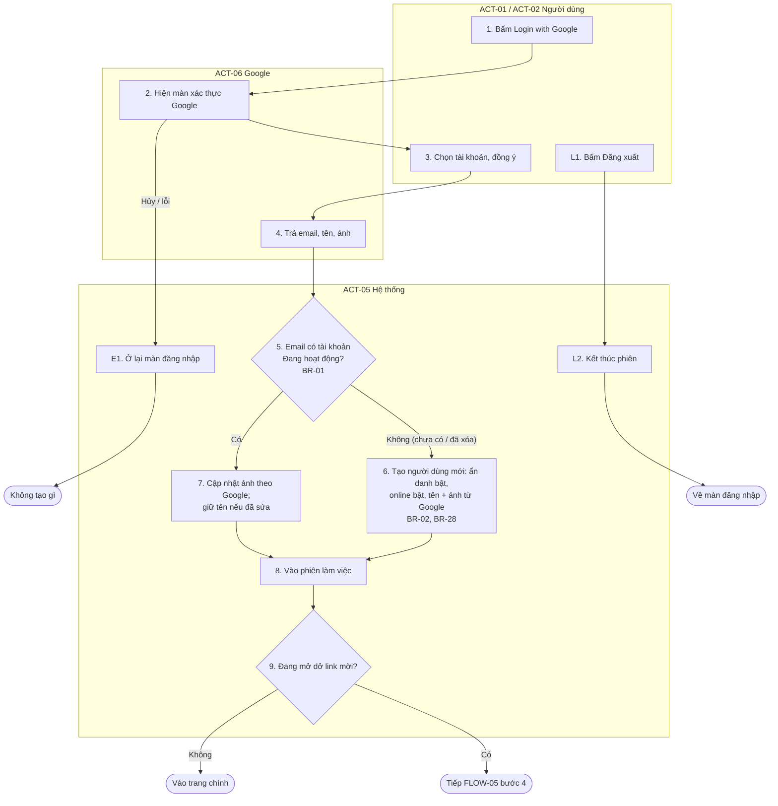

### FLOW-01 Tham gia & đăng nhập (BIZ-01)
- **Actor:** ACT-01, ACT-02 (chính); ACT-06 Google, ACT-05 Hệ thống (liên quan)
- **Trigger:** Bấm "Login with Google", hoặc phải đăng nhập khi mở link mời (FLOW-05).
- **Kết quả:** Người dùng ở trạng thái đã đăng nhập (tài khoản mới được tạo nếu là lần đầu); hoặc đã đăng xuất.

- **Happy path:**
  1. Người dùng bấm "Login with Google".
  2. Google hiện màn xác thực.
  3. Người dùng chọn tài khoản và đồng ý.
  4. Google trả email, tên, ảnh đại diện.
  5. Hệ thống kiểm tra email đã có tài khoản Đang hoạt động chưa (BR-01).
  6. *(Lần đầu)* Tạo người dùng (ENT-01) **Đang hoạt động**: ẩn danh **bật**, hiển thị online **bật**, tên và ảnh lấy từ Google (BR-02). Email từng thuộc tài khoản đã xóa → vẫn tạo tài khoản mới hoàn toàn (BR-28).
  7. *(Các lần sau)* Cập nhật ảnh theo Google; tên hiển thị giữ nguyên nếu người dùng đã sửa (Q-029).
  8. Vào phiên làm việc.
  9. Nếu đang mở dở link mời → tiếp FLOW-05 bước 4; không thì vào trang chính. Kết thúc.
- **Alternative paths:**
  - A1. Đăng xuất: L1 người dùng bấm Đăng xuất → L2 hệ thống kết thúc phiên, về màn đăng nhập.
- **Exceptions:**
  - E1. Người dùng hủy hoặc Google báo lỗi ở bước 2–3 → ở lại màn đăng nhập, không tạo gì.
  - E2. Google không trả tên → (Q-037) dùng phần trước "@" của email làm tên hiển thị (vì BR-29 tên không được trống).
- **Supporting kích hoạt:** —
- **Business rules áp dụng:** BR-01 bước 5; BR-02 bước 6; BR-28 bước 6; BR-29 E2.
