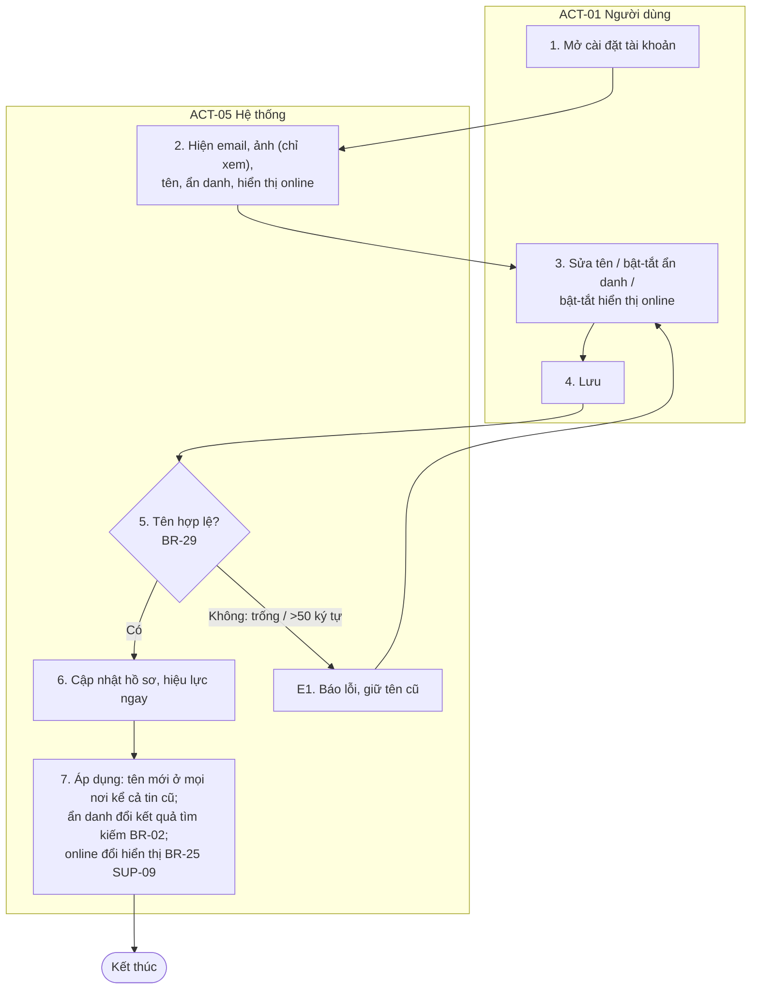

### FLOW-02 Cài đặt tài khoản (BIZ-02)
- **Actor:** ACT-01 (chính); ACT-05 Hệ thống (liên quan)
- **Trigger:** Người dùng mở cài đặt tài khoản và thay đổi.
- **Kết quả:** Tên / ẩn danh / hiển thị online mới có hiệu lực ngay.

- **Happy path:**
  1. Người dùng mở cài đặt tài khoản.
  2. Hệ thống hiện email và ảnh (chỉ xem), tên, ẩn danh, hiển thị online.
  3. Người dùng sửa tên và/hoặc bật/tắt ẩn danh, hiển thị online.
  4. Bấm Lưu.
  5. Hệ thống kiểm tra tên không trống, ≤50 ký tự (BR-29).
  6. Cập nhật hồ sơ (ENT-01), hiệu lực ngay.
  7. Áp dụng:
     - Tên mới hiển thị ở mọi nơi, kể cả trên tin cũ (Q-029).
     - Bật ẩn danh → từ giờ không ai tìm thấy qua email; lời mời đang chờ giữ nguyên. Tắt → tìm thấy được (BR-02).
     - Tắt hiển thị online → mọi người thấy mình offline ngay, và mình không thấy online người khác (BR-25, SUP-09).
- **Alternative paths:** A1. Bật/tắt ẩn danh hoặc online (Q-037) lưu ngay khi gạt công tắc, không cần bấm Lưu (bỏ qua bước 4–5).
- **Exceptions:** E1. Tên trống hoặc quá 50 ký tự → báo lỗi, giữ tên cũ, quay lại bước 3.
- **Kèm theo:** Từ cài đặt → Xóa tài khoản (FLOW-11), Đăng xuất (FLOW-01 A1), Danh sách đã chặn (FLOW-07).
- **Supporting kích hoạt:** SUP-09 bước 7.
- **Business rules áp dụng:** BR-29 bước 5; BR-02, BR-25 bước 7.
