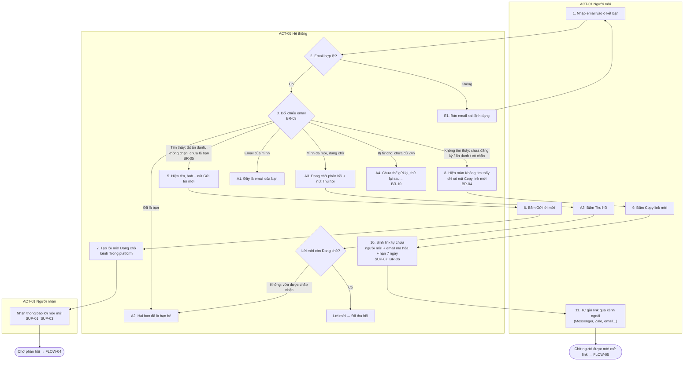

### FLOW-03 Mời kết bạn (BIZ-03)
- **Actor:** ACT-01 người mời (chính); ACT-01 người nhận, ACT-05 Hệ thống (liên quan)
- **Trigger:** Người mời nhập email vào ô kết bạn.
- **Kết quả:** Có thêm 1 lời mời Đang chờ (ENT-02), hoặc người mời có 1 link mời để tự gửi (ENT-03), hoặc không có gì thay đổi.

- **Happy path (Tìm thấy):**
  1. Người mời nhập email.
  2. Hệ thống kiểm tra email đúng định dạng.
  3. Hệ thống đối chiếu email với người dùng, cài đặt ẩn danh, quan hệ bạn bè / chặn, lời mời hiện có (BR-03).
  4. *(Tìm thấy)* — người đó đang tắt ẩn danh, không có quan hệ chặn chiều nào, chưa là bạn, mình chưa có lời mời đang chờ tới họ, không bị từ chối trong 24h (BR-05).
  5. Hệ thống hiện tên, ảnh người đó và nút **Gửi lời mời**.
  6. Người mời bấm Gửi lời mời.
  7. Hệ thống tạo lời mời (ENT-02) kênh "Trong platform", trạng thái **Đang chờ**; người nhận nhận thông báo "Có lời mời kết bạn mới" (SUP-01, SUP-03). Kết thúc → chờ FLOW-04.
- **Happy path (Không tìm thấy):**
  8. Email chưa đăng ký, hoặc người đó đang ẩn danh, hoặc có quan hệ chặn (chiều nào cũng vậy) → hiện màn hình giống hệt nhau, chỉ có nút **Copy link mời** (BR-04).
  9. Người mời bấm Copy link mời.
  10. Hệ thống sinh link tự chứa: người mời, email đã mã hóa, hạn 7 ngày. Không lưu gì; link cũ cho cùng email vẫn còn hiệu lực (SUP-07, BR-06). Nếu thực chất là có quan hệ chặn, link vẫn được sinh nhưng khi mở sẽ không dùng được.
  11. Người mời tự gửi link qua kênh ngoài. Kết thúc → chờ FLOW-05.
- **Alternative paths:**
  - A1. Email của chính mình → "Đây là email của bạn". Kết thúc.
  - A2. Đã là bạn → "Hai bạn đã là bạn bè". Kết thúc.
  - A3. Mình đã gửi lời mời và đang chờ → "Đang chờ phản hồi" + nút **Thu hồi**. Bấm Thu hồi → lời mời → **Đã thu hồi** (BR-08). Kết thúc.
  - A4. Mình bị người đó từ chối chưa đủ 24 giờ → "Chưa thể gửi lại, thử lại sau …" (BR-10). Kết thúc.
  - A5. Người kia cũng đang có lời mời đang chờ gửi cho mình → vẫn đi bước 5–7 bình thường; hai lời mời cùng tồn tại (BR-09).
  - A6. **Xem danh sách lời mời**: đã gửi (đang chờ, nút Thu hồi → như A3) và đã nhận (đang chờ, nút Chấp nhận / Từ chối / Chặn → FLOW-04, FLOW-07).
- **Exceptions:**
  - E1. Email sai định dạng → báo lỗi, quay lại bước 1.
  - E2. Thu hồi đúng lúc người nhận vừa chấp nhận → chấp nhận thắng, hai người thành bạn, hiển thị như A2 (Q-029).
  - E3. (Q-035) Giữa bước 5 và 7, trạng thái thay đổi (người kia vừa bật ẩn danh, vừa chặn, vừa thành bạn qua lời mời ngược chiều) → hệ thống kiểm tra lại ở bước 7: đã là bạn → A2; còn lại → hiển thị như bước 8 (không để lộ lý do).
- **Supporting kích hoạt:** SUP-01, SUP-03 tại bước 7; SUP-07 tại bước 10.
- **Business rules áp dụng:** BR-03 bước 3; BR-04 bước 8; BR-05 bước 4; BR-06 bước 10; BR-08 A3; BR-09 A5; BR-10 A4.
