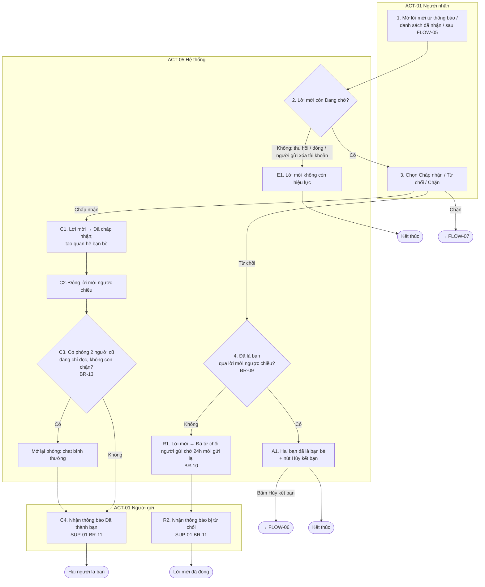

### FLOW-04 Phản hồi lời mời kết bạn (BIZ-04)
- **Actor:** ACT-01 người nhận (chính); ACT-01 người gửi, ACT-05 Hệ thống (liên quan)
- **Trigger:** Người nhận mở thông báo lời mời, danh sách lời mời đã nhận, hoặc màn chấp nhận/từ chối ngay sau FLOW-05.
- **Kết quả:** Hai người thành bạn, hoặc lời mời bị từ chối, hoặc chuyển sang chặn (FLOW-07).

- **Happy path (Chấp nhận):**
  1. Người nhận mở lời mời (từ thông báo SUP-03, danh sách lời mời đã nhận, hoặc ngay sau FLOW-05).
  2. Hệ thống kiểm tra lời mời còn **Đang chờ**.
  3. Người nhận chọn **Chấp nhận**.
  - C1. Lời mời (ENT-02) → **Đã chấp nhận**; tạo quan hệ bạn bè (ENT-04) **Đang là bạn** (BR-09).
  - C2. Lời mời ngược chiều đang chờ (nếu có) → **Đã đóng**. (Link mời giữa hai người tự hết dùng được vì đã là bạn – SUP-07.)
  - C3. Phòng 2 người cũ giữa hai người đang chỉ đọc, và không còn chặn chiều nào → mở lại, chat bình thường (BR-13).
  - C4. Người gửi nhận thông báo "đã trở thành bạn bè" (SUP-01, BR-11). Kết thúc.
- **Alternative paths:**
  - A1. *(Từ chối)* nhưng hai người đã thành bạn qua lời mời ngược chiều → lời từ chối vô hiệu; hiện "Hai bạn đã là bạn bè" + nút **Hủy kết bạn** (→ FLOW-06) (BR-09).
  - A2. *(Từ chối)* bình thường: R1 lời mời → **Đã từ chối**; người gửi phải chờ 24h mới gửi lại, người từ chối mời lại được ngay (BR-10). R2 người gửi nhận thông báo bị từ chối (SUP-01, BR-11). Kết thúc.
  - A3. *(Chặn)* → FLOW-07; lời mời tự đóng ở đó.
  - A4. Mình đã từ chối lời mời của người kia, sau đó người kia chấp nhận lời mời của mình → vẫn thành bạn (bước C1 xảy ra ở phía người kia) (BR-09).
- **Exceptions:**
  - E1. Lời mời đã thu hồi, đã đóng, hoặc người gửi đã xóa tài khoản → "Lời mời không còn hiệu lực". Kết thúc.
  - E2. Thu hồi trùng lúc chấp nhận → chấp nhận thắng (Q-029).
- **Supporting kích hoạt:** SUP-01, SUP-03 tại C4, R2.
- **Business rules áp dụng:** BR-09 C1, A1, A4; BR-10 R1; BR-11 C4, R2; BR-13 C3.
