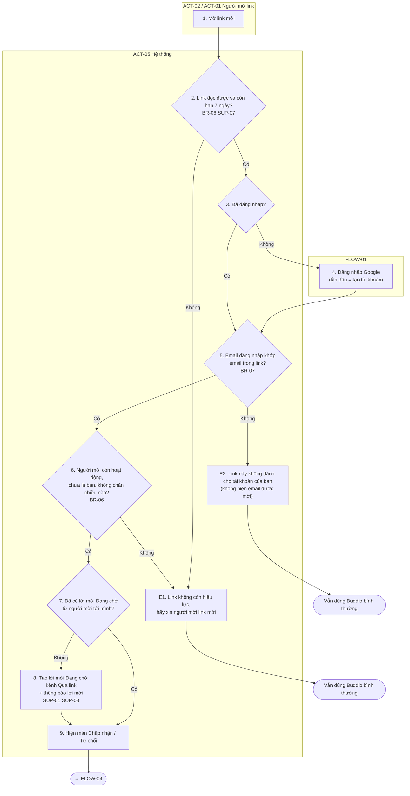

### FLOW-05 Tham gia qua link mời (BIZ-05)
- **Actor:** ACT-02, hoặc ACT-01 có đúng email được mời (chính); ACT-06 Google, ACT-05 Hệ thống (liên quan)
- **Trigger:** Mở link mời nhận qua kênh ngoài.
- **Kết quả:** Người mở link có 1 lời mời Đang chờ từ người mời và thấy ngay màn chấp nhận/từ chối.

- **Happy path:**
  1. Người được mời mở link.
  2. Hệ thống đọc link (người mời, email mã hóa, hạn) và kiểm tra còn trong 7 ngày (BR-06, SUP-07).
  3. Kiểm tra đã đăng nhập chưa.
  4. Chưa → đăng nhập Google (FLOW-01); lần đầu thì tạo tài khoản.
  5. Kiểm tra email đăng nhập khớp email trong link (BR-07).
  6. Kiểm tra người mời còn hoạt động, hai người chưa là bạn, không có chặn chiều nào (BR-06).
  7. Kiểm tra đã có lời mời Đang chờ từ người mời tới mình chưa.
  8. Chưa có → tạo lời mời (ENT-02) kênh "Qua link", **Đang chờ**; tạo thông báo lời mời cho người mở link (SUP-01, SUP-03). Link coi như **Đã dùng**.
  9. Hiện màn Chấp nhận / Từ chối → FLOW-04.
- **Alternative paths:**
  - A1. Đã có lời mời Đang chờ (từ link khác hoặc người mời đã gửi trong platform) → bỏ qua bước 8, hiện lời mời đó (Q-029).
  - A2. Mở lại cùng link sau khi đã phản hồi (đã chấp nhận → là bạn → E1; đã từ chối) → (Q-036) link chỉ mang email + hạn dùng, không lưu "đã dùng" → còn hạn và còn thỏa bước 5–6 thì **tạo lời mời mới**, không áp luật chờ 24h (người được mời tự chủ động mở link).
- **Exceptions:**
  - E1. Link hỏng, hết hạn; người mời đã xóa tài khoản; đã là bạn; có chặn → "Link không còn hiệu lực, hãy xin người mời link mới". Người dùng vẫn dùng Buddio bình thường.
  - E2. Email không khớp → "Link này không dành cho tài khoản của bạn". **Không hiển thị email được mời.**
- **Supporting kích hoạt:** SUP-07 bước 2, 6; SUP-01, SUP-03 bước 8.
- **Business rules áp dụng:** BR-06 bước 2, 6; BR-07 bước 5; BR-01 bước 4.
