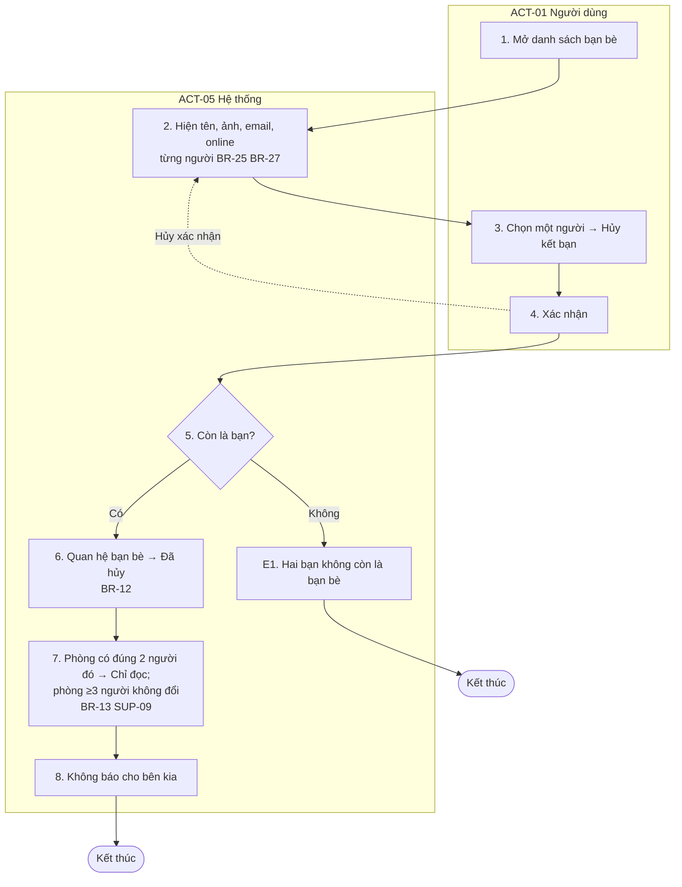

### FLOW-06 Hủy kết bạn (BIZ-06)
- **Actor:** ACT-01 (chính); ACT-05 Hệ thống (liên quan)
- **Trigger:** Chọn "Hủy kết bạn" trong danh sách bạn bè, hoặc từ màn "Hai bạn đã là bạn bè" (FLOW-04 A1).
- **Kết quả:** Hai người không còn là bạn; phòng 2 người chung chuyển chỉ đọc.

- **Happy path:**
  1. Người dùng mở danh sách bạn bè.
  2. Hệ thống hiện tên, ảnh, email, trạng thái online từng người (BR-25, BR-27).
  3. Chọn một người → "Hủy kết bạn".
  4. Xác nhận.
  5. Hệ thống kiểm tra hai người còn là bạn.
  6. Quan hệ bạn bè (ENT-04) → **Đã hủy** (BR-12).
  7. Mọi phòng có đúng 2 thành viên là hai người này → **chỉ đọc**, cập nhật tức thời (BR-13, SUP-09). Phòng ≥3 người không đổi. Từ giờ hai người không thêm nhau vào phòng mới được.
  8. Không thông báo cho bên kia (BR-12). Kết thúc.
- **Alternative paths:**
  - A1. Không xác nhận ở bước 4 → không đổi gì, quay lại bước 2.
  - A2. Từ danh sách bạn bè cũng chọn được **Chặn** → FLOW-07.
- **Exceptions:** E1. Bên kia vừa hủy trước → "Hai bạn không còn là bạn bè". Kết thúc.
- **Supporting kích hoạt:** SUP-09 bước 7.
- **Business rules áp dụng:** BR-12 bước 6, 8; BR-13 bước 7; BR-25, BR-27 bước 2.
