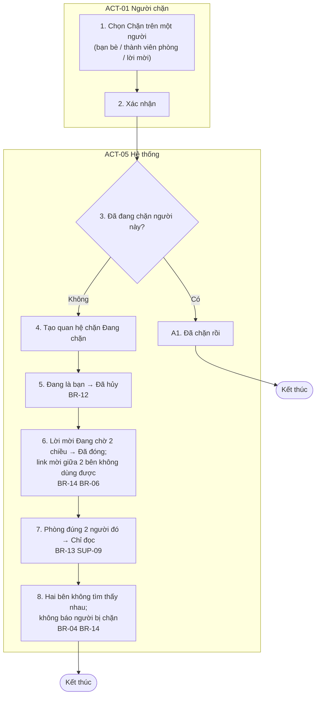
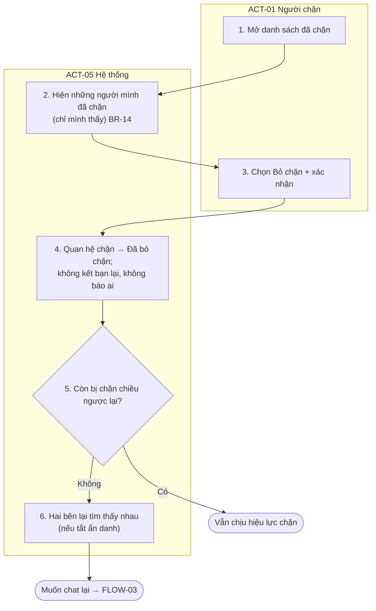

### FLOW-07 Chặn / bỏ chặn người dùng (BIZ-07)
- **Actor:** ACT-01 (chính); ACT-05 Hệ thống (liên quan)
- **Trigger:** Chặn — từ danh sách bạn bè, danh sách thành viên phòng, hoặc một lời mời kết bạn. Bỏ chặn — từ danh sách đã chặn.
- **Kết quả:** Quan hệ chặn có hiệu lực (kèm các hệ quả), hoặc được gỡ.

#### FLOW-07a Chặn

- **Happy path:**
  1. Người dùng chọn **Chặn** trên một người (từ danh sách bạn bè, danh sách thành viên phòng, hoặc lời mời kết bạn). Chặn được cả người chưa là bạn (Q-025).
  2. Xác nhận.
  3. Hệ thống kiểm tra chưa chặn người này.
  4. Tạo quan hệ chặn (ENT-05) **Đang chặn**.
  5. Quan hệ bạn bè (nếu có) → **Đã hủy** (BR-12).
  6. Lời mời Đang chờ cả hai chiều → **Đã đóng**; link mời giữa hai bên không còn dùng được (BR-14, BR-06).
  7. Phòng có đúng 2 thành viên là hai người này → **chỉ đọc** (BR-13, SUP-09). Phòng ≥3 người: vẫn chat bình thường, cả hai vẫn thấy tin của nhau.
  8. Hai bên không tìm thấy nhau qua email; người bị chặn không được báo (BR-04, BR-14). Kết thúc.
- **Alternative paths:**
  - A1. Đã đang chặn người này → báo đã chặn. Kết thúc.
  - A2. Người kia đang chặn mình → vẫn chặn được; hai quan hệ độc lập (BR-14).
  - A3. Chặn từ lời mời: lời mời đó cũng đóng ở bước 6.
  - A4. Không xác nhận ở bước 2 → không đổi gì.
- **Business rules:** BR-04, BR-06, BR-12, BR-13, BR-14.

#### FLOW-07b Bỏ chặn

- **Happy path:** 1. Mở danh sách đã chặn. 2. Hệ thống hiện những người mình đã chặn — chỉ mình thấy (BR-14). 3. Chọn Bỏ chặn và xác nhận. 4. ENT-05 → **Đã bỏ chặn**; không tự kết bạn lại, không báo ai. 5–6. Nếu không còn chặn chiều ngược lại → hai bên lại tìm thấy nhau (nếu tắt ẩn danh). Phòng 2 người cũ **vẫn chỉ đọc** cho tới khi kết bạn lại (FLOW-03 → FLOW-04 C3) (BR-13).
- **Business rules:** BR-13, BR-14.
