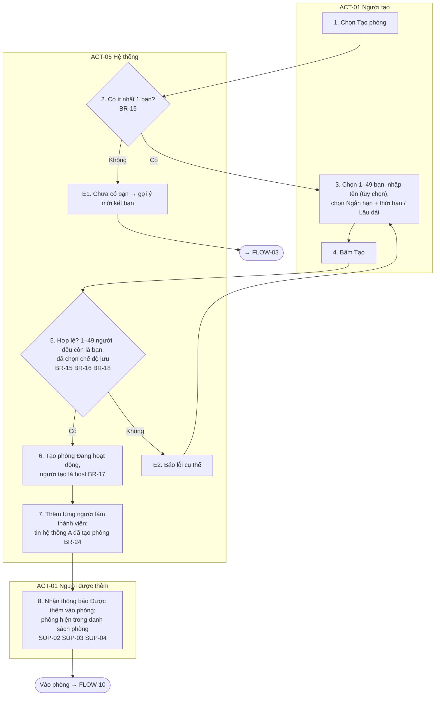

### FLOW-08 Tạo phòng chat (BIZ-08)
- **Actor:** ACT-01 → trở thành ACT-03 của phòng mới (chính); ACT-05 Hệ thống, ACT-01 người được thêm (liên quan)
- **Trigger:** Người dùng chọn "Tạo phòng".
- **Kết quả:** Phòng mới Đang hoạt động, người tạo là host, sẵn sàng nhắn tin.

- **Happy path:**
  1. Người dùng chọn "Tạo phòng".
  2. Hệ thống kiểm tra có ít nhất 1 người bạn (BR-15).
  3. Người dùng chọn 1–49 người từ danh sách bạn bè, nhập tên phòng (không bắt buộc), chọn chế độ lưu: **Ngắn hạn** + thời hạn (1 ngày / 2 ngày / 3 ngày / 1 tuần / 1 tháng / 3 tháng) hoặc **Lâu dài**. Màn hình nhắc: chế độ lưu không đổi được về sau.
  4. Bấm Tạo.
  5. Hệ thống kiểm tra: 1–49 người, tất cả vẫn đang là bạn, đã chọn chế độ lưu (+ thời hạn nếu ngắn hạn) (BR-15, BR-16, BR-18).
  6. Tạo phòng (ENT-06) **Đang hoạt động**; người tạo là host (BR-17).
  7. Tạo thành viên (ENT-07) **Đang tham gia** cho host và từng người; tin hệ thống "A đã tạo phòng" (BR-24).
  8. Mỗi người được thêm nhận thông báo "Được thêm vào phòng" (SUP-02, SUP-03); phòng hiện trong danh sách phòng của mọi thành viên (SUP-04). Kết thúc → FLOW-10.
- **Alternative paths:**
  - A1. Đã có phòng khác với cùng những người này → vẫn tạo phòng mới (Q-002).
  - A2. Không đặt tên → phòng hiển thị tên các thành viên (Q-012).
- **Exceptions:**
  - E1. Chưa có bạn nào → không tạo được, gợi ý đi mời kết bạn (FLOW-03).
  - E2. Chọn quá 49 người; chưa chọn chế độ lưu / thời hạn; một người vừa hủy kết bạn hoặc chặn → báo lỗi cụ thể, quay lại bước 3. (Q-037) Người không còn là bạn bị bỏ khỏi danh sách chọn và báo "Người này không còn trong danh sách bạn bè".
- **Supporting kích hoạt:** SUP-02, SUP-03, SUP-04 bước 8.
- **Business rules áp dụng:** BR-15 bước 2, 5; BR-16, BR-18 bước 5; BR-17 bước 6; BR-24 bước 7.
