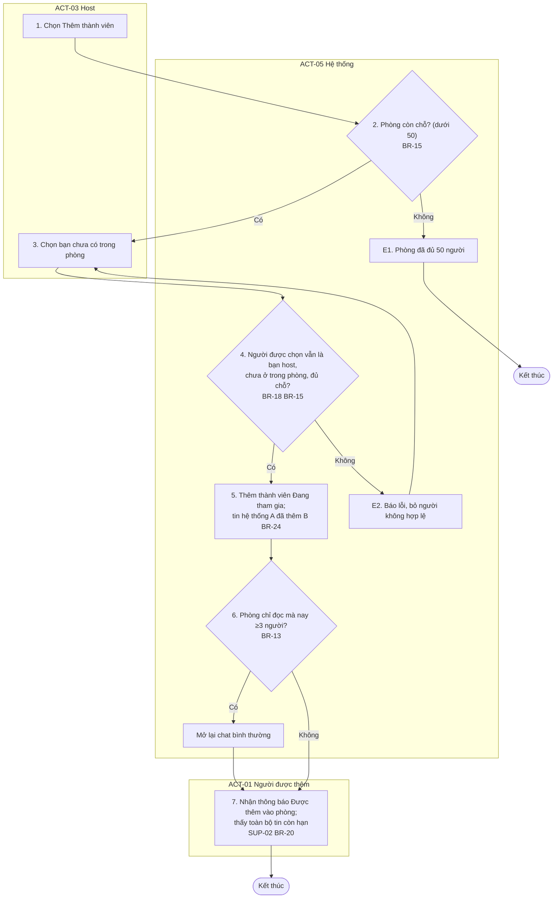
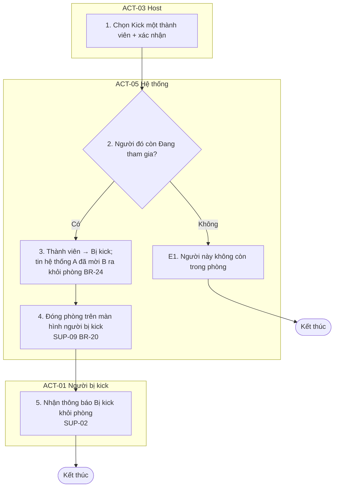
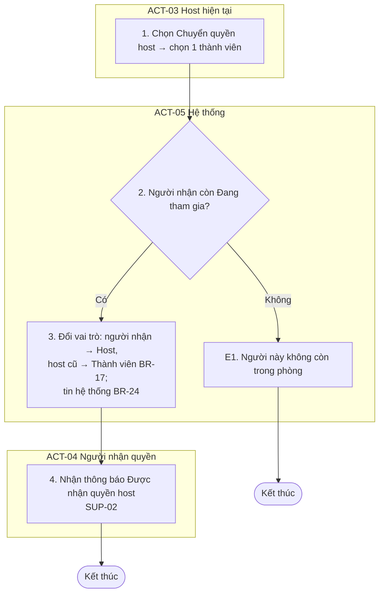
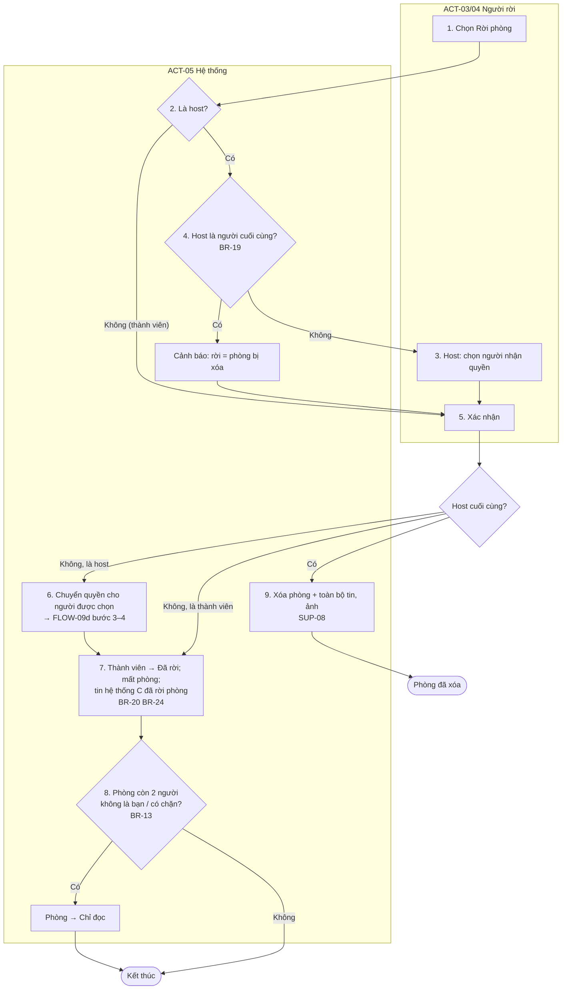
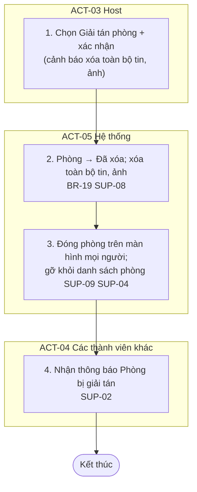

### FLOW-09 Quản lý phòng & thành viên (BIZ-09)
- **Actor:** ACT-03 Host (chính); ACT-04 Thành viên (xem thành viên, rời phòng); ACT-05 Hệ thống (liên quan)
- **Trigger:** Host hoặc thành viên chọn thao tác trong phần thông tin phòng.
- **Điều kiện chung (mọi nhánh):** người thao tác là thành viên **Đang tham gia**, phòng **Đang hoạt động**; thao tác của host → kiểm tra đúng là host (BR-18). Sai → "Bạn không có quyền thực hiện thao tác này" (Q-037).
- **Kết quả:** Phòng luôn có đúng 1 host và ≤50 thành viên, hoặc phòng đã bị xóa.
- Tách nhánh: **09a** Xem thành viên & sửa tên phòng · **09b** Thêm thành viên · **09c** Kick · **09d** Chuyển quyền host · **09e** Rời phòng · **09f** Giải tán phòng.

#### FLOW-09a Xem thành viên & sửa tên phòng
- **Xem thành viên (mọi thành viên):** hệ thống hiện tên, ảnh, email, online, vai trò từng người (BR-25, BR-27). Từ đây chọn được **Chặn** một người (→ FLOW-07).
- **Sửa tên phòng (host):** 1. Host nhập tên mới (để trống được). 2. Hệ thống kiểm tra quyền host (BR-18). 3. Cập nhật tên; trống → hiển thị tên các thành viên. 4. Tin hệ thống "A đã đổi tên phòng thành …" (BR-24); mọi người thấy ngay (SUP-09, SUP-04).
  - (Q-037) Tên phòng tối đa 50 ký tự (giống tên hiển thị).

#### FLOW-09b Thêm thành viên

- **Happy path:** 1. Host chọn Thêm thành viên. 2. Hệ thống kiểm tra phòng < 50 người (BR-15). 3. Host chọn một hoặc nhiều **bạn của mình** chưa có trong phòng. 4. Kiểm tra từng người vẫn là bạn host, chưa ở trong phòng, tổng không vượt 50 (BR-18, BR-15). 5. Thêm thành viên (ENT-07) **Đang tham gia** — không cần người được thêm đồng ý (Q-029); tin hệ thống "A đã thêm B" (BR-24). 6. Nếu phòng đang chỉ đọc và giờ có ≥3 người → chat lại bình thường (BR-13). 7. Người được thêm nhận thông báo (SUP-02, SUP-03), thấy toàn bộ tin còn hạn (BR-20). Kết thúc.
- **Alternative:** A1. Thêm lại người đã rời / bị kick → lần tham gia mới, thấy toàn bộ tin còn hạn (BR-20).
- **Exceptions:** E1. Phòng đủ 50 → không thêm được. E2. Người được chọn vừa hủy kết bạn / chặn host, hoặc vượt số chỗ còn lại → báo lỗi, quay lại bước 3.
- **Business rules:** BR-13, BR-15, BR-18, BR-20, BR-24.

#### FLOW-09c Kick thành viên

- **Happy path:** 1. Host chọn Kick một thành viên (không phải chính mình) và xác nhận. 2. Kiểm tra người đó còn Đang tham gia. 3. ENT-07 → **Bị kick**; tin hệ thống (BR-24). 4. Người bị kick mất phòng ngay, không xem được tin nữa (BR-20, SUP-09). 5. Người bị kick nhận thông báo (SUP-02, SUP-03).
- **Alternative:** A1. Kick làm phòng chỉ còn 2 người không còn là bạn / có chặn → phòng chuyển chỉ đọc (BR-13). A2. Kick làm phòng chỉ còn host → phòng vẫn tồn tại (Q-018).
- **Exceptions:** E1. Người đó vừa rời → "Người này không còn trong phòng".
- **Business rules:** BR-13, BR-18, BR-20, BR-24.

#### FLOW-09d Chuyển quyền host

- **Happy path:** 1. Host chọn một thành viên đang tham gia. 2. Kiểm tra còn Đang tham gia. 3. Đổi vai trò hai người — không cần người nhận đồng ý (Q-029); luôn đúng 1 host (BR-17); tin hệ thống "A chuyển quyền host cho B" (BR-24). 4. Người nhận được thông báo (SUP-02, SUP-03).
- **Exceptions:** E1. Người nhận vừa rời → "Người này không còn trong phòng".
- **Business rules:** BR-17, BR-18, BR-24.

#### FLOW-09e Rời phòng

- **Happy path (thành viên):** 1. Chọn Rời phòng. 2. Không phải host. 5. Xác nhận. 7. ENT-07 → **Đã rời**, mất phòng và tin (BR-20); tin hệ thống "C đã rời phòng" (BR-24). 8. Nếu còn đúng 2 người không là bạn / có chặn → phòng chỉ đọc (BR-13). Kết thúc.
- **Alternative paths:**
  - A1. *(Host, còn người khác)* bước 3 chọn người nhận quyền ngay trong thao tác rời (Q-029) → 5 xác nhận → 6 chuyển quyền (FLOW-09d bước 3–4, có thông báo SUP-02) → 7.
  - A2. *(Host là người cuối cùng)* bước 4 cảnh báo rời = phòng bị xóa → 5 xác nhận → 9 xóa phòng (ENT-06 **Đã xóa**) cùng toàn bộ tin và ảnh (BR-19, SUP-08).
  - A3. Không xác nhận ở bước 5 → không đổi gì.
- **Business rules:** BR-13, BR-17, BR-19, BR-20, BR-24.

#### FLOW-09f Giải tán phòng

- **Happy path:** 1. Host chọn Giải tán và xác nhận (cảnh báo không khôi phục được). 2. Phòng → **Đã xóa**, toàn bộ tin và ảnh bị xóa (BR-19, SUP-08). 3. Phòng biến mất với mọi thành viên ngay, kể cả người đang mở (SUP-09, SUP-04). 4. Các thành viên khác nhận thông báo "Phòng X đã bị giải tán" (SUP-02, SUP-03) — thông báo giữ tên phòng để người nhận biết (Q-037).
- **Business rules:** BR-18, BR-19.
