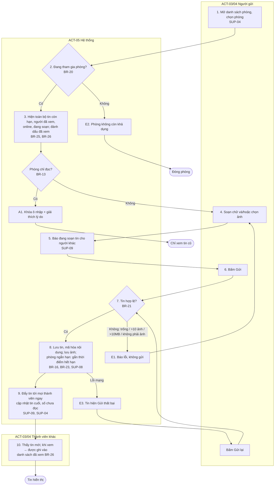
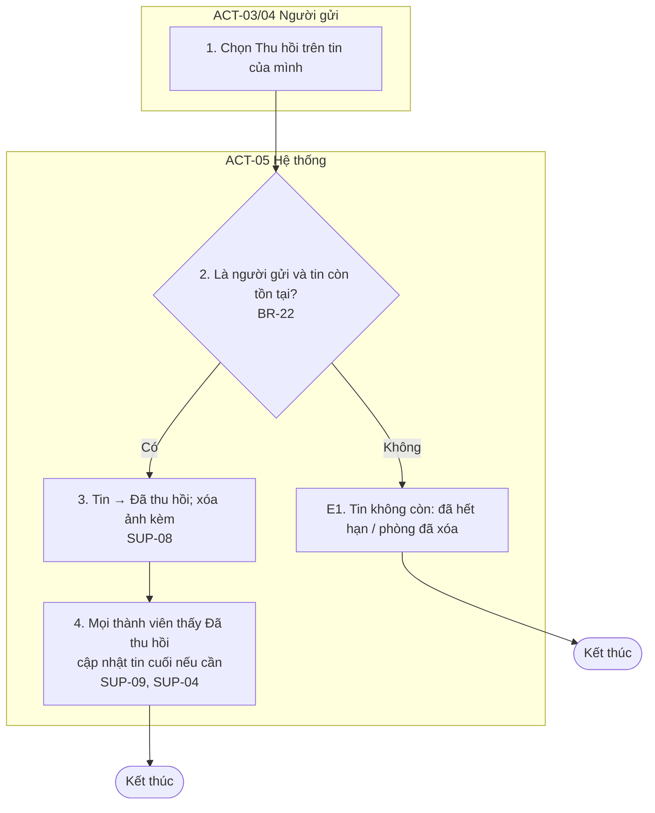
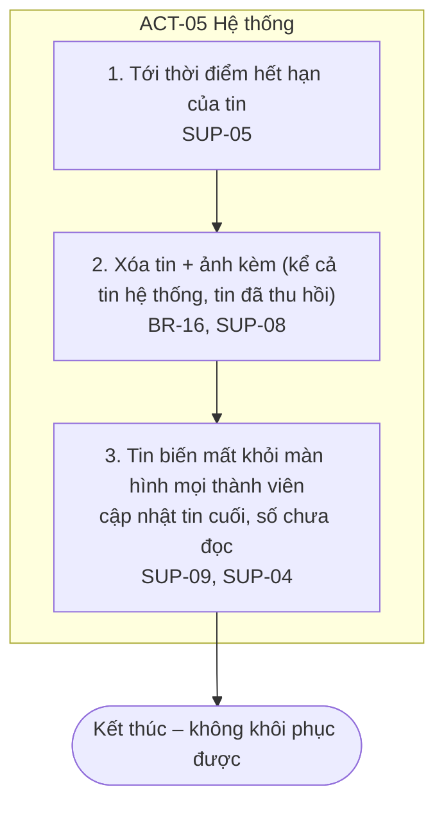

### FLOW-10 Nhắn tin trong phòng (BIZ-10)
- **Actor:** ACT-03 Host, ACT-04 Thành viên (chính); ACT-05 Hệ thống (liên quan)
- **Trigger:** Thành viên mở phòng; nhập và gửi tin; thu hồi tin; tới thời điểm hết hạn.
- **Kết quả:** Tin hiển thị cho mọi thành viên đang tham gia tới khi hết hạn, bị thu hồi, hoặc phòng bị xóa.
- Tách 3 nhánh: **FLOW-10a** Gửi & xem tin · **FLOW-10b** Thu hồi tin · **FLOW-10c** Tin hết hạn.

#### FLOW-10a Gửi & xem tin

- **Happy path:**
  1. Thành viên mở danh sách phòng (tin cuối, số chưa đọc – SUP-04), chọn một phòng.
  2. Hệ thống kiểm tra người đó còn là thành viên đang tham gia (BR-20).
  3. Hệ thống hiện toàn bộ tin còn hạn (kể cả tin trước khi mình vào), người đã xem từng tin, ai đang soạn, ai online (BR-25, BR-26). Các tin chưa xem được đánh dấu đã xem; số chưa đọc của phòng về 0.
  4. Thành viên soạn chữ và/hoặc chọn ảnh.
  5. Hệ thống báo "đang soạn tin" cho các thành viên khác (SUP-09).
  6. Thành viên bấm Gửi.
  7. Hệ thống kiểm tra: có chữ hoặc ảnh, ≤10 ảnh, tổng ≤10MB, chỉ là ảnh (BR-21).
  8. Hệ thống tạo tin (ENT-08) trạng thái **Đã gửi**, nội dung được mã hóa (BR-23); lưu ảnh (ENT-09, SUP-08). Phòng ngắn hạn → thời điểm hết hạn = lúc gửi + thời hạn phòng (BR-16).
  9. Hệ thống đẩy tin tới mọi thành viên đang tham gia ngay lập tức; cập nhật tin cuối và số chưa đọc ở danh sách phòng của họ (SUP-09, SUP-04). Không tạo thông báo (SUP-03).
  10. Thành viên khác thấy tin; khi họ xem, tên họ vào danh sách đã xem (BR-26). Kết thúc.
- **Alternative paths:**
  - A1. Phòng đang chỉ đọc (phòng 2 người không còn là bạn / có chặn – BR-13) → khóa ô nhập kèm lý do; vẫn xem được tin cũ. Kết thúc.
  - A2. Người dùng tắt hiển thị online → mọi người thấy họ offline, họ cũng không thấy online người khác (BR-25); các bước khác như thường.
  - A3. Người gửi đã xóa tài khoản → tin cũ hiển thị người gửi "Người dùng đã xóa" (BR-28).
- **Exceptions:**
  - E1. Tin trống, quá 10 ảnh, quá 10MB, tệp không phải ảnh → báo lỗi, không gửi, quay lại bước 4.
  - E2. Không còn là thành viên (bị kick / đã rời) hoặc phòng đã bị giải tán — kể cả khi đang xem → đóng phòng, báo cho người dùng (SUP-09). Kết thúc.
  - E3. Gửi lỗi (mất mạng) → tin hiện "Gửi thất bại", cho phép gửi lại → quay lại bước 7 (Q-029).
  - E4. (Q-035) Phòng vừa chuyển sang chỉ đọc trong lúc đang soạn → bước 7 từ chối gửi, chuyển sang A1.
- **Supporting kích hoạt:** SUP-04 bước 1, 9; SUP-08 bước 8; SUP-09 bước 5, 9, E2.
- **Business rules áp dụng:** BR-20 bước 2; BR-25, BR-26 bước 3, 10; BR-13 A1; BR-21 bước 7; BR-16, BR-23 bước 8; BR-28 A3.

#### FLOW-10b Thu hồi tin

- **Happy path:** 1. Người gửi chọn Thu hồi trên tin của mình (bất cứ lúc nào, kể cả khi phòng đang chỉ đọc – Q-035). 2. Hệ thống kiểm tra là người gửi và tin còn tồn tại (BR-22). 3. Tin → **Đã thu hồi**, ảnh kèm bị xóa hẳn (SUP-08). 4. Mọi thành viên thấy "Đã thu hồi" ngay (SUP-09); nếu là tin cuối thì danh sách phòng hiện "Đã thu hồi" (SUP-04).
- **Exceptions:** E1. Tin vừa hết hạn hoặc phòng vừa bị xóa → không làm gì, tin biến mất khỏi màn hình.
- **Business rules:** BR-22 bước 2.

#### FLOW-10c Tin hết hạn (phòng ngắn hạn)

- **Happy path:** 1. Tới thời điểm hết hạn (lúc gửi + thời hạn phòng) (SUP-05). 2. Hệ thống xóa tin, ảnh kèm (BR-16, SUP-08). 3. Tin biến mất với mọi thành viên, kể cả người đang mở phòng; tin cuối và số chưa đọc cập nhật (SUP-09, SUP-04).
- **Business rules:** BR-16.
