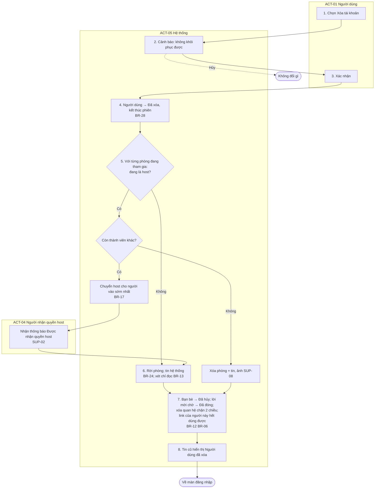

### FLOW-11 Xóa tài khoản (BIZ-11)
- **Actor:** ACT-01 (chính); ACT-05 Hệ thống (liên quan)
- **Trigger:** Chọn "Xóa tài khoản" trong cài đặt.
- **Kết quả:** Tài khoản Đã xóa ngay; mọi quan hệ được dọn; tin cũ giữ lại với tên "Người dùng đã xóa".

- **Happy path:**
  1. Người dùng chọn "Xóa tài khoản".
  2. Hệ thống cảnh báo không khôi phục được.
  3. Người dùng xác nhận.
  4. ENT-01 → **Đã xóa** ngay, kết thúc phiên (BR-28, Q-029).
  5. Với từng phòng đang tham gia:
     - Đang là host và còn người khác → quyền host tự chuyển cho thành viên vào phòng sớm nhất (BR-17); người đó nhận thông báo (SUP-02).
     - Đang là host và là người duy nhất → phòng bị xóa cùng tin, ảnh (SUP-08).
  6. Rời phòng (ENT-07 → **Đã rời**); tin hệ thống "C đã rời phòng" (BR-24); phòng còn đúng 2 người → xét chỉ đọc (BR-13).
  7. Mọi quan hệ bạn bè → **Đã hủy**; lời mời Đang chờ (cả gửi và nhận) → **Đã đóng**; quan hệ chặn của và đến người này bị xóa; link mời người này đã tạo không dùng được nữa (BR-12, BR-06, Q-029). Không thông báo cho ai, trừ người nhận quyền host (Q-037).
  8. Tin đã gửi được giữ, hiển thị người gửi "Người dùng đã xóa". Kết thúc → màn đăng nhập.
- **Alternative paths:**
  - A1. Đăng nhập lại bằng cùng Google → tài khoản mới hoàn toàn (FLOW-01 bước 6, BR-28).
  - A2. Thông báo đã gửi cho người khác từ người này (vd lời mời) vẫn còn trong danh sách thông báo của họ tới khi hết 30 ngày; mở ra → "Lời mời không còn hiệu lực" (FLOW-04 E1) (Q-037).
- **Exceptions:** E1. Hủy ở bước 2–3 → không có gì thay đổi.
- **Supporting kích hoạt:** SUP-02 bước 5; SUP-08 bước 5; SUP-09 bước 6.
- **Business rules áp dụng:** BR-06, BR-12, BR-13, BR-17, BR-24, BR-28.
