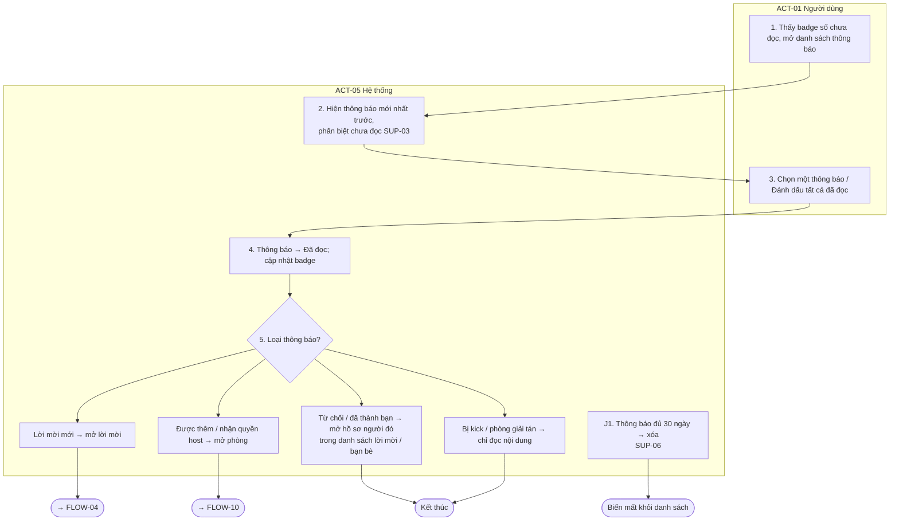

### FLOW-12 Xem & dọn thông báo (SUP-03, SUP-06 — flow phụ trợ, không có BIZ tương ứng)
- **Actor:** ACT-01 (chính); ACT-05 Hệ thống (liên quan)
- **Trigger:** Người dùng mở danh sách thông báo; hoặc thông báo đủ 30 ngày.
- **Kết quả:** Thông báo được đọc / dẫn tới đối tượng liên quan; thông báo cũ tự biến mất.

- **Happy path:**
  1. Người dùng thấy badge số thông báo chưa đọc, mở danh sách thông báo.
  2. Hệ thống hiện thông báo mới nhất trước, đánh dấu cái chưa đọc (SUP-03).
  3. Người dùng chọn một thông báo, hoặc "Đánh dấu tất cả đã đọc".
  4. Thông báo (ENT-10) → **Đã đọc**; badge cập nhật.
  5. Theo loại: lời mời mới → mở lời mời (FLOW-04); được thêm vào phòng / nhận quyền host → mở phòng (FLOW-10); bị từ chối / đã thành bạn → mở danh sách lời mời / bạn bè; bị kick / phòng giải tán → chỉ đọc nội dung.
- **Alternative paths:** A1. Đối tượng không còn (lời mời đã đóng, phòng đã xóa, đã bị kick khỏi phòng sau đó, người kia xóa tài khoản) → "Nội dung không còn hiệu lực" (Q-037).
- **Flow hệ thống:** J1. Thông báo đủ 30 ngày kể từ lúc tạo (đã đọc hay chưa) → hệ thống xóa (SUP-06, NFR-21).
- **Supporting kích hoạt:** SUP-03 bước 2–4; SUP-06 J1.
- **Business rules / NFR:** NFR-21.
