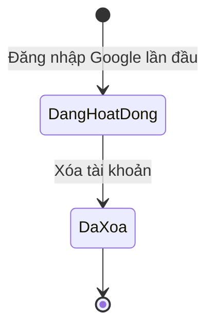
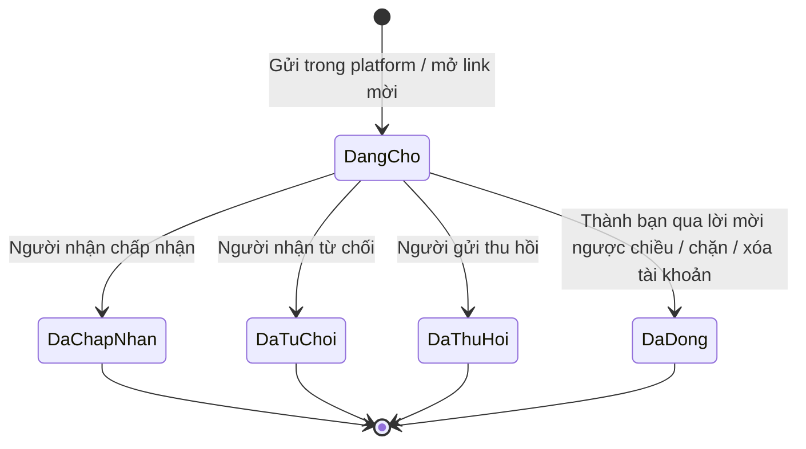
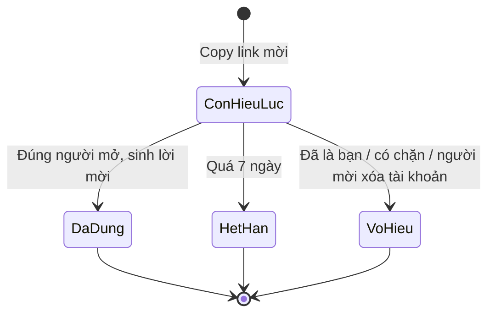
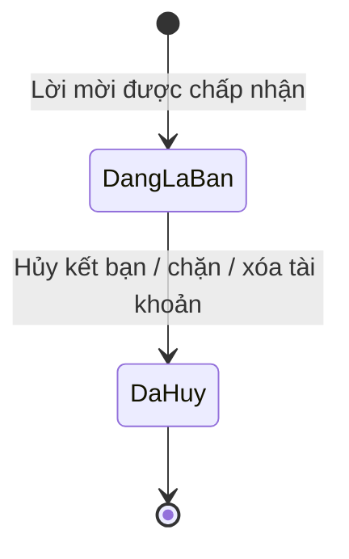
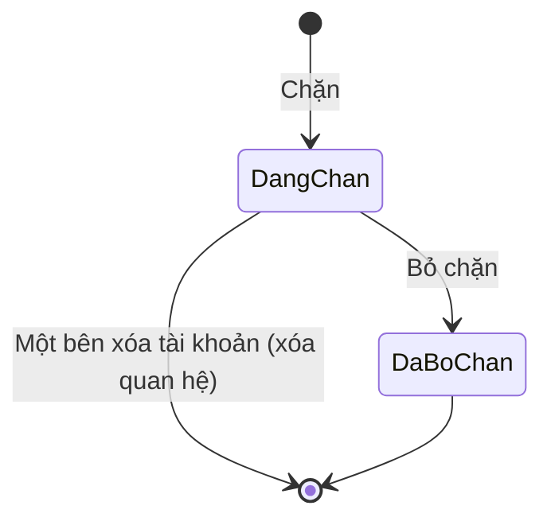
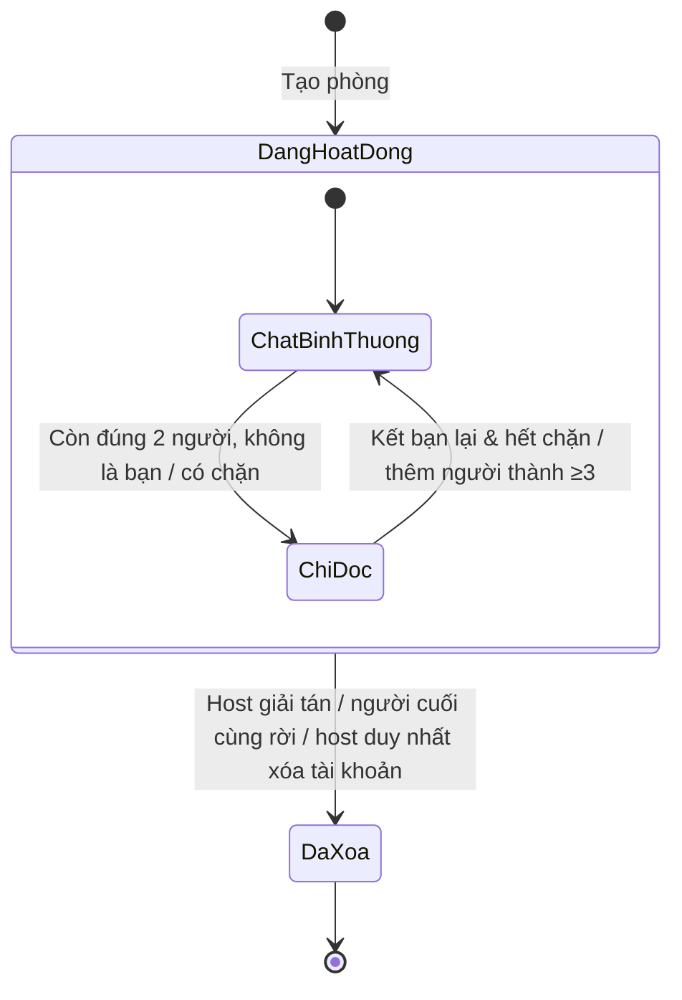
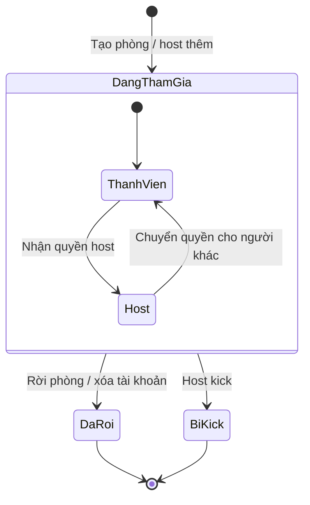
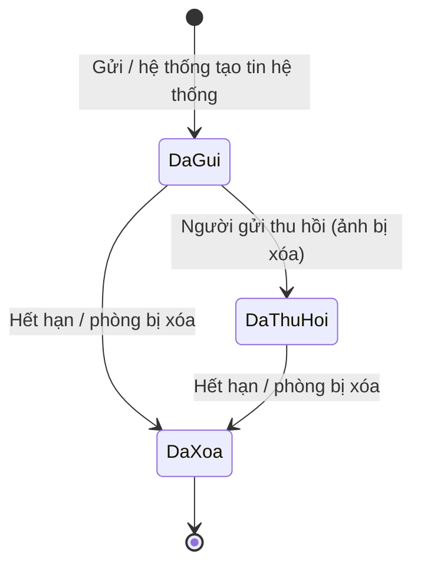
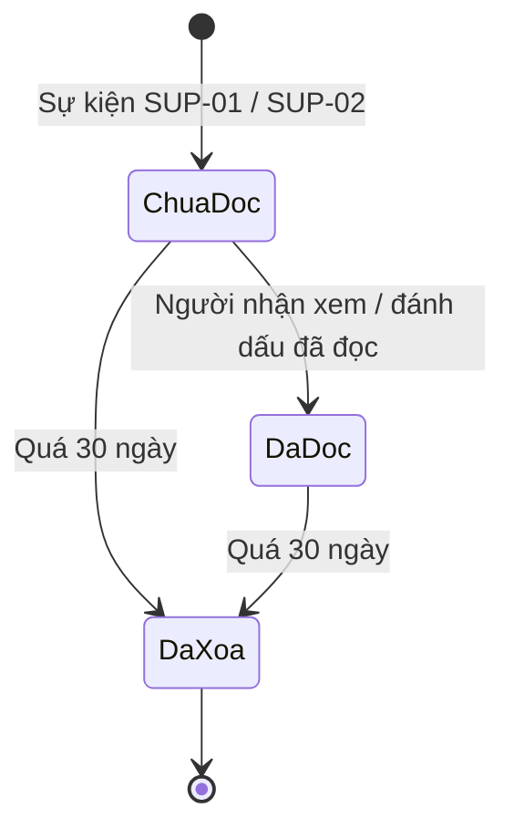

### Vòng đời entity

#### ENT-01 Người dùng

| Trạng thái | → Trạng thái | Do FLOW/bước | Actor |
|---|---|---|---|
| (chưa có) | Đang hoạt động | FLOW-01 bước 6 (cả khi email từng thuộc tài khoản đã xóa) | ACT-05 (sau xác thực ACT-06) |
| Đang hoạt động | Đã xóa | FLOW-11 bước 4 | ACT-01 |

#### ENT-02 Lời mời kết bạn

| Trạng thái | → Trạng thái | Do FLOW/bước | Actor |
|---|---|---|---|
| (chưa có) | Đang chờ | FLOW-03 bước 7 (Trong platform); FLOW-05 bước 8 (Qua link) | ACT-01 người gửi / ACT-05 |
| Đang chờ | Đã chấp nhận | FLOW-04 C1 | ACT-01 người nhận |
| Đang chờ | Đã từ chối | FLOW-04 R1 | ACT-01 người nhận |
| Đang chờ | Đã thu hồi | FLOW-03 A3 | ACT-01 người gửi |
| Đang chờ | Đã đóng | FLOW-04 C2 (lời mời ngược chiều); FLOW-07a bước 6; FLOW-11 bước 7 | ACT-05 |

#### ENT-03 Link mời
Link **tự chứa, không lưu khi tạo** (SUP-07, Q-033). Trạng thái không được ghi lại mà **xác định lúc mở link** (FLOW-05 bước 2, 5, 6, 7).

| Trạng thái | → Trạng thái | Do FLOW/bước | Actor |
|---|---|---|---|
| (chưa có) | Còn hiệu lực | FLOW-03 bước 10 | ACT-01 người mời |
| Còn hiệu lực | Đã dùng | FLOW-05 bước 8 | ACT-01/02 người được mời |
| Còn hiệu lực | Hết hạn | Xác định ở FLOW-05 bước 2 | ACT-05 |
| Còn hiệu lực | Vô hiệu | Xác định ở FLOW-05 bước 6 (nguyên nhân: FLOW-04 C1, FLOW-07a, FLOW-11) | ACT-05 |

#### ENT-04 Quan hệ bạn bè

| Trạng thái | → Trạng thái | Do FLOW/bước | Actor |
|---|---|---|---|
| (chưa có) | Đang là bạn | FLOW-04 C1 | ACT-05 (khi ACT-01 chấp nhận) |
| Đang là bạn | Đã hủy | FLOW-06 bước 6; FLOW-07a bước 5; FLOW-11 bước 7 | ACT-01 / ACT-05 |

Kết bạn lại = quan hệ mới qua FLOW-03 → FLOW-04.

#### ENT-05 Quan hệ chặn

| Trạng thái | → Trạng thái | Do FLOW/bước | Actor |
|---|---|---|---|
| (chưa có) | Đang chặn | FLOW-07a bước 4 | ACT-01 người chặn |
| Đang chặn | Đã bỏ chặn | FLOW-07b bước 4 | ACT-01 người chặn |
| Đang chặn | (bị xóa) | FLOW-11 bước 7 | ACT-05 |

#### ENT-06 Phòng chat

| Trạng thái | → Trạng thái | Do FLOW/bước | Actor |
|---|---|---|---|
| (chưa có) | Đang hoạt động | FLOW-08 bước 6 | ACT-01 → ACT-03 |
| Chat bình thường | Chỉ đọc | FLOW-06 bước 7; FLOW-07a bước 7; FLOW-09c A1; FLOW-09e bước 8; FLOW-11 bước 6 | ACT-05 |
| Chỉ đọc | Chat bình thường | FLOW-04 C3; FLOW-09b bước 6 | ACT-05 |
| Đang hoạt động | Đã xóa | FLOW-09f bước 2; FLOW-09e A2; FLOW-11 bước 5 | ACT-03 / ACT-05 |

"Chỉ đọc" là tình trạng tính theo BR-13, không phải trạng thái người dùng chọn.

#### ENT-07 Thành viên phòng

| Trạng thái | → Trạng thái | Do FLOW/bước | Actor |
|---|---|---|---|
| (chưa có) | Đang tham gia (Host) | FLOW-08 bước 6–7 | ACT-01 người tạo |
| (chưa có) | Đang tham gia (Thành viên) | FLOW-08 bước 7; FLOW-09b bước 5 | ACT-03 |
| Thành viên | Host | FLOW-09d bước 3; FLOW-09e A1; FLOW-11 bước 5 | ACT-03 / ACT-05 |
| Host | Thành viên | FLOW-09d bước 3; FLOW-09e A1 | ACT-03 |
| Đang tham gia | Đã rời | FLOW-09e bước 7; FLOW-11 bước 6 | ACT-03/04 / ACT-05 |
| Đang tham gia | Bị kick | FLOW-09c bước 3 | ACT-03 |

Thêm lại sau khi rời / bị kick = lần tham gia mới.

#### ENT-08 Tin nhắn (ENT-09 Ảnh đính kèm theo vòng đời tin)

| Trạng thái | → Trạng thái | Do FLOW/bước | Actor |
|---|---|---|---|
| (chưa có) | Đã gửi | FLOW-10a bước 8; tin hệ thống ở FLOW-08, FLOW-09, FLOW-11 | ACT-03/04 / ACT-05 |
| Đã gửi | Đã thu hồi | FLOW-10b bước 3 | ACT-03/04 người gửi |
| Đã gửi / Đã thu hồi | Đã xóa | FLOW-10c bước 2; FLOW-09f bước 2; FLOW-09e A2; FLOW-11 bước 5 | ACT-05 / ACT-03 |

(Gửi thất bại ở FLOW-10a E3 chỉ là trạng thái tạm trên máy người gửi, tin chưa tồn tại.)

#### ENT-10 Thông báo

| Trạng thái | → Trạng thái | Do FLOW/bước | Actor |
|---|---|---|---|
| (chưa có) | Chưa đọc | FLOW-03 bước 7; FLOW-04 C4, R2; FLOW-05 bước 8; FLOW-08 bước 8; FLOW-09b/c/d/f; FLOW-11 bước 5 | ACT-05 |
| Chưa đọc | Đã đọc | SUP-03 | ACT-01 người nhận |
| Chưa đọc / Đã đọc | Đã xóa | SUP-06 | ACT-05 |

#### Đối chiếu với business.md
- ENT-01, 02, 04, 05, 07, 08, 10: khớp.
- ENT-03: khớp sau cập nhật Q-033/Q-034 (trạng thái xác định lúc mở link).
- ENT-06: thêm tình trạng con "Chỉ đọc / Chat bình thường" trong Đang hoạt động — đúng theo BR-13, chỉ là cách trình bày.
- ENT-10: thêm Đã xóa sau 30 ngày (Q-032) — đã cập nhật business.md.
