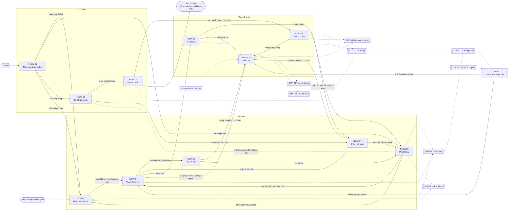

## Flow tổng thể (Overview)

Buddio có 3 nhóm flow: **Tài khoản** (vào, cài đặt, rời platform), **Kết bạn** (mời, link mời, phản hồi, hủy, chặn) và **Phòng & chat** (tạo, quản lý, nhắn tin). Hành trình chính: đăng nhập (FLOW-01) → kết bạn (FLOW-03 → FLOW-04, hoặc FLOW-03 → FLOW-05 → FLOW-04) → tạo phòng (FLOW-08) → nhắn tin (FLOW-10). Hủy kết bạn hoặc chặn (FLOW-06, FLOW-07) ngược lại khóa phòng 2 người về chỉ đọc. Điểm bắt đầu: FLOW-01 (tự vào) và FLOW-05 (mở link mời). Kết thúc tự nhiên: FLOW-11.

### 1. Sơ đồ quan hệ FLOW

### 2. Bảng quan hệ
| Từ | Đến | Loại | Điều kiện |
|---|---|---|---|
| FLOW-01 | Mọi FLOW (trừ FLOW-05 bước 1–3) | tiên quyết | Phải đăng nhập |
| FLOW-05 | FLOW-01 | kích hoạt | Mở link khi chưa đăng nhập |
| FLOW-01 | FLOW-05 | kích hoạt | Đăng nhập xong mà đang mở dở link → quay lại FLOW-05 bước 4 |
| FLOW-03 | FLOW-04 | kích hoạt | Tìm thấy → gửi lời mời trong platform |
| FLOW-03 | FLOW-05 | kích hoạt (gián tiếp) | Không tìm thấy → copy link, người mời tự gửi qua kênh ngoài |
| FLOW-05 | FLOW-04 | kích hoạt | Email khớp, link hợp lệ → lời mời đang chờ, hiện màn chấp nhận/từ chối |
| FLOW-04 | FLOW-08 | tiên quyết | Có ít nhất 1 bạn mới tạo được phòng; chỉ thêm được bạn vào phòng (FLOW-09b) |
| FLOW-04 | FLOW-10 | kích hoạt | Kết bạn lại, không còn chặn → phòng 2 người cũ mở lại |
| FLOW-04 | FLOW-06 | tùy chọn | Từ chối nhưng đã là bạn → gợi ý hủy kết bạn |
| FLOW-04 | FLOW-07 | tùy chọn | Chặn ngay từ lời mời |
| FLOW-06 | FLOW-10 | kích hoạt | Phòng đúng 2 người → chỉ đọc |
| FLOW-07 | FLOW-10 | kích hoạt | Phòng đúng 2 người → chỉ đọc |
| FLOW-06, FLOW-07b | FLOW-03 | tùy chọn | Muốn kết bạn lại |
| FLOW-07a | FLOW-03, FLOW-05 | tiên quyết (chặn) | Đang chặn → không tìm thấy nhau, link không dùng được |
| FLOW-02 | FLOW-03 | tiên quyết (ảnh hưởng) | Ẩn danh bật → người khác không tìm thấy → chỉ mời được bằng link |
| FLOW-02 | FLOW-11, FLOW-07b | tùy chọn | Mở từ cài đặt |
| FLOW-08 | FLOW-10 | kích hoạt | Phòng tạo xong |
| FLOW-08 | FLOW-03 | tùy chọn | Chưa có bạn → gợi ý mời |
| FLOW-09 | FLOW-10 | song song | Cùng diễn ra trong phòng; thay đổi thành viên sinh tin hệ thống trong FLOW-10; bị kick / giải tán đóng phòng ở FLOW-10 |
| FLOW-09 | FLOW-07 | tùy chọn | Chặn từ danh sách thành viên |
| FLOW-11 | FLOW-09 | kích hoạt | Tự rời mọi phòng, tự chuyển host, xóa phòng trống |
| FLOW-11 | FLOW-04, FLOW-06, FLOW-07 | kích hoạt (hệ quả) | Đóng lời mời, hủy bạn bè, xóa quan hệ chặn |
| SUP-05 | FLOW-10 | kích hoạt (hệ thống) | Tới thời điểm hết hạn của tin (phòng ngắn hạn) |
| SUP-01, SUP-02 | FLOW-12 | kích hoạt | Có thông báo mới → badge, danh sách thông báo |
| FLOW-12 | FLOW-04 | kích hoạt | Mở thông báo lời mời |
| FLOW-12 | FLOW-10 | kích hoạt | Mở thông báo được thêm vào phòng / nhận quyền host |
| SUP-06 | FLOW-12 | kích hoạt (hệ thống) | Thông báo đủ 30 ngày |

### 3. Hành trình theo actor
- **ACT-02 Người được mời (lần đầu):** nhận link → FLOW-05 → FLOW-01 (tạo tài khoản, ẩn danh bật) → FLOW-05 → FLOW-04 (chấp nhận) → được bạn thêm vào phòng (FLOW-09b) hoặc tự tạo phòng (FLOW-08) → FLOW-10.
- **ACT-01 Người dùng tự tham gia:** FLOW-01 → FLOW-02 (tùy chọn tắt ẩn danh / đổi tên) → FLOW-03 (mời bằng email hoặc link) → chờ FLOW-04 / FLOW-05 ở phía người kia → FLOW-08 → FLOW-10. Lúc cần: FLOW-06, FLOW-07, FLOW-11.
- **ACT-03 Host:** FLOW-08 → FLOW-10 ⇄ FLOW-09 (thêm, kick, đổi tên, chuyển quyền) → rời (FLOW-09e, phải chuyển quyền) hoặc giải tán (FLOW-09f).
- **ACT-04 Thành viên:** nhận thông báo được thêm (SUP-02) → FLOW-10 → xem thành viên / chặn / rời (FLOW-09a, FLOW-07, FLOW-09e).
- **ACT-05 Hệ thống:** chạy nền SUP-05 (xóa tin hết hạn), SUP-06 (dọn thông báo), SUP-09 (cập nhật tức thời); thực thi hệ quả trong FLOW-04 C2–C3, FLOW-06/07 (chỉ đọc), FLOW-11 (chuyển host, dọn quan hệ).

### 4. Kiểm tra
- **FLOW không có cạnh vào:** chỉ FLOW-01, FLOW-05 — đều là điểm bắt đầu hợp lệ.
- **FLOW không có cạnh ra:** FLOW-11 (kết thúc tự nhiên). FLOW-10 là nơi người dùng ở lâu nhất (kết thúc tự nhiên của hành trình).
- **Vòng lặp:** FLOW-03 → FLOW-04 → FLOW-06 → FLOW-03 (kết bạn – hủy – kết bạn lại) do người dùng chủ động, có BR-10 (chờ 24h sau từ chối) chặn spam phía người gửi. FLOW-01 ⇄ FLOW-05 chỉ đi qua 1 lần mỗi lượt mở link. Không có phụ thuộc vòng vô hạn.
- **Gap:** không phát hiện.
