# Business Flows: Buddio

> Nguồn: `idea/business.md` · Nhật ký: `idea/_qa-log.md` (Phase 2: Q-030 → Q-039) · Cập nhật: 2026-11-12

## 1. Nghiệp vụ phụ trợ (Supporting)

### Trong phiên bản đầu (MVP)
| ID | Tên | Loại | Kích hoạt bởi | Người nhận / tác động | Nội dung chính · Kênh | Trong MVP? | Q-ref |
|---|---|---|---|---|---|---|---|
| SUP-01 | Thông báo kết bạn | notification | BIZ-03 (gửi lời mời trong platform), BIZ-05 (mở link → phát sinh lời mời), BIZ-04 (chấp nhận / từ chối) | Người nhận lời mời; người gửi (khi bị từ chối / đã thành bạn) | 3 loại: "Có lời mời kết bạn mới từ A" (kèm nút Chấp nhận / Từ chối / Chặn), "A đã từ chối lời mời", "A và bạn đã trở thành bạn bè". Kênh: in-app | Có | raw, Q-029 |
| SUP-02 | Thông báo sự kiện phòng | notification | BIZ-08 (tạo phòng), BIZ-09c (thêm), BIZ-09d (kick), BIZ-09e/f (chuyển quyền, host rời), BIZ-09g (giải tán), BIZ-11 (host xóa tài khoản → tự chuyển quyền) | Người được thêm; người bị kick; mọi thành viên khác (giải tán); người nhận quyền host | 4 loại: "A đã thêm bạn vào phòng X", "Bạn đã bị mời ra khỏi phòng X", "Phòng X đã bị giải tán", "Bạn đã trở thành host phòng X". Kênh: in-app | Có | Q-030 |
| SUP-03 | Danh sách thông báo & đã đọc | notification | Mọi SUP-01, SUP-02 | Người nhận thông báo | Xem danh sách thông báo mới nhất trước, đánh dấu đã đọc (từng cái / tất cả), badge số thông báo chưa đọc. Mở thông báo → đi tới đối tượng liên quan (lời mời, phòng). Thông báo về phòng đã giải tán / bị kick chỉ để đọc | Có | Q-018, Q-031 |
| SUP-04 | Tóm tắt phòng & số tin chưa đọc | notification (in-app) | BIZ-10 (gửi / xem tin) | Mọi thành viên đang tham gia | Danh sách phòng hiện tin cuối (hoặc "Đã thu hồi" / ảnh), thời điểm, số tin chưa đọc mỗi phòng; tổng số tin chưa đọc. Tin nhắn mới **không** tạo thông báo ở SUP-03 | Có | Q-030, Q-033 |
| SUP-05 | Tự xóa tin & ảnh hết hạn | scheduler | BIZ-10, phòng chế độ Ngắn hạn (BR-16) | Mọi thành viên phòng | Tới thời điểm hết hạn (gửi + thời hạn phòng) → tin, ảnh, tin hệ thống biến mất với mọi người, không khôi phục được | Có | raw, Q-003 |
| SUP-06 | Tự dọn thông báo cũ | scheduler | ENT-10 | Người nhận thông báo | Thông báo quá 30 ngày (kể cả chưa đọc) bị xóa | Có | Q-032 |
| SUP-07 | Link mời tự chứa (không lưu khi tạo) | auth / security | BIZ-03 (trường hợp f), BIZ-05 | Người mời, người được mời | Link chứa người mời + email được mời (đã mã hóa, không lộ) + hạn 7 ngày. Tạo link không lưu gì → không bị spam làm phình dữ liệu; không giới hạn số link; link mới không vô hiệu link cũ. Hiệu lực kiểm tra lúc mở: còn hạn, đúng email, chưa là bạn, không chặn, người mời còn hoạt động. Mở lại khi lời mời đang chờ → hiện lời mời đó | Có | Q-007, Q-033, Q-034 |
| SUP-08 | Lưu trữ ảnh tin nhắn | file | BIZ-10 (gửi tin có ảnh), BIZ-10 (thu hồi), SUP-05 (hết hạn), BIZ-09g (giải tán) | Người gửi; thành viên phòng | Nhận tối đa 10 ảnh/tin, tổng ≤10MB, chỉ ảnh; chỉ thành viên đang tham gia xem được; ảnh bị xóa hẳn khi thu hồi, hết hạn hoặc phòng bị xóa | Có | raw, Q-022 |
| SUP-09 | Cập nhật tức thời trong phòng | realtime | BIZ-10, BIZ-09, BIZ-02 (tắt hiển thị online) | Thành viên phòng, bạn bè | Tin mới, thu hồi, tin hệ thống, đã xem, đang soạn tin, online/offline hiển thị ngay không cần tải lại; bị kick / phòng giải tán → đóng phòng ngay. Độ trễ cụ thể → NFR | Có | Q-026 → Q-028 |

### Ngoài MVP / ngoài phạm vi
| ID | Tên | Loại | Kích hoạt bởi | Người nhận / tác động | Nội dung chính · Kênh | Trong MVP? | Q-ref |
|---|---|---|---|---|---|---|---|
| SUP-10 | Push notification (trình duyệt / điện thoại) | notification | SUP-01, SUP-02, tin mới | Người dùng không mở app | Báo tin mới và lời mời khi không mở app; không hiển thị nội dung tin | **Ngoài MVP** (làm sau) | Q-031 |
| SUP-11 | Email thông báo | email | SUP-01 | Người nhận lời mời | — | Ngoài phạm vi | Q-031 |
| SUP-12 | Tắt tiếng từng phòng | notification setting | — | — | — | Ngoài phạm vi | Q-031 |
| SUP-13 | Giới hạn số lời mời / link mỗi ngày | anti-abuse | — | — | Đã thay bằng SUP-07 | Ngoài phạm vi | Q-034 |
| SUP-14 | Quản lý phiên nhiều thiết bị; nhật ký bảo mật (audit) | auth / audit | — | — | Đăng xuất thường vẫn có ở BIZ-01 | Ngoài phạm vi | Q-033 |

**Đã xem xét, không cần SUP riêng:**
- **Job vô hiệu link sau 7 ngày:** không cần — hạn dùng nằm trong link (SUP-07).
- **Báo cáo / dashboard, payment, import, i18n, search phức tạp:** không có tín hiệu trong business.md (không có admin – Q-005, không có tiền, chỉ tìm bằng email chính xác).
- **Quản lý hồ sơ cá nhân:** đã là BIZ-02.

## 2. Flow tổng thể (Overview)

Buddio có 3 nhóm flow: **Tài khoản** (vào, cài đặt, rời platform), **Kết bạn** (mời, link mời, phản hồi, hủy, chặn) và **Phòng & chat** (tạo, quản lý, nhắn tin). Hành trình chính: đăng nhập (FLOW-01) → kết bạn (FLOW-03 → FLOW-04, hoặc FLOW-03 → FLOW-05 → FLOW-04) → tạo phòng (FLOW-08) → nhắn tin (FLOW-10). Hủy kết bạn hoặc chặn (FLOW-06, FLOW-07) ngược lại khóa phòng 2 người về chỉ đọc. Điểm bắt đầu: FLOW-01 (tự vào) và FLOW-05 (mở link mời). Kết thúc tự nhiên: FLOW-11.

### 1. Sơ đồ quan hệ FLOW

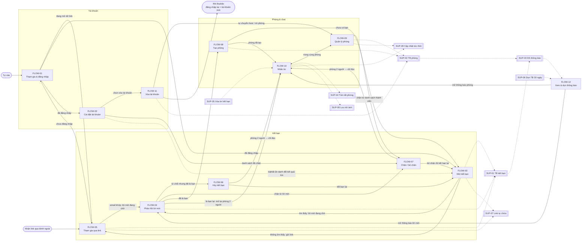

### 2. Bảng quan hệ
| Từ | Đến | Loại | Điều kiện |
|---|---|---|---|
| FLOW-01 | Mọi FLOW (trừ FLOW-05 bước 1–3) | tiên quyết | Phải đăng nhập |
| FLOW-05 | FLOW-01 | kích hoạt | Mở link khi chưa đăng nhập |
| FLOW-01 | FLOW-05 | kích hoạt | Đăng nhập xong mà đang mở dở link → quay lại FLOW-05 bước 4 |
| FLOW-03 | FLOW-04 | kích hoạt | Tìm thấy → gửi lời mời trong platform |
| FLOW-03 | FLOW-05 | kích hoạt (gián tiếp) | Không tìm thấy → copy link, người mời tự gửi qua kênh ngoài |
| FLOW-05 | FLOW-04 | kích hoạt | Email khớp, link hợp lệ → lời mời đang chờ, hiện màn chấp nhận/từ chối |
| FLOW-04 | FLOW-08 | tiên quyết | Có ít nhất 1 bạn mới tạo được phòng; chỉ thêm được bạn vào phòng (FLOW-09b) |
| FLOW-04 | FLOW-10 | kích hoạt | Kết bạn lại, không còn chặn → phòng 2 người cũ mở lại |
| FLOW-04 | FLOW-06 | tùy chọn | Từ chối nhưng đã là bạn → gợi ý hủy kết bạn |
| FLOW-04 | FLOW-07 | tùy chọn | Chặn ngay từ lời mời |
| FLOW-06 | FLOW-10 | kích hoạt | Phòng đúng 2 người → chỉ đọc |
| FLOW-07 | FLOW-10 | kích hoạt | Phòng đúng 2 người → chỉ đọc |
| FLOW-06, FLOW-07b | FLOW-03 | tùy chọn | Muốn kết bạn lại |
| FLOW-07a | FLOW-03, FLOW-05 | tiên quyết (chặn) | Đang chặn → không tìm thấy nhau, link không dùng được |
| FLOW-02 | FLOW-03 | tiên quyết (ảnh hưởng) | Ẩn danh bật → người khác không tìm thấy → chỉ mời được bằng link |
| FLOW-02 | FLOW-11, FLOW-07b | tùy chọn | Mở từ cài đặt |
| FLOW-08 | FLOW-10 | kích hoạt | Phòng tạo xong |
| FLOW-08 | FLOW-03 | tùy chọn | Chưa có bạn → gợi ý mời |
| FLOW-09 | FLOW-10 | song song | Cùng diễn ra trong phòng; thay đổi thành viên sinh tin hệ thống trong FLOW-10; bị kick / giải tán đóng phòng ở FLOW-10 |
| FLOW-09 | FLOW-07 | tùy chọn | Chặn từ danh sách thành viên |
| FLOW-11 | FLOW-09 | kích hoạt | Tự rời mọi phòng, tự chuyển host, xóa phòng trống |
| FLOW-11 | FLOW-04, FLOW-06, FLOW-07 | kích hoạt (hệ quả) | Đóng lời mời, hủy bạn bè, xóa quan hệ chặn |
| SUP-05 | FLOW-10 | kích hoạt (hệ thống) | Tới thời điểm hết hạn của tin (phòng ngắn hạn) |
| SUP-01, SUP-02 | FLOW-12 | kích hoạt | Có thông báo mới → badge, danh sách thông báo |
| FLOW-12 | FLOW-04 | kích hoạt | Mở thông báo lời mời |
| FLOW-12 | FLOW-10 | kích hoạt | Mở thông báo được thêm vào phòng / nhận quyền host |
| SUP-06 | FLOW-12 | kích hoạt (hệ thống) | Thông báo đủ 30 ngày |

### 3. Hành trình theo actor
- **ACT-02 Người được mời (lần đầu):** nhận link → FLOW-05 → FLOW-01 (tạo tài khoản, ẩn danh bật) → FLOW-05 → FLOW-04 (chấp nhận) → được bạn thêm vào phòng (FLOW-09b) hoặc tự tạo phòng (FLOW-08) → FLOW-10.
- **ACT-01 Người dùng tự tham gia:** FLOW-01 → FLOW-02 (tùy chọn tắt ẩn danh / đổi tên) → FLOW-03 (mời bằng email hoặc link) → chờ FLOW-04 / FLOW-05 ở phía người kia → FLOW-08 → FLOW-10. Lúc cần: FLOW-06, FLOW-07, FLOW-11.
- **ACT-03 Host:** FLOW-08 → FLOW-10 ⇄ FLOW-09 (thêm, kick, đổi tên, chuyển quyền) → rời (FLOW-09e, phải chuyển quyền) hoặc giải tán (FLOW-09f).
- **ACT-04 Thành viên:** nhận thông báo được thêm (SUP-02) → FLOW-10 → xem thành viên / chặn / rời (FLOW-09a, FLOW-07, FLOW-09e).
- **ACT-05 Hệ thống:** chạy nền SUP-05 (xóa tin hết hạn), SUP-06 (dọn thông báo), SUP-09 (cập nhật tức thời); thực thi hệ quả trong FLOW-04 C2–C3, FLOW-06/07 (chỉ đọc), FLOW-11 (chuyển host, dọn quan hệ).

### 4. Kiểm tra
- **FLOW không có cạnh vào:** chỉ FLOW-01, FLOW-05 — đều là điểm bắt đầu hợp lệ.
- **FLOW không có cạnh ra:** FLOW-11 (kết thúc tự nhiên). FLOW-10 là nơi người dùng ở lâu nhất (kết thúc tự nhiên của hành trình).
- **Vòng lặp:** FLOW-03 → FLOW-04 → FLOW-06 → FLOW-03 (kết bạn – hủy – kết bạn lại) do người dùng chủ động, có BR-10 (chờ 24h sau từ chối) chặn spam phía người gửi. FLOW-01 ⇄ FLOW-05 chỉ đi qua 1 lần mỗi lượt mở link. Không có phụ thuộc vòng vô hạn.
- **Gap:** không phát hiện.

## 3. Flows chi tiết

### FLOW-01 Tham gia & đăng nhập (BIZ-01)
- **Actor:** ACT-01, ACT-02 (chính); ACT-06 Google, ACT-05 Hệ thống (liên quan)
- **Trigger:** Bấm "Login with Google", hoặc phải đăng nhập khi mở link mời (FLOW-05).
- **Kết quả:** Người dùng ở trạng thái đã đăng nhập (tài khoản mới được tạo nếu là lần đầu); hoặc đã đăng xuất.

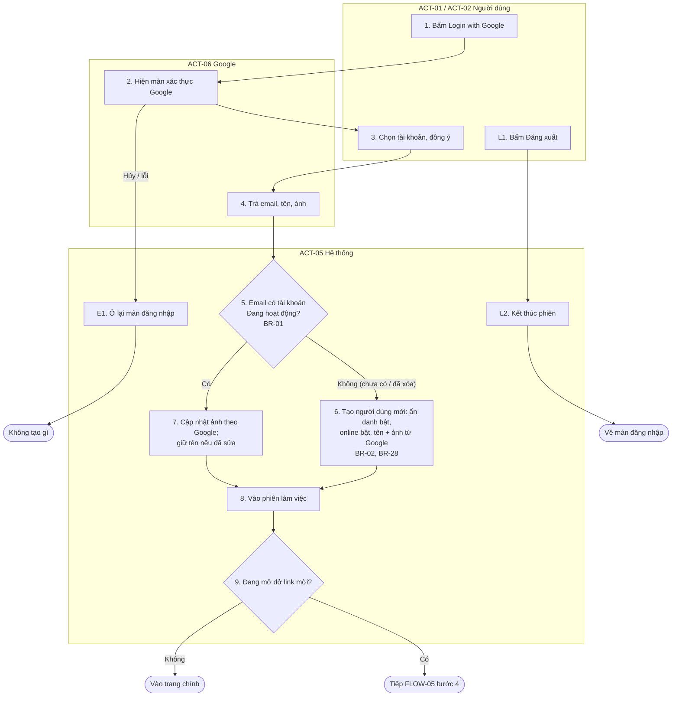

- **Happy path:**
  1. Người dùng bấm "Login with Google".
  2. Google hiện màn xác thực.
  3. Người dùng chọn tài khoản và đồng ý.
  4. Google trả email, tên, ảnh đại diện.
  5. Hệ thống kiểm tra email đã có tài khoản Đang hoạt động chưa (BR-01).
  6. *(Lần đầu)* Tạo người dùng (ENT-01) **Đang hoạt động**: ẩn danh **bật**, hiển thị online **bật**, tên và ảnh lấy từ Google (BR-02). Email từng thuộc tài khoản đã xóa → vẫn tạo tài khoản mới hoàn toàn (BR-28).
  7. *(Các lần sau)* Cập nhật ảnh theo Google; tên hiển thị giữ nguyên nếu người dùng đã sửa (Q-029).
  8. Vào phiên làm việc.
  9. Nếu đang mở dở link mời → tiếp FLOW-05 bước 4; không thì vào trang chính. Kết thúc.
- **Alternative paths:**
  - A1. Đăng xuất: L1 người dùng bấm Đăng xuất → L2 hệ thống kết thúc phiên, về màn đăng nhập.
- **Exceptions:**
  - E1. Người dùng hủy hoặc Google báo lỗi ở bước 2–3 → ở lại màn đăng nhập, không tạo gì.
  - E2. Google không trả tên → (Q-037) dùng phần trước "@" của email làm tên hiển thị (vì BR-29 tên không được trống).
- **Supporting kích hoạt:** —
- **Business rules áp dụng:** BR-01 bước 5; BR-02 bước 6; BR-28 bước 6; BR-29 E2.

### FLOW-02 Cài đặt tài khoản (BIZ-02)
- **Actor:** ACT-01 (chính); ACT-05 Hệ thống (liên quan)
- **Trigger:** Người dùng mở cài đặt tài khoản và thay đổi.
- **Kết quả:** Tên / ẩn danh / hiển thị online mới có hiệu lực ngay.

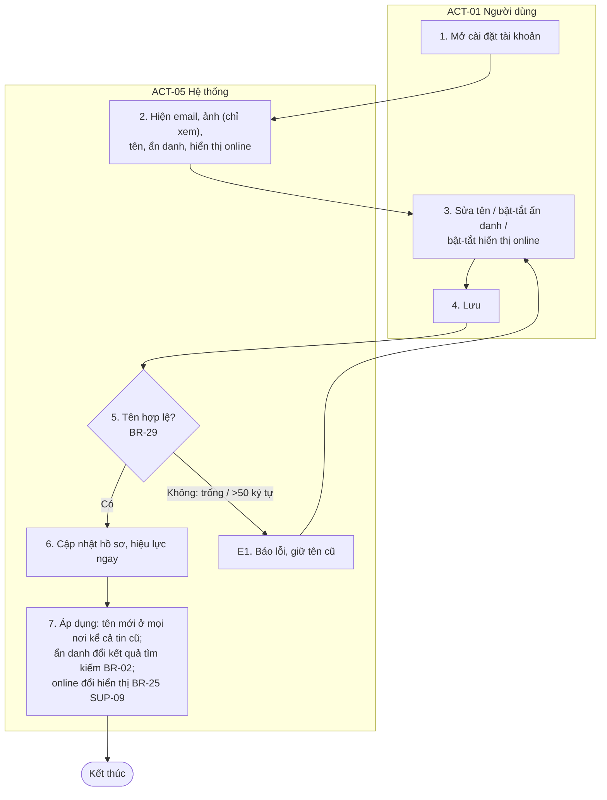

- **Happy path:**
  1. Người dùng mở cài đặt tài khoản.
  2. Hệ thống hiện email và ảnh (chỉ xem), tên, ẩn danh, hiển thị online.
  3. Người dùng sửa tên và/hoặc bật/tắt ẩn danh, hiển thị online.
  4. Bấm Lưu.
  5. Hệ thống kiểm tra tên không trống, ≤50 ký tự (BR-29).
  6. Cập nhật hồ sơ (ENT-01), hiệu lực ngay.
  7. Áp dụng:
     - Tên mới hiển thị ở mọi nơi, kể cả trên tin cũ (Q-029).
     - Bật ẩn danh → từ giờ không ai tìm thấy qua email; lời mời đang chờ giữ nguyên. Tắt → tìm thấy được (BR-02).
     - Tắt hiển thị online → mọi người thấy mình offline ngay, và mình không thấy online người khác (BR-25, SUP-09).
- **Alternative paths:** A1. Bật/tắt ẩn danh hoặc online (Q-037) lưu ngay khi gạt công tắc, không cần bấm Lưu (bỏ qua bước 4–5).
- **Exceptions:** E1. Tên trống hoặc quá 50 ký tự → báo lỗi, giữ tên cũ, quay lại bước 3.
- **Kèm theo:** Từ cài đặt → Xóa tài khoản (FLOW-11), Đăng xuất (FLOW-01 A1), Danh sách đã chặn (FLOW-07).
- **Supporting kích hoạt:** SUP-09 bước 7.
- **Business rules áp dụng:** BR-29 bước 5; BR-02, BR-25 bước 7.

### FLOW-03 Mời kết bạn (BIZ-03)
- **Actor:** ACT-01 người mời (chính); ACT-01 người nhận, ACT-05 Hệ thống (liên quan)
- **Trigger:** Người mời nhập email vào ô kết bạn.
- **Kết quả:** Có thêm 1 lời mời Đang chờ (ENT-02), hoặc người mời có 1 link mời để tự gửi (ENT-03), hoặc không có gì thay đổi.

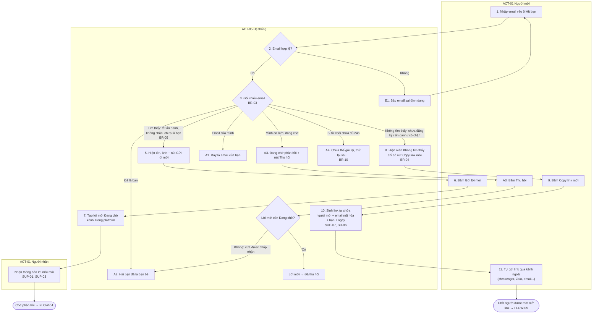

- **Happy path (Tìm thấy):**
  1. Người mời nhập email.
  2. Hệ thống kiểm tra email đúng định dạng.
  3. Hệ thống đối chiếu email với người dùng, cài đặt ẩn danh, quan hệ bạn bè / chặn, lời mời hiện có (BR-03).
  4. *(Tìm thấy)* — người đó đang tắt ẩn danh, không có quan hệ chặn chiều nào, chưa là bạn, mình chưa có lời mời đang chờ tới họ, không bị từ chối trong 24h (BR-05).
  5. Hệ thống hiện tên, ảnh người đó và nút **Gửi lời mời**.
  6. Người mời bấm Gửi lời mời.
  7. Hệ thống tạo lời mời (ENT-02) kênh "Trong platform", trạng thái **Đang chờ**; người nhận nhận thông báo "Có lời mời kết bạn mới" (SUP-01, SUP-03). Kết thúc → chờ FLOW-04.
- **Happy path (Không tìm thấy):**
  8. Email chưa đăng ký, hoặc người đó đang ẩn danh, hoặc có quan hệ chặn (chiều nào cũng vậy) → hiện màn hình giống hệt nhau, chỉ có nút **Copy link mời** (BR-04).
  9. Người mời bấm Copy link mời.
  10. Hệ thống sinh link tự chứa: người mời, email đã mã hóa, hạn 7 ngày. Không lưu gì; link cũ cho cùng email vẫn còn hiệu lực (SUP-07, BR-06). Nếu thực chất là có quan hệ chặn, link vẫn được sinh nhưng khi mở sẽ không dùng được.
  11. Người mời tự gửi link qua kênh ngoài. Kết thúc → chờ FLOW-05.
- **Alternative paths:**
  - A1. Email của chính mình → "Đây là email của bạn". Kết thúc.
  - A2. Đã là bạn → "Hai bạn đã là bạn bè". Kết thúc.
  - A3. Mình đã gửi lời mời và đang chờ → "Đang chờ phản hồi" + nút **Thu hồi**. Bấm Thu hồi → lời mời → **Đã thu hồi** (BR-08). Kết thúc.
  - A4. Mình bị người đó từ chối chưa đủ 24 giờ → "Chưa thể gửi lại, thử lại sau …" (BR-10). Kết thúc.
  - A5. Người kia cũng đang có lời mời đang chờ gửi cho mình → vẫn đi bước 5–7 bình thường; hai lời mời cùng tồn tại (BR-09).
  - A6. **Xem danh sách lời mời**: đã gửi (đang chờ, nút Thu hồi → như A3) và đã nhận (đang chờ, nút Chấp nhận / Từ chối / Chặn → FLOW-04, FLOW-07).
- **Exceptions:**
  - E1. Email sai định dạng → báo lỗi, quay lại bước 1.
  - E2. Thu hồi đúng lúc người nhận vừa chấp nhận → chấp nhận thắng, hai người thành bạn, hiển thị như A2 (Q-029).
  - E3. (Q-035) Giữa bước 5 và 7, trạng thái thay đổi (người kia vừa bật ẩn danh, vừa chặn, vừa thành bạn qua lời mời ngược chiều) → hệ thống kiểm tra lại ở bước 7: đã là bạn → A2; còn lại → hiển thị như bước 8 (không để lộ lý do).
- **Supporting kích hoạt:** SUP-01, SUP-03 tại bước 7; SUP-07 tại bước 10.
- **Business rules áp dụng:** BR-03 bước 3; BR-04 bước 8; BR-05 bước 4; BR-06 bước 10; BR-08 A3; BR-09 A5; BR-10 A4.

### FLOW-04 Phản hồi lời mời kết bạn (BIZ-04)
- **Actor:** ACT-01 người nhận (chính); ACT-01 người gửi, ACT-05 Hệ thống (liên quan)
- **Trigger:** Người nhận mở thông báo lời mời, danh sách lời mời đã nhận, hoặc màn chấp nhận/từ chối ngay sau FLOW-05.
- **Kết quả:** Hai người thành bạn, hoặc lời mời bị từ chối, hoặc chuyển sang chặn (FLOW-07).

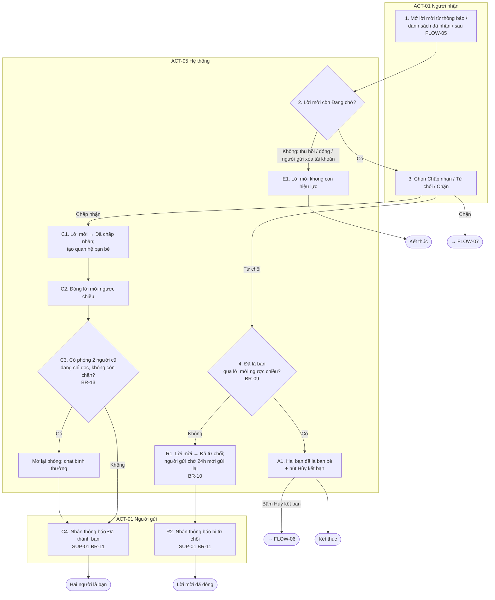

- **Happy path (Chấp nhận):**
  1. Người nhận mở lời mời (từ thông báo SUP-03, danh sách lời mời đã nhận, hoặc ngay sau FLOW-05).
  2. Hệ thống kiểm tra lời mời còn **Đang chờ**.
  3. Người nhận chọn **Chấp nhận**.
  - C1. Lời mời (ENT-02) → **Đã chấp nhận**; tạo quan hệ bạn bè (ENT-04) **Đang là bạn** (BR-09).
  - C2. Lời mời ngược chiều đang chờ (nếu có) → **Đã đóng**. (Link mời giữa hai người tự hết dùng được vì đã là bạn – SUP-07.)
  - C3. Phòng 2 người cũ giữa hai người đang chỉ đọc, và không còn chặn chiều nào → mở lại, chat bình thường (BR-13).
  - C4. Người gửi nhận thông báo "đã trở thành bạn bè" (SUP-01, BR-11). Kết thúc.
- **Alternative paths:**
  - A1. *(Từ chối)* nhưng hai người đã thành bạn qua lời mời ngược chiều → lời từ chối vô hiệu; hiện "Hai bạn đã là bạn bè" + nút **Hủy kết bạn** (→ FLOW-06) (BR-09).
  - A2. *(Từ chối)* bình thường: R1 lời mời → **Đã từ chối**; người gửi phải chờ 24h mới gửi lại, người từ chối mời lại được ngay (BR-10). R2 người gửi nhận thông báo bị từ chối (SUP-01, BR-11). Kết thúc.
  - A3. *(Chặn)* → FLOW-07; lời mời tự đóng ở đó.
  - A4. Mình đã từ chối lời mời của người kia, sau đó người kia chấp nhận lời mời của mình → vẫn thành bạn (bước C1 xảy ra ở phía người kia) (BR-09).
- **Exceptions:**
  - E1. Lời mời đã thu hồi, đã đóng, hoặc người gửi đã xóa tài khoản → "Lời mời không còn hiệu lực". Kết thúc.
  - E2. Thu hồi trùng lúc chấp nhận → chấp nhận thắng (Q-029).
- **Supporting kích hoạt:** SUP-01, SUP-03 tại C4, R2.
- **Business rules áp dụng:** BR-09 C1, A1, A4; BR-10 R1; BR-11 C4, R2; BR-13 C3.

### FLOW-05 Tham gia qua link mời (BIZ-05)
- **Actor:** ACT-02, hoặc ACT-01 có đúng email được mời (chính); ACT-06 Google, ACT-05 Hệ thống (liên quan)
- **Trigger:** Mở link mời nhận qua kênh ngoài.
- **Kết quả:** Người mở link có 1 lời mời Đang chờ từ người mời và thấy ngay màn chấp nhận/từ chối.

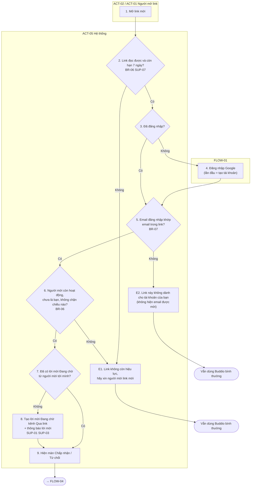

- **Happy path:**
  1. Người được mời mở link.
  2. Hệ thống đọc link (người mời, email mã hóa, hạn) và kiểm tra còn trong 7 ngày (BR-06, SUP-07).
  3. Kiểm tra đã đăng nhập chưa.
  4. Chưa → đăng nhập Google (FLOW-01); lần đầu thì tạo tài khoản.
  5. Kiểm tra email đăng nhập khớp email trong link (BR-07).
  6. Kiểm tra người mời còn hoạt động, hai người chưa là bạn, không có chặn chiều nào (BR-06).
  7. Kiểm tra đã có lời mời Đang chờ từ người mời tới mình chưa.
  8. Chưa có → tạo lời mời (ENT-02) kênh "Qua link", **Đang chờ**; tạo thông báo lời mời cho người mở link (SUP-01, SUP-03). Link coi như **Đã dùng**.
  9. Hiện màn Chấp nhận / Từ chối → FLOW-04.
- **Alternative paths:**
  - A1. Đã có lời mời Đang chờ (từ link khác hoặc người mời đã gửi trong platform) → bỏ qua bước 8, hiện lời mời đó (Q-029).
  - A2. Mở lại cùng link sau khi đã phản hồi (đã chấp nhận → là bạn → E1; đã từ chối) → (Q-036) link chỉ mang email + hạn dùng, không lưu "đã dùng" → còn hạn và còn thỏa bước 5–6 thì **tạo lời mời mới**, không áp luật chờ 24h (người được mời tự chủ động mở link).
- **Exceptions:**
  - E1. Link hỏng, hết hạn; người mời đã xóa tài khoản; đã là bạn; có chặn → "Link không còn hiệu lực, hãy xin người mời link mới". Người dùng vẫn dùng Buddio bình thường.
  - E2. Email không khớp → "Link này không dành cho tài khoản của bạn". **Không hiển thị email được mời.**
- **Supporting kích hoạt:** SUP-07 bước 2, 6; SUP-01, SUP-03 bước 8.
- **Business rules áp dụng:** BR-06 bước 2, 6; BR-07 bước 5; BR-01 bước 4.

### FLOW-06 Hủy kết bạn (BIZ-06)
- **Actor:** ACT-01 (chính); ACT-05 Hệ thống (liên quan)
- **Trigger:** Chọn "Hủy kết bạn" trong danh sách bạn bè, hoặc từ màn "Hai bạn đã là bạn bè" (FLOW-04 A1).
- **Kết quả:** Hai người không còn là bạn; phòng 2 người chung chuyển chỉ đọc.

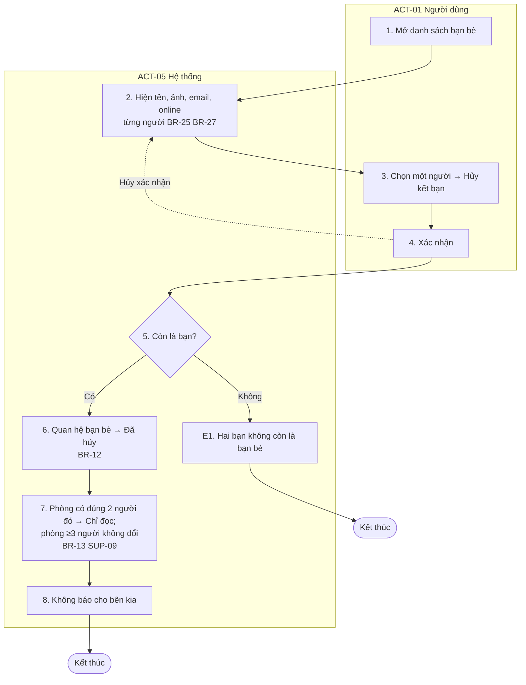

- **Happy path:**
  1. Người dùng mở danh sách bạn bè.
  2. Hệ thống hiện tên, ảnh, email, trạng thái online từng người (BR-25, BR-27).
  3. Chọn một người → "Hủy kết bạn".
  4. Xác nhận.
  5. Hệ thống kiểm tra hai người còn là bạn.
  6. Quan hệ bạn bè (ENT-04) → **Đã hủy** (BR-12).
  7. Mọi phòng có đúng 2 thành viên là hai người này → **chỉ đọc**, cập nhật tức thời (BR-13, SUP-09). Phòng ≥3 người không đổi. Từ giờ hai người không thêm nhau vào phòng mới được.
  8. Không thông báo cho bên kia (BR-12). Kết thúc.
- **Alternative paths:**
  - A1. Không xác nhận ở bước 4 → không đổi gì, quay lại bước 2.
  - A2. Từ danh sách bạn bè cũng chọn được **Chặn** → FLOW-07.
- **Exceptions:** E1. Bên kia vừa hủy trước → "Hai bạn không còn là bạn bè". Kết thúc.
- **Supporting kích hoạt:** SUP-09 bước 7.
- **Business rules áp dụng:** BR-12 bước 6, 8; BR-13 bước 7; BR-25, BR-27 bước 2.

### FLOW-07 Chặn / bỏ chặn người dùng (BIZ-07)
- **Actor:** ACT-01 (chính); ACT-05 Hệ thống (liên quan)
- **Trigger:** Chặn — từ danh sách bạn bè, danh sách thành viên phòng, hoặc một lời mời kết bạn. Bỏ chặn — từ danh sách đã chặn.
- **Kết quả:** Quan hệ chặn có hiệu lực (kèm các hệ quả), hoặc được gỡ.

#### FLOW-07a Chặn

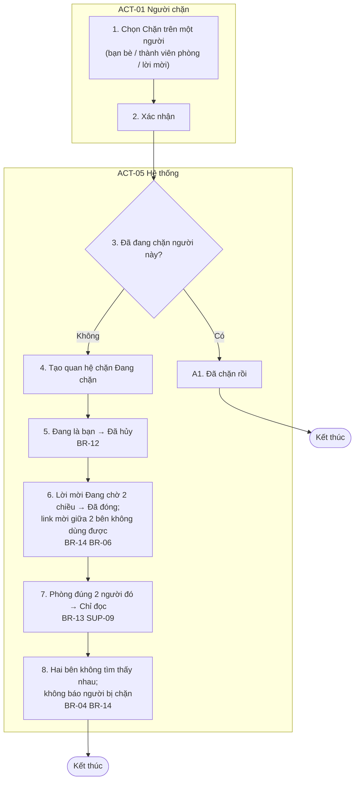

- **Happy path:**
  1. Người dùng chọn **Chặn** trên một người (từ danh sách bạn bè, danh sách thành viên phòng, hoặc lời mời kết bạn). Chặn được cả người chưa là bạn (Q-025).
  2. Xác nhận.
  3. Hệ thống kiểm tra chưa chặn người này.
  4. Tạo quan hệ chặn (ENT-05) **Đang chặn**.
  5. Quan hệ bạn bè (nếu có) → **Đã hủy** (BR-12).
  6. Lời mời Đang chờ cả hai chiều → **Đã đóng**; link mời giữa hai bên không còn dùng được (BR-14, BR-06).
  7. Phòng có đúng 2 thành viên là hai người này → **chỉ đọc** (BR-13, SUP-09). Phòng ≥3 người: vẫn chat bình thường, cả hai vẫn thấy tin của nhau.
  8. Hai bên không tìm thấy nhau qua email; người bị chặn không được báo (BR-04, BR-14). Kết thúc.
- **Alternative paths:**
  - A1. Đã đang chặn người này → báo đã chặn. Kết thúc.
  - A2. Người kia đang chặn mình → vẫn chặn được; hai quan hệ độc lập (BR-14).
  - A3. Chặn từ lời mời: lời mời đó cũng đóng ở bước 6.
  - A4. Không xác nhận ở bước 2 → không đổi gì.
- **Business rules:** BR-04, BR-06, BR-12, BR-13, BR-14.

#### FLOW-07b Bỏ chặn

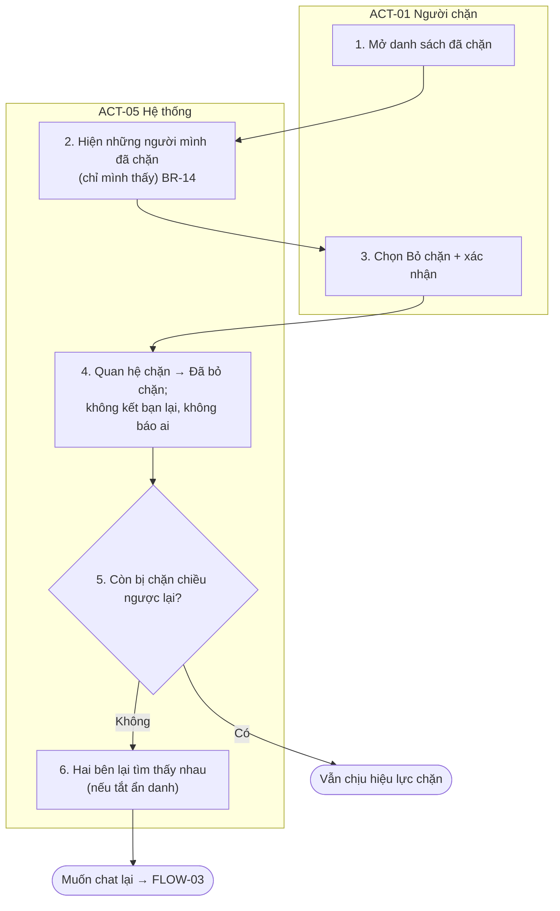

- **Happy path:** 1. Mở danh sách đã chặn. 2. Hệ thống hiện những người mình đã chặn — chỉ mình thấy (BR-14). 3. Chọn Bỏ chặn và xác nhận. 4. ENT-05 → **Đã bỏ chặn**; không tự kết bạn lại, không báo ai. 5–6. Nếu không còn chặn chiều ngược lại → hai bên lại tìm thấy nhau (nếu tắt ẩn danh). Phòng 2 người cũ **vẫn chỉ đọc** cho tới khi kết bạn lại (FLOW-03 → FLOW-04 C3) (BR-13).
- **Business rules:** BR-13, BR-14.

### FLOW-08 Tạo phòng chat (BIZ-08)
- **Actor:** ACT-01 → trở thành ACT-03 của phòng mới (chính); ACT-05 Hệ thống, ACT-01 người được thêm (liên quan)
- **Trigger:** Người dùng chọn "Tạo phòng".
- **Kết quả:** Phòng mới Đang hoạt động, người tạo là host, sẵn sàng nhắn tin.

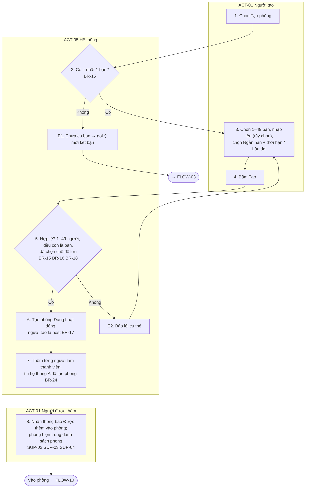

- **Happy path:**
  1. Người dùng chọn "Tạo phòng".
  2. Hệ thống kiểm tra có ít nhất 1 người bạn (BR-15).
  3. Người dùng chọn 1–49 người từ danh sách bạn bè, nhập tên phòng (không bắt buộc), chọn chế độ lưu: **Ngắn hạn** + thời hạn (1 ngày / 2 ngày / 3 ngày / 1 tuần / 1 tháng / 3 tháng) hoặc **Lâu dài**. Màn hình nhắc: chế độ lưu không đổi được về sau.
  4. Bấm Tạo.
  5. Hệ thống kiểm tra: 1–49 người, tất cả vẫn đang là bạn, đã chọn chế độ lưu (+ thời hạn nếu ngắn hạn) (BR-15, BR-16, BR-18).
  6. Tạo phòng (ENT-06) **Đang hoạt động**; người tạo là host (BR-17).
  7. Tạo thành viên (ENT-07) **Đang tham gia** cho host và từng người; tin hệ thống "A đã tạo phòng" (BR-24).
  8. Mỗi người được thêm nhận thông báo "Được thêm vào phòng" (SUP-02, SUP-03); phòng hiện trong danh sách phòng của mọi thành viên (SUP-04). Kết thúc → FLOW-10.
- **Alternative paths:**
  - A1. Đã có phòng khác với cùng những người này → vẫn tạo phòng mới (Q-002).
  - A2. Không đặt tên → phòng hiển thị tên các thành viên (Q-012).
- **Exceptions:**
  - E1. Chưa có bạn nào → không tạo được, gợi ý đi mời kết bạn (FLOW-03).
  - E2. Chọn quá 49 người; chưa chọn chế độ lưu / thời hạn; một người vừa hủy kết bạn hoặc chặn → báo lỗi cụ thể, quay lại bước 3. (Q-037) Người không còn là bạn bị bỏ khỏi danh sách chọn và báo "Người này không còn trong danh sách bạn bè".
- **Supporting kích hoạt:** SUP-02, SUP-03, SUP-04 bước 8.
- **Business rules áp dụng:** BR-15 bước 2, 5; BR-16, BR-18 bước 5; BR-17 bước 6; BR-24 bước 7.

### FLOW-09 Quản lý phòng & thành viên (BIZ-09)
- **Actor:** ACT-03 Host (chính); ACT-04 Thành viên (xem thành viên, rời phòng); ACT-05 Hệ thống (liên quan)
- **Trigger:** Host hoặc thành viên chọn thao tác trong phần thông tin phòng.
- **Điều kiện chung (mọi nhánh):** người thao tác là thành viên **Đang tham gia**, phòng **Đang hoạt động**; thao tác của host → kiểm tra đúng là host (BR-18). Sai → "Bạn không có quyền thực hiện thao tác này" (Q-037).
- **Kết quả:** Phòng luôn có đúng 1 host và ≤50 thành viên, hoặc phòng đã bị xóa.
- Tách nhánh: **09a** Xem thành viên & sửa tên phòng · **09b** Thêm thành viên · **09c** Kick · **09d** Chuyển quyền host · **09e** Rời phòng · **09f** Giải tán phòng.

#### FLOW-09a Xem thành viên & sửa tên phòng
- **Xem thành viên (mọi thành viên):** hệ thống hiện tên, ảnh, email, online, vai trò từng người (BR-25, BR-27). Từ đây chọn được **Chặn** một người (→ FLOW-07).
- **Sửa tên phòng (host):** 1. Host nhập tên mới (để trống được). 2. Hệ thống kiểm tra quyền host (BR-18). 3. Cập nhật tên; trống → hiển thị tên các thành viên. 4. Tin hệ thống "A đã đổi tên phòng thành …" (BR-24); mọi người thấy ngay (SUP-09, SUP-04).
  - (Q-037) Tên phòng tối đa 50 ký tự (giống tên hiển thị).

#### FLOW-09b Thêm thành viên

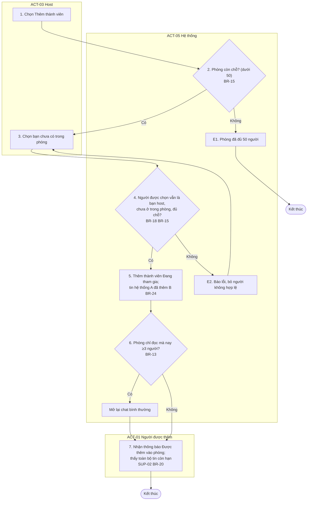

- **Happy path:** 1. Host chọn Thêm thành viên. 2. Hệ thống kiểm tra phòng < 50 người (BR-15). 3. Host chọn một hoặc nhiều **bạn của mình** chưa có trong phòng. 4. Kiểm tra từng người vẫn là bạn host, chưa ở trong phòng, tổng không vượt 50 (BR-18, BR-15). 5. Thêm thành viên (ENT-07) **Đang tham gia** — không cần người được thêm đồng ý (Q-029); tin hệ thống "A đã thêm B" (BR-24). 6. Nếu phòng đang chỉ đọc và giờ có ≥3 người → chat lại bình thường (BR-13). 7. Người được thêm nhận thông báo (SUP-02, SUP-03), thấy toàn bộ tin còn hạn (BR-20). Kết thúc.
- **Alternative:** A1. Thêm lại người đã rời / bị kick → lần tham gia mới, thấy toàn bộ tin còn hạn (BR-20).
- **Exceptions:** E1. Phòng đủ 50 → không thêm được. E2. Người được chọn vừa hủy kết bạn / chặn host, hoặc vượt số chỗ còn lại → báo lỗi, quay lại bước 3.
- **Business rules:** BR-13, BR-15, BR-18, BR-20, BR-24.

#### FLOW-09c Kick thành viên

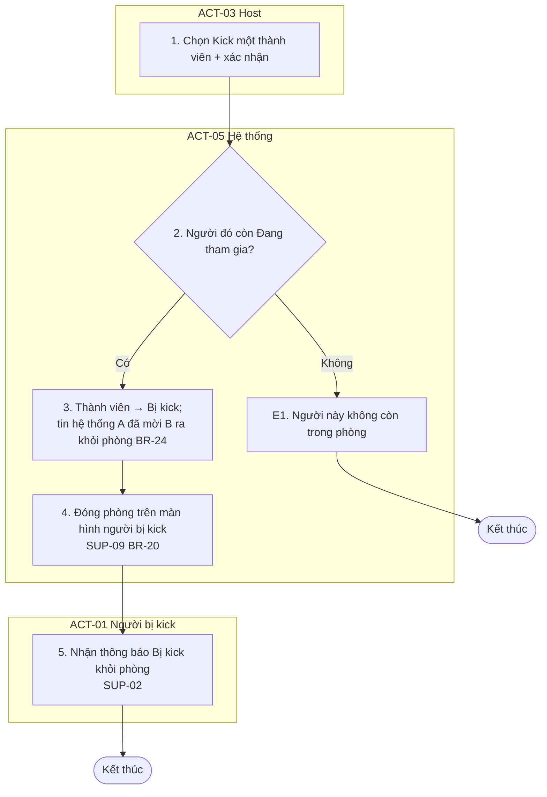

- **Happy path:** 1. Host chọn Kick một thành viên (không phải chính mình) và xác nhận. 2. Kiểm tra người đó còn Đang tham gia. 3. ENT-07 → **Bị kick**; tin hệ thống (BR-24). 4. Người bị kick mất phòng ngay, không xem được tin nữa (BR-20, SUP-09). 5. Người bị kick nhận thông báo (SUP-02, SUP-03).
- **Alternative:** A1. Kick làm phòng chỉ còn 2 người không còn là bạn / có chặn → phòng chuyển chỉ đọc (BR-13). A2. Kick làm phòng chỉ còn host → phòng vẫn tồn tại (Q-018).
- **Exceptions:** E1. Người đó vừa rời → "Người này không còn trong phòng".
- **Business rules:** BR-13, BR-18, BR-20, BR-24.

#### FLOW-09d Chuyển quyền host

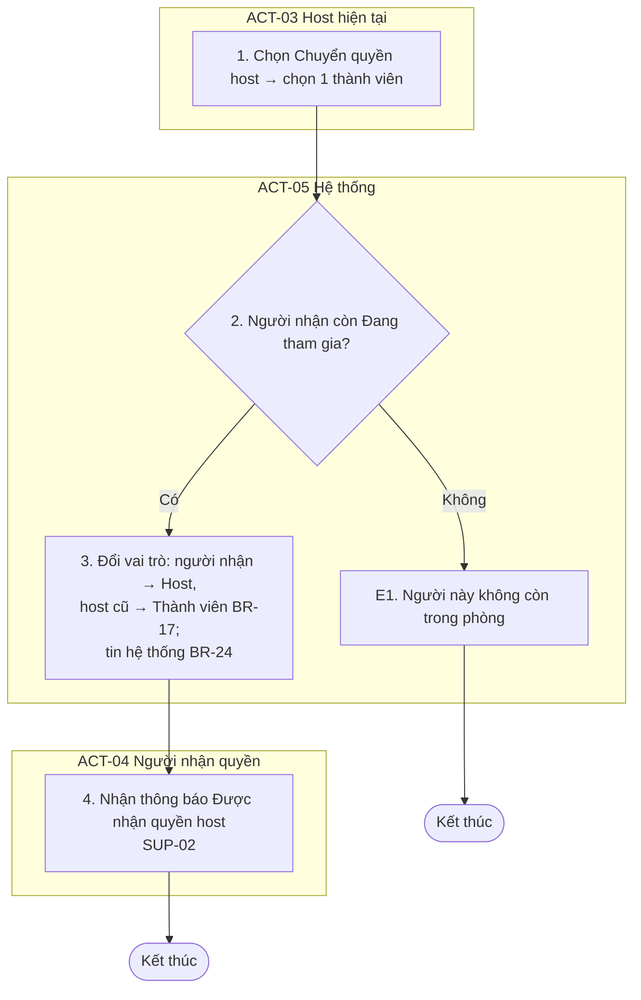

- **Happy path:** 1. Host chọn một thành viên đang tham gia. 2. Kiểm tra còn Đang tham gia. 3. Đổi vai trò hai người — không cần người nhận đồng ý (Q-029); luôn đúng 1 host (BR-17); tin hệ thống "A chuyển quyền host cho B" (BR-24). 4. Người nhận được thông báo (SUP-02, SUP-03).
- **Exceptions:** E1. Người nhận vừa rời → "Người này không còn trong phòng".
- **Business rules:** BR-17, BR-18, BR-24.

#### FLOW-09e Rời phòng

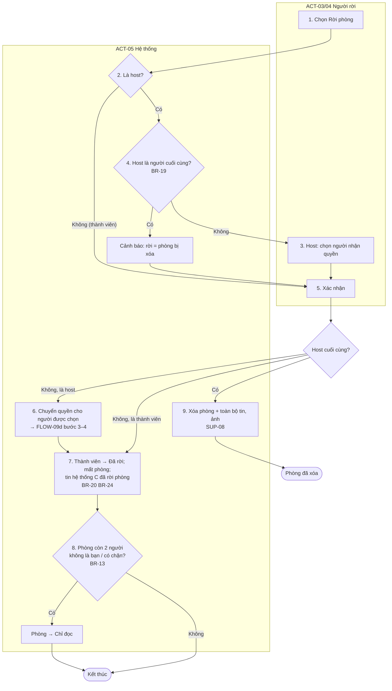

- **Happy path (thành viên):** 1. Chọn Rời phòng. 2. Không phải host. 5. Xác nhận. 7. ENT-07 → **Đã rời**, mất phòng và tin (BR-20); tin hệ thống "C đã rời phòng" (BR-24). 8. Nếu còn đúng 2 người không là bạn / có chặn → phòng chỉ đọc (BR-13). Kết thúc.
- **Alternative paths:**
  - A1. *(Host, còn người khác)* bước 3 chọn người nhận quyền ngay trong thao tác rời (Q-029) → 5 xác nhận → 6 chuyển quyền (FLOW-09d bước 3–4, có thông báo SUP-02) → 7.
  - A2. *(Host là người cuối cùng)* bước 4 cảnh báo rời = phòng bị xóa → 5 xác nhận → 9 xóa phòng (ENT-06 **Đã xóa**) cùng toàn bộ tin và ảnh (BR-19, SUP-08).
  - A3. Không xác nhận ở bước 5 → không đổi gì.
- **Business rules:** BR-13, BR-17, BR-19, BR-20, BR-24.

#### FLOW-09f Giải tán phòng

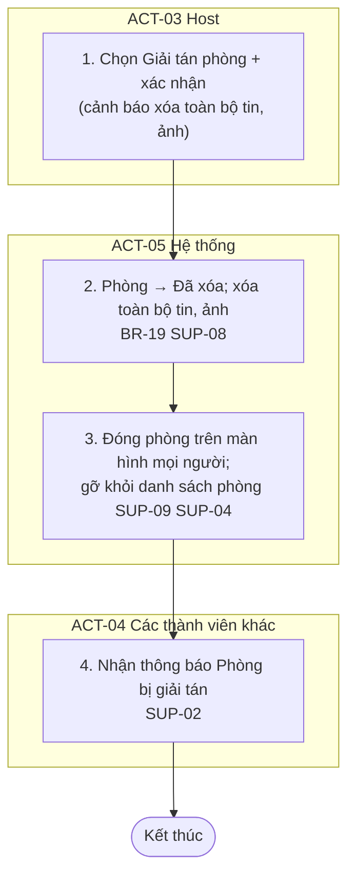

- **Happy path:** 1. Host chọn Giải tán và xác nhận (cảnh báo không khôi phục được). 2. Phòng → **Đã xóa**, toàn bộ tin và ảnh bị xóa (BR-19, SUP-08). 3. Phòng biến mất với mọi thành viên ngay, kể cả người đang mở (SUP-09, SUP-04). 4. Các thành viên khác nhận thông báo "Phòng X đã bị giải tán" (SUP-02, SUP-03) — thông báo giữ tên phòng để người nhận biết (Q-037).
- **Business rules:** BR-18, BR-19.

### FLOW-10 Nhắn tin trong phòng (BIZ-10)
- **Actor:** ACT-03 Host, ACT-04 Thành viên (chính); ACT-05 Hệ thống (liên quan)
- **Trigger:** Thành viên mở phòng; nhập và gửi tin; thu hồi tin; tới thời điểm hết hạn.
- **Kết quả:** Tin hiển thị cho mọi thành viên đang tham gia tới khi hết hạn, bị thu hồi, hoặc phòng bị xóa.
- Tách 3 nhánh: **FLOW-10a** Gửi & xem tin · **FLOW-10b** Thu hồi tin · **FLOW-10c** Tin hết hạn.

#### FLOW-10a Gửi & xem tin

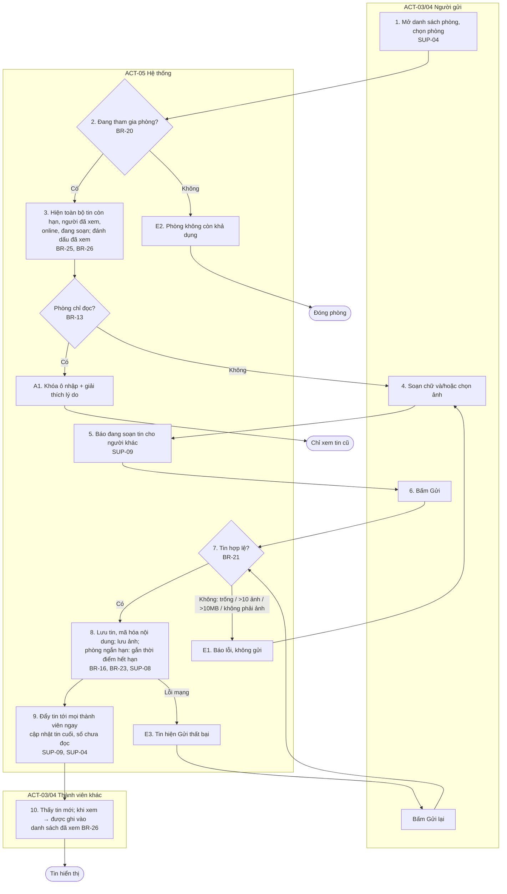

- **Happy path:**
  1. Thành viên mở danh sách phòng (tin cuối, số chưa đọc – SUP-04), chọn một phòng.
  2. Hệ thống kiểm tra người đó còn là thành viên đang tham gia (BR-20).
  3. Hệ thống hiện toàn bộ tin còn hạn (kể cả tin trước khi mình vào), người đã xem từng tin, ai đang soạn, ai online (BR-25, BR-26). Các tin chưa xem được đánh dấu đã xem; số chưa đọc của phòng về 0.
  4. Thành viên soạn chữ và/hoặc chọn ảnh.
  5. Hệ thống báo "đang soạn tin" cho các thành viên khác (SUP-09).
  6. Thành viên bấm Gửi.
  7. Hệ thống kiểm tra: có chữ hoặc ảnh, ≤10 ảnh, tổng ≤10MB, chỉ là ảnh (BR-21).
  8. Hệ thống tạo tin (ENT-08) trạng thái **Đã gửi**, nội dung được mã hóa (BR-23); lưu ảnh (ENT-09, SUP-08). Phòng ngắn hạn → thời điểm hết hạn = lúc gửi + thời hạn phòng (BR-16).
  9. Hệ thống đẩy tin tới mọi thành viên đang tham gia ngay lập tức; cập nhật tin cuối và số chưa đọc ở danh sách phòng của họ (SUP-09, SUP-04). Không tạo thông báo (SUP-03).
  10. Thành viên khác thấy tin; khi họ xem, tên họ vào danh sách đã xem (BR-26). Kết thúc.
- **Alternative paths:**
  - A1. Phòng đang chỉ đọc (phòng 2 người không còn là bạn / có chặn – BR-13) → khóa ô nhập kèm lý do; vẫn xem được tin cũ. Kết thúc.
  - A2. Người dùng tắt hiển thị online → mọi người thấy họ offline, họ cũng không thấy online người khác (BR-25); các bước khác như thường.
  - A3. Người gửi đã xóa tài khoản → tin cũ hiển thị người gửi "Người dùng đã xóa" (BR-28).
- **Exceptions:**
  - E1. Tin trống, quá 10 ảnh, quá 10MB, tệp không phải ảnh → báo lỗi, không gửi, quay lại bước 4.
  - E2. Không còn là thành viên (bị kick / đã rời) hoặc phòng đã bị giải tán — kể cả khi đang xem → đóng phòng, báo cho người dùng (SUP-09). Kết thúc.
  - E3. Gửi lỗi (mất mạng) → tin hiện "Gửi thất bại", cho phép gửi lại → quay lại bước 7 (Q-029).
  - E4. (Q-035) Phòng vừa chuyển sang chỉ đọc trong lúc đang soạn → bước 7 từ chối gửi, chuyển sang A1.
- **Supporting kích hoạt:** SUP-04 bước 1, 9; SUP-08 bước 8; SUP-09 bước 5, 9, E2.
- **Business rules áp dụng:** BR-20 bước 2; BR-25, BR-26 bước 3, 10; BR-13 A1; BR-21 bước 7; BR-16, BR-23 bước 8; BR-28 A3.

#### FLOW-10b Thu hồi tin

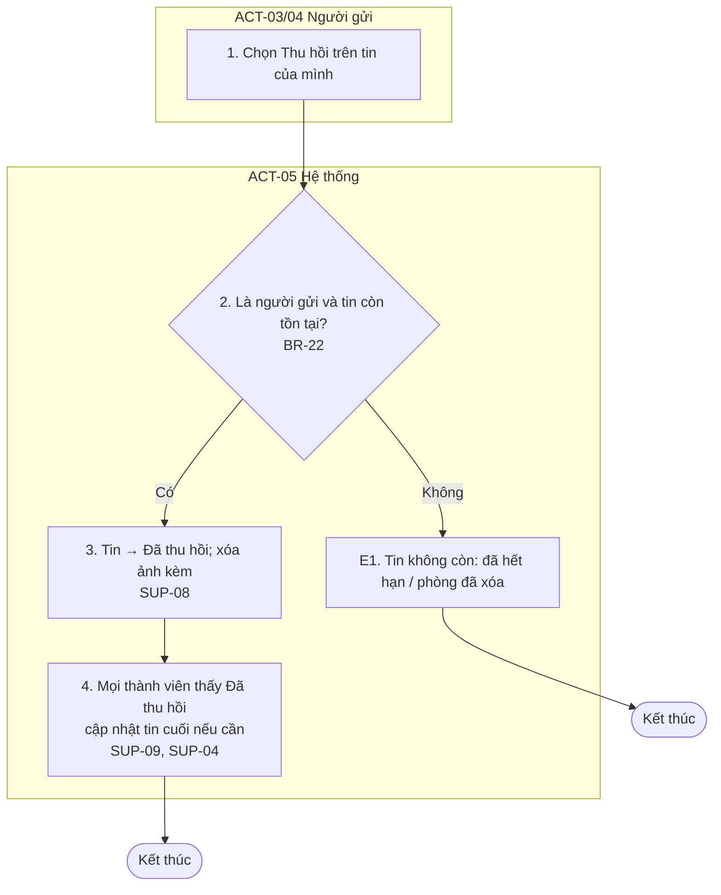

- **Happy path:** 1. Người gửi chọn Thu hồi trên tin của mình (bất cứ lúc nào, kể cả khi phòng đang chỉ đọc – Q-035). 2. Hệ thống kiểm tra là người gửi và tin còn tồn tại (BR-22). 3. Tin → **Đã thu hồi**, ảnh kèm bị xóa hẳn (SUP-08). 4. Mọi thành viên thấy "Đã thu hồi" ngay (SUP-09); nếu là tin cuối thì danh sách phòng hiện "Đã thu hồi" (SUP-04).
- **Exceptions:** E1. Tin vừa hết hạn hoặc phòng vừa bị xóa → không làm gì, tin biến mất khỏi màn hình.
- **Business rules:** BR-22 bước 2.

#### FLOW-10c Tin hết hạn (phòng ngắn hạn)

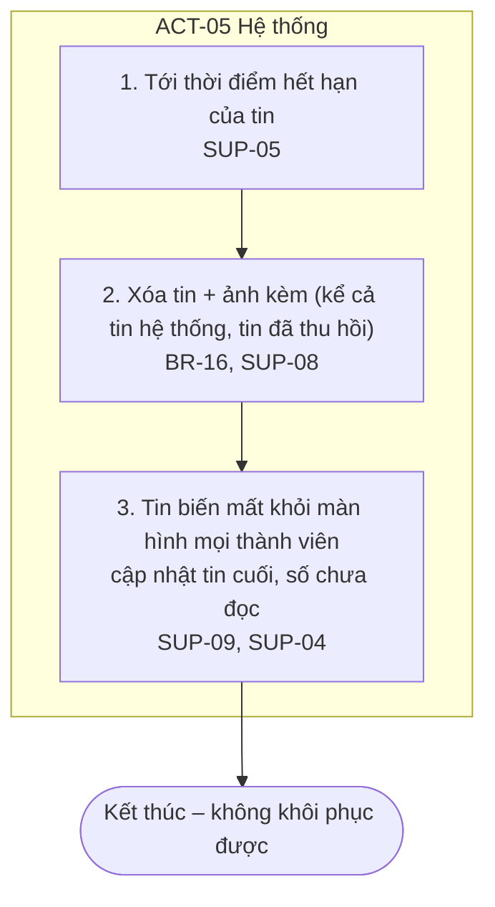

- **Happy path:** 1. Tới thời điểm hết hạn (lúc gửi + thời hạn phòng) (SUP-05). 2. Hệ thống xóa tin, ảnh kèm (BR-16, SUP-08). 3. Tin biến mất với mọi thành viên, kể cả người đang mở phòng; tin cuối và số chưa đọc cập nhật (SUP-09, SUP-04).
- **Business rules:** BR-16.

### FLOW-11 Xóa tài khoản (BIZ-11)
- **Actor:** ACT-01 (chính); ACT-05 Hệ thống (liên quan)
- **Trigger:** Chọn "Xóa tài khoản" trong cài đặt.
- **Kết quả:** Tài khoản Đã xóa ngay; mọi quan hệ được dọn; tin cũ giữ lại với tên "Người dùng đã xóa".

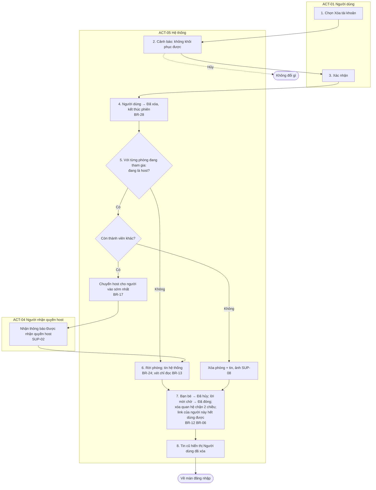

- **Happy path:**
  1. Người dùng chọn "Xóa tài khoản".
  2. Hệ thống cảnh báo không khôi phục được.
  3. Người dùng xác nhận.
  4. ENT-01 → **Đã xóa** ngay, kết thúc phiên (BR-28, Q-029).
  5. Với từng phòng đang tham gia:
     - Đang là host và còn người khác → quyền host tự chuyển cho thành viên vào phòng sớm nhất (BR-17); người đó nhận thông báo (SUP-02).
     - Đang là host và là người duy nhất → phòng bị xóa cùng tin, ảnh (SUP-08).
  6. Rời phòng (ENT-07 → **Đã rời**); tin hệ thống "C đã rời phòng" (BR-24); phòng còn đúng 2 người → xét chỉ đọc (BR-13).
  7. Mọi quan hệ bạn bè → **Đã hủy**; lời mời Đang chờ (cả gửi và nhận) → **Đã đóng**; quan hệ chặn của và đến người này bị xóa; link mời người này đã tạo không dùng được nữa (BR-12, BR-06, Q-029). Không thông báo cho ai, trừ người nhận quyền host (Q-037).
  8. Tin đã gửi được giữ, hiển thị người gửi "Người dùng đã xóa". Kết thúc → màn đăng nhập.
- **Alternative paths:**
  - A1. Đăng nhập lại bằng cùng Google → tài khoản mới hoàn toàn (FLOW-01 bước 6, BR-28).
  - A2. Thông báo đã gửi cho người khác từ người này (vd lời mời) vẫn còn trong danh sách thông báo của họ tới khi hết 30 ngày; mở ra → "Lời mời không còn hiệu lực" (FLOW-04 E1) (Q-037).
- **Exceptions:** E1. Hủy ở bước 2–3 → không có gì thay đổi.
- **Supporting kích hoạt:** SUP-02 bước 5; SUP-08 bước 5; SUP-09 bước 6.
- **Business rules áp dụng:** BR-06, BR-12, BR-13, BR-17, BR-24, BR-28.

### FLOW-12 Xem & dọn thông báo (SUP-03, SUP-06 — flow phụ trợ, không có BIZ tương ứng)
- **Actor:** ACT-01 (chính); ACT-05 Hệ thống (liên quan)
- **Trigger:** Người dùng mở danh sách thông báo; hoặc thông báo đủ 30 ngày.
- **Kết quả:** Thông báo được đọc / dẫn tới đối tượng liên quan; thông báo cũ tự biến mất.

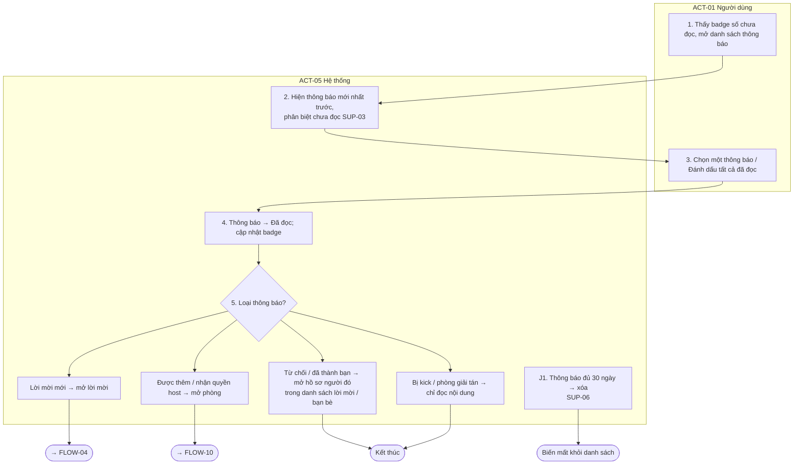

- **Happy path:**
  1. Người dùng thấy badge số thông báo chưa đọc, mở danh sách thông báo.
  2. Hệ thống hiện thông báo mới nhất trước, đánh dấu cái chưa đọc (SUP-03).
  3. Người dùng chọn một thông báo, hoặc "Đánh dấu tất cả đã đọc".
  4. Thông báo (ENT-10) → **Đã đọc**; badge cập nhật.
  5. Theo loại: lời mời mới → mở lời mời (FLOW-04); được thêm vào phòng / nhận quyền host → mở phòng (FLOW-10); bị từ chối / đã thành bạn → mở danh sách lời mời / bạn bè; bị kick / phòng giải tán → chỉ đọc nội dung.
- **Alternative paths:** A1. Đối tượng không còn (lời mời đã đóng, phòng đã xóa, đã bị kick khỏi phòng sau đó, người kia xóa tài khoản) → "Nội dung không còn hiệu lực" (Q-037).
- **Flow hệ thống:** J1. Thông báo đủ 30 ngày kể từ lúc tạo (đã đọc hay chưa) → hệ thống xóa (SUP-06, NFR-21).
- **Supporting kích hoạt:** SUP-03 bước 2–4; SUP-06 J1.
- **Business rules / NFR:** NFR-21.

### Vòng đời entity

#### ENT-01 Người dùng
```mermaid
stateDiagram-v2
  [*] --> DangHoatDong: Đăng nhập Google lần đầu
  DangHoatDong --> DaXoa: Xóa tài khoản
  DaXoa --> [*]
```
| Trạng thái | → Trạng thái | Do FLOW/bước | Actor |
|---|---|---|---|
| (chưa có) | Đang hoạt động | FLOW-01 bước 6 (cả khi email từng thuộc tài khoản đã xóa) | ACT-05 (sau xác thực ACT-06) |
| Đang hoạt động | Đã xóa | FLOW-11 bước 4 | ACT-01 |

#### ENT-02 Lời mời kết bạn
```mermaid
stateDiagram-v2
  [*] --> DangCho: Gửi trong platform / mở link mời
  DangCho --> DaChapNhan: Người nhận chấp nhận
  DangCho --> DaTuChoi: Người nhận từ chối
  DangCho --> DaThuHoi: Người gửi thu hồi
  DangCho --> DaDong: Thành bạn qua lời mời ngược chiều / chặn / xóa tài khoản
  DaChapNhan --> [*]
  DaTuChoi --> [*]
  DaThuHoi --> [*]
  DaDong --> [*]
```
| Trạng thái | → Trạng thái | Do FLOW/bước | Actor |
|---|---|---|---|
| (chưa có) | Đang chờ | FLOW-03 bước 7 (Trong platform); FLOW-05 bước 8 (Qua link) | ACT-01 người gửi / ACT-05 |
| Đang chờ | Đã chấp nhận | FLOW-04 C1 | ACT-01 người nhận |
| Đang chờ | Đã từ chối | FLOW-04 R1 | ACT-01 người nhận |
| Đang chờ | Đã thu hồi | FLOW-03 A3 | ACT-01 người gửi |
| Đang chờ | Đã đóng | FLOW-04 C2 (lời mời ngược chiều); FLOW-07a bước 6; FLOW-11 bước 7 | ACT-05 |

#### ENT-03 Link mời
Link **tự chứa, không lưu khi tạo** (SUP-07, Q-033). Trạng thái không được ghi lại mà **xác định lúc mở link** (FLOW-05 bước 2, 5, 6, 7).
```mermaid
stateDiagram-v2
  [*] --> ConHieuLuc: Copy link mời
  ConHieuLuc --> DaDung: Đúng người mở, sinh lời mời
  ConHieuLuc --> HetHan: Quá 7 ngày
  ConHieuLuc --> VoHieu: Đã là bạn / có chặn / người mời xóa tài khoản
  DaDung --> [*]
  HetHan --> [*]
  VoHieu --> [*]
```
| Trạng thái | → Trạng thái | Do FLOW/bước | Actor |
|---|---|---|---|
| (chưa có) | Còn hiệu lực | FLOW-03 bước 10 | ACT-01 người mời |
| Còn hiệu lực | Đã dùng | FLOW-05 bước 8 | ACT-01/02 người được mời |
| Còn hiệu lực | Hết hạn | Xác định ở FLOW-05 bước 2 | ACT-05 |
| Còn hiệu lực | Vô hiệu | Xác định ở FLOW-05 bước 6 (nguyên nhân: FLOW-04 C1, FLOW-07a, FLOW-11) | ACT-05 |

#### ENT-04 Quan hệ bạn bè
```mermaid
stateDiagram-v2
  [*] --> DangLaBan: Lời mời được chấp nhận
  DangLaBan --> DaHuy: Hủy kết bạn / chặn / xóa tài khoản
  DaHuy --> [*]
```
| Trạng thái | → Trạng thái | Do FLOW/bước | Actor |
|---|---|---|---|
| (chưa có) | Đang là bạn | FLOW-04 C1 | ACT-05 (khi ACT-01 chấp nhận) |
| Đang là bạn | Đã hủy | FLOW-06 bước 6; FLOW-07a bước 5; FLOW-11 bước 7 | ACT-01 / ACT-05 |

Kết bạn lại = quan hệ mới qua FLOW-03 → FLOW-04.

#### ENT-05 Quan hệ chặn
```mermaid
stateDiagram-v2
  [*] --> DangChan: Chặn
  DangChan --> DaBoChan: Bỏ chặn
  DangChan --> [*]: Một bên xóa tài khoản (xóa quan hệ)
  DaBoChan --> [*]
```
| Trạng thái | → Trạng thái | Do FLOW/bước | Actor |
|---|---|---|---|
| (chưa có) | Đang chặn | FLOW-07a bước 4 | ACT-01 người chặn |
| Đang chặn | Đã bỏ chặn | FLOW-07b bước 4 | ACT-01 người chặn |
| Đang chặn | (bị xóa) | FLOW-11 bước 7 | ACT-05 |

#### ENT-06 Phòng chat
```mermaid
stateDiagram-v2
  [*] --> DangHoatDong: Tạo phòng
  state DangHoatDong {
    [*] --> ChatBinhThuong
    ChatBinhThuong --> ChiDoc: Còn đúng 2 người, không là bạn / có chặn
    ChiDoc --> ChatBinhThuong: Kết bạn lại & hết chặn / thêm người thành ≥3
  }
  DangHoatDong --> DaXoa: Host giải tán / người cuối cùng rời / host duy nhất xóa tài khoản
  DaXoa --> [*]
```
| Trạng thái | → Trạng thái | Do FLOW/bước | Actor |
|---|---|---|---|
| (chưa có) | Đang hoạt động | FLOW-08 bước 6 | ACT-01 → ACT-03 |
| Chat bình thường | Chỉ đọc | FLOW-06 bước 7; FLOW-07a bước 7; FLOW-09c A1; FLOW-09e bước 8; FLOW-11 bước 6 | ACT-05 |
| Chỉ đọc | Chat bình thường | FLOW-04 C3; FLOW-09b bước 6 | ACT-05 |
| Đang hoạt động | Đã xóa | FLOW-09f bước 2; FLOW-09e A2; FLOW-11 bước 5 | ACT-03 / ACT-05 |

"Chỉ đọc" là tình trạng tính theo BR-13, không phải trạng thái người dùng chọn.

#### ENT-07 Thành viên phòng
```mermaid
stateDiagram-v2
  [*] --> DangThamGia: Tạo phòng / host thêm
  state DangThamGia {
    [*] --> ThanhVien
    ThanhVien --> Host: Nhận quyền host
    Host --> ThanhVien: Chuyển quyền cho người khác
  }
  DangThamGia --> DaRoi: Rời phòng / xóa tài khoản
  DangThamGia --> BiKick: Host kick
  DaRoi --> [*]
  BiKick --> [*]
```
| Trạng thái | → Trạng thái | Do FLOW/bước | Actor |
|---|---|---|---|
| (chưa có) | Đang tham gia (Host) | FLOW-08 bước 6–7 | ACT-01 người tạo |
| (chưa có) | Đang tham gia (Thành viên) | FLOW-08 bước 7; FLOW-09b bước 5 | ACT-03 |
| Thành viên | Host | FLOW-09d bước 3; FLOW-09e A1; FLOW-11 bước 5 | ACT-03 / ACT-05 |
| Host | Thành viên | FLOW-09d bước 3; FLOW-09e A1 | ACT-03 |
| Đang tham gia | Đã rời | FLOW-09e bước 7; FLOW-11 bước 6 | ACT-03/04 / ACT-05 |
| Đang tham gia | Bị kick | FLOW-09c bước 3 | ACT-03 |

Thêm lại sau khi rời / bị kick = lần tham gia mới.

#### ENT-08 Tin nhắn (ENT-09 Ảnh đính kèm theo vòng đời tin)
```mermaid
stateDiagram-v2
  [*] --> DaGui: Gửi / hệ thống tạo tin hệ thống
  DaGui --> DaThuHoi: Người gửi thu hồi (ảnh bị xóa)
  DaGui --> DaXoa: Hết hạn / phòng bị xóa
  DaThuHoi --> DaXoa: Hết hạn / phòng bị xóa
  DaXoa --> [*]
```
| Trạng thái | → Trạng thái | Do FLOW/bước | Actor |
|---|---|---|---|
| (chưa có) | Đã gửi | FLOW-10a bước 8; tin hệ thống ở FLOW-08, FLOW-09, FLOW-11 | ACT-03/04 / ACT-05 |
| Đã gửi | Đã thu hồi | FLOW-10b bước 3 | ACT-03/04 người gửi |
| Đã gửi / Đã thu hồi | Đã xóa | FLOW-10c bước 2; FLOW-09f bước 2; FLOW-09e A2; FLOW-11 bước 5 | ACT-05 / ACT-03 |

(Gửi thất bại ở FLOW-10a E3 chỉ là trạng thái tạm trên máy người gửi, tin chưa tồn tại.)

#### ENT-10 Thông báo
```mermaid
stateDiagram-v2
  [*] --> ChuaDoc: Sự kiện SUP-01 / SUP-02
  ChuaDoc --> DaDoc: Người nhận xem / đánh dấu đã đọc
  ChuaDoc --> DaXoa: Quá 30 ngày
  DaDoc --> DaXoa: Quá 30 ngày
  DaXoa --> [*]
```
| Trạng thái | → Trạng thái | Do FLOW/bước | Actor |
|---|---|---|---|
| (chưa có) | Chưa đọc | FLOW-03 bước 7; FLOW-04 C4, R2; FLOW-05 bước 8; FLOW-08 bước 8; FLOW-09b/c/d/f; FLOW-11 bước 5 | ACT-05 |
| Chưa đọc | Đã đọc | SUP-03 | ACT-01 người nhận |
| Chưa đọc / Đã đọc | Đã xóa | SUP-06 | ACT-05 |

#### Đối chiếu với business.md
- ENT-01, 02, 04, 05, 07, 08, 10: khớp.
- ENT-03: khớp sau cập nhật Q-033/Q-034 (trạng thái xác định lúc mở link).
- ENT-06: thêm tình trạng con "Chỉ đọc / Chat bình thường" trong Đang hoạt động — đúng theo BR-13, chỉ là cách trình bày.
- ENT-10: thêm Đã xóa sau 30 ngày (Q-032) — đã cập nhật business.md.

## 4. Non-Functional Requirements
Bối cảnh: 1k–10k người dùng năm đầu, web responsive ưu tiên điện thoại, chỉ tiếng Việt, tin nhắn mã hóa khi lưu (Q-038).

| ID | Nhóm | Yêu cầu | Chỉ số đo được | Ưu tiên | Áp dụng cho | Q-ref |
|---|---|---|---|---|---|---|
| NFR-01 | Performance | Tin mới tới các thành viên đang mở app gần như tức thì | P95 ≤ 1 giây từ lúc bấm Gửi tới lúc hiện trên máy người nhận (tin chữ) | Must | BIZ-10, SUP-09 | Q-039 |
| NFR-02 | Performance | Đang soạn tin, online/offline, đã xem, thu hồi cập nhật nhanh | P95 ≤ 2 giây | Should | BIZ-10, SUP-09 | Q-039 |
| NFR-03 | Performance | Mở một phòng hiện ngay các tin gần nhất | P95 ≤ 1,5 giây hiện 50 tin mới nhất trên mạng 4G; tin cũ hơn tải thêm khi cuộn | Must | BIZ-10 | Q-039 |
| NFR-04 | Performance | Thao tác thường phản hồi nhanh (tra email, gửi/phản hồi lời mời, tạo phòng, thêm/kick, cài đặt) | P95 ≤ 1 giây | Should | BIZ-02 → BIZ-09 | Q-039 |
| NFR-05 | Performance | Gửi tin có ảnh | Tin 10 ảnh / 10MB gửi xong P95 ≤ 10 giây trên 4G; có thanh tiến độ; ảnh xem trước hiện ≤ 2 giây | Should | BIZ-10, SUP-08 | Q-039 |
| NFR-06 | Performance | Mở Buddio lần đầu | Trang chính dùng được ≤ 3 giây trên 4G | Should | Toàn hệ thống | Q-039 |
| NFR-07 | Scalability | Đáp ứng quy mô năm đầu | 10k người dùng; 1k người online cùng lúc (gấp đôi ước tính 500); 200k tin/ngày; phòng tối đa 50 người. Mở rộng tới 100k người dùng chỉ bằng thêm tài nguyên, không đổi nghiệp vụ | Must | Toàn hệ thống | Q-038 |
| NFR-08 | Scalability | Các giới hạn nghiệp vụ điều chỉnh được không cần sửa chương trình | 50 người/phòng (BR-15), 10 ảnh và 10MB/tin (BR-21), 30 ngày lưu thông báo, 7 ngày hạn link | Should | BIZ-08, BIZ-09, BIZ-10, SUP-06, SUP-07 | Q-016, Q-022 |
| NFR-09 | Availability | Hệ thống sẵn sàng | ≥ 99,5% / tháng (ngừng tối đa ~3,6 giờ/tháng); bảo trì có báo trước trong app ≥ 24 giờ | Should | Toàn hệ thống | Q-039 |
| NFR-10 | Availability | Mất mạng không mất tin | Tự kết nối lại; sau khi có mạng, tải bù mọi tin bị lỡ; không mất, không trùng tin; tin gửi lỗi hiện "Gửi thất bại" + gửi lại (Q-029) | Must | BIZ-10, SUP-09 | Q-039 |
| NFR-11 | Security | Xác thực | Chỉ đăng nhập Google (BR-01). Phiên tự hết sau 30 ngày không dùng. Đăng xuất / xóa tài khoản kết thúc phiên ngay | Must | BIZ-01, BIZ-11 | Q-039 |
| NFR-12 | Security | Bảo mật nội dung tin nhắn | Nội dung chữ và ảnh **mã hóa khi lưu** và **khi truyền**; khóa mã hóa giữ tách biệt với dữ liệu; người lấy được bản sao dữ liệu không đọc được nội dung. Không mã hóa đầu-cuối (để giữ BR-20) | Must | BIZ-10, BR-23, SUP-08 | Q-038 |
| NFR-13 | Security | Phân quyền luôn được hệ thống kiểm tra | Mọi thao tác kiểm tra quyền phía hệ thống (không tin vào giao diện): chỉ thành viên đang tham gia đọc được tin, ảnh, danh sách thành viên; chỉ host làm thao tác host. Ảnh không có đường dẫn công khai; đường dẫn xem ảnh hết hiệu lực sau ≤ 1 giờ | Must | BIZ-09, BIZ-10, SUP-08 | Q-039 |
| NFR-14 | Security | Link mời an toàn | Email trong link được mã hóa, không đọc được; link không sửa / giả mạo được (sửa → không hợp lệ); không đoán được link của người khác | Must | BIZ-03, BIZ-05, SUP-07 | Q-033, Q-036 |
| NFR-15 | Security / Privacy | Không lộ sự tồn tại tài khoản (BR-04) | Kết quả "Không tìm thấy" giống hệt nhau về nội dung **và thời gian phản hồi** (chênh lệch trung bình ≤ 50ms) giữa: chưa đăng ký / ẩn danh / có chặn. Link mời sai email không hiện email được mời | Must | BIZ-03, BIZ-05 | Q-023, Q-039 |
| NFR-16 | Security | Hạn chế dò email hàng loạt | Một người tra quá 100 email trong 1 giờ → tạm khóa ô tra trong 1 giờ. Không áp cho việc gửi lời mời / tạo link (Q-034) | Should | BIZ-03 | Q-039 |
| NFR-17 | Privacy / Compliance | Tuân thủ Nghị định 13/2023/NĐ-CP về bảo vệ dữ liệu cá nhân | Lần đăng nhập đầu hiện chính sách quyền riêng tư và người dùng đồng ý; chỉ thu email, tên, ảnh từ Google; không chia sẻ cho bên thứ ba | Must | BIZ-01 | Q-039 |
| NFR-18 | Privacy / Data retention | Xóa tài khoản xóa thật | Email, tên, ảnh không còn hiển thị ngay (BR-28); xóa hẳn khỏi hệ thống ≤ 24 giờ, khỏi bản sao lưu ≤ 30 ngày | Must | BIZ-11 | Q-039 |
| NFR-19 | Privacy / Data retention | Tin hết hạn, thu hồi, phòng giải tán biến mất thật | Biến mất khỏi màn hình ≤ 1 phút sau thời điểm hết hạn / thao tác; nội dung và ảnh xóa hẳn khỏi hệ thống ≤ 24 giờ, khỏi bản sao lưu ≤ 7 ngày | Must | BIZ-09, BIZ-10, SUP-05, SUP-08 | Q-039 |
| NFR-20 | Data retention / Backup | Sao lưu & khôi phục | Sao lưu hằng ngày, giữ 7 ngày. Mất tối đa 24 giờ dữ liệu (RPO 24h); khôi phục trong 4 giờ (RTO 4h) | Should | Toàn hệ thống | Q-039 |
| NFR-21 | Data retention | Thông báo | Tự xóa sau 30 ngày (SUP-06) | Must | SUP-03, SUP-06 | Q-032 |
| NFR-22 | Usability | Ưu tiên điện thoại | Dùng đầy đủ trên màn hình rộng từ 360px; gửi tin ≤ 2 chạm sau khi mở phòng; mời bạn ≤ 3 bước | Must | Toàn hệ thống | Q-038 |
| NFR-23 | Usability / Accessibility | Dễ đọc | Độ tương phản chữ đạt WCAG 2.1 AA; vùng chạm ≥ 44×44px | Could | Toàn hệ thống | Q-039 |
| NFR-24 | i18n | Ngôn ngữ & giờ | Chỉ tiếng Việt. Giờ hiển thị theo múi giờ thiết bị (mặc định GMT+7). Hạn tin tính theo thời gian tuyệt đối từ lúc gửi | Must | Toàn hệ thống | Q-038 |
| NFR-25 | Compatibility | Trình duyệt hỗ trợ | Chrome, Edge, Firefox, Safari: 2 phiên bản mới nhất; Safari iOS 16+; Chrome Android 2 phiên bản mới nhất | Must | Toàn hệ thống | Q-038 |
| NFR-26 | Observability | Theo dõi & cảnh báo | Ghi lỗi tập trung; cảnh báo đội vận hành khi: tỉ lệ gửi tin lỗi > 1% trong 5 phút; việc xóa tin hết hạn trễ > 1 giờ; đăng nhập Google lỗi > 5% trong 5 phút; hệ thống không phản hồi > 2 phút | Should | SUP-05, BIZ-01, BIZ-10 | Q-039 |
| NFR-27 | Observability / Privacy | Nhật ký không lộ dữ liệu | Nhật ký không ghi nội dung tin, ảnh, email dạng đọc được | Must | Toàn hệ thống | Q-039 |

## 5. Độ phủ
| BIZ | FLOW | SUP liên quan |
|---|---|---|
| BIZ-01 Tham gia & đăng nhập | FLOW-01 | — |
| BIZ-02 Cài đặt tài khoản | FLOW-02 | SUP-09 |
| BIZ-03 Mời kết bạn | FLOW-03 | SUP-01, SUP-03, SUP-07 |
| BIZ-04 Phản hồi lời mời | FLOW-04 | SUP-01, SUP-03, SUP-07 |
| BIZ-05 Tham gia qua link mời | FLOW-05 | SUP-01, SUP-03, SUP-07 |
| BIZ-06 Hủy kết bạn | FLOW-06 | SUP-09 |
| BIZ-07 Chặn / bỏ chặn | FLOW-07 (07a, 07b) | SUP-09 |
| BIZ-08 Tạo phòng chat | FLOW-08 | SUP-02, SUP-03, SUP-04 |
| BIZ-09 Quản lý phòng & thành viên | FLOW-09 (09a → 09f) | SUP-02, SUP-03, SUP-04, SUP-08, SUP-09 |
| BIZ-10 Nhắn tin trong phòng | FLOW-10 (10a, 10b, 10c) | SUP-04, SUP-05, SUP-08, SUP-09 |
| BIZ-11 Xóa tài khoản | FLOW-11 | SUP-02, SUP-08, SUP-09 |
| — (phụ trợ) | FLOW-12 | SUP-03, SUP-06 |

**Kết quả:** 11/11 BIZ có FLOW. 9/9 SUP trong MVP xuất hiện trong ít nhất 1 FLOW. 12/12 FLOW có trong sơ đồ tổng thể.

## 6. Giả định & Câu hỏi mở
Không còn giả định chưa xác nhận hay câu hỏi mở ở Phase 2. Mọi quyết định ghi ở `idea/_qa-log.md` Q-030 → Q-039.

| Loại | Nội dung | Ref |
|---|---|---|
| Quyết định | Phiên bản đầu không có push / email; chỉ thông báo trong app, lưu 30 ngày. Push (SUP-10) làm sau. | Q-031, Q-032 |
| Quyết định | Link mời tự chứa người mời + email mã hóa + hạn 7 ngày, tạo link không lưu gì; bỏ quy tắc "link mới vô hiệu link cũ"; không giới hạn số lời mời / link; mở lại link còn hạn sau khi từ chối → lời mời mới. | Q-033, Q-034, Q-036 |
| Quyết định | Mã hóa khi lưu + khi truyền, không đầu-cuối (giữ BR-20). | Q-038 |
| Quyết định | Quy mô 1k–10k người dùng; web responsive ưu tiên điện thoại; chỉ tiếng Việt. | Q-038 |
| Đã xác nhận | Các giả định trong flow (đổi trạng thái giữa chừng, thu hồi khi chỉ đọc, tên mặc định, tên phòng ≤50 ký tự, báo lỗi quyền, thông báo khi xóa tài khoản...) và giá trị 27 NFR. | Q-035, Q-037, Q-039 |
| Chuyển Phase 3 | Cách hiện thực link tự chứa (SUP-07, NFR-14), cập nhật tức thời (SUP-09), lưu trữ ảnh (SUP-08), xóa tin hết hạn (SUP-05), mã hóa (NFR-12). Thiết kế để thêm push sau không phải sửa SUP-01/02. | `tech-stack-select`, `db-design` |
