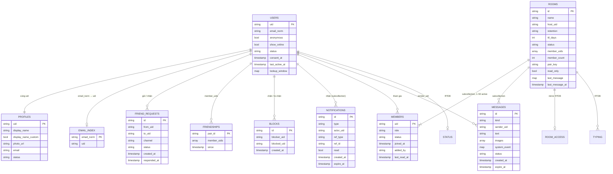

# Database Design

> DBMS: Cloud Firestore Native + Firebase Realtime Database, region `asia-southeast1` (ADR-04, ADR-05) · Chi tiết: `specs/database.md` · Quyết định: Q-043 · Cập nhật: 2026-11-12

## 1. Nguyên tắc thiết kế
- **"Bảng" = collection / subcollection Firestore hoặc node Realtime DB.** Thiết kế theo truy vấn của từng flow, chấp nhận dữ liệu trùng lặp có kiểm soát (`member_uids`, `last_message`, `pair_key`).
- **Naming:** collection `snake_case` số nhiều; field `snake_case`. ID document:
  - `uid` của Firebase Auth cho dữ liệu theo người dùng.
  - ID ghép xác định cho quan hệ cặp: `friendships/{uidMin}_{uidMax}`, `blocks/{blocker}_{blocked}`.
  - Auto-ID của Firestore (20 ký tự ngẫu nhiên) cho còn lại.
- **Timestamp:** kiểu `timestamp` của Firestore (UTC, ghi bằng `serverTimestamp()` ở server), có `created_at`; thêm `updated_at` cho document bị sửa.
- **Ghi:** chỉ server ghi Firestore (Admin SDK, ADR-03). Security Rules: `allow write: if false` cho mọi collection; chỉ khai báo quyền đọc (mục 4.3). Ngoại lệ duy nhất: client ghi node của chính mình trong Realtime DB `status`, `typing` (ADR-05).
- **Soft delete:**
  - **Có**, cho `users` / `profiles` (giữ uid để tin cũ hiển thị "Người dùng đã xóa" – BR-28, nhưng xóa dữ liệu cá nhân) và `rooms` (đánh dấu `deleted` ngay, `purgeRoom` xóa hẳn sau).
  - **Không**, cho quan hệ (bạn bè, chặn): kết thúc = xóa document. Tin nhắn: TTL / thu hồi.
- **Audit:** không có bảng audit (SUP-14 ngoài phạm vi). Cloud Audit Logs ghi truy cập dữ liệu ở cấp project (ADR-07).
- **Multi-tenant:** không.

## 2. ERD

`CONFIG` (`config/limits`) đứng riêng, không có quan hệ.

## 3. Map Entity → Bảng
| ENT | Bảng | Ghi chú (tách/gộp, bảng trung gian...) |
|---|---|---|
| ENT-01 Người dùng | TBL-01 `users`, TBL-02 `profiles`, TBL-03 `email_index` | **Tách** riêng tư / công khai vì Firestore Rules không giới hạn đọc theo field. `email_index` để tra email O(1) và đảm bảo email duy nhất trong tài khoản đang hoạt động |
| ENT-02 Lời mời kết bạn | TBL-04 `friend_requests` | — |
| ENT-03 Link mời | *(không lưu)* | Link tự chứa, mã hóa AES-256-GCM (ADR-08, Q-033). Trạng thái xác định lúc mở link từ TBL-04/05/06 + TBL-01 |
| ENT-04 Quan hệ bạn bè | TBL-05 `friendships` | Bảng trung gian n-n. ID cặp xác định → tối đa 1 quan hệ / cặp. "Đã hủy" = xóa document |
| ENT-05 Quan hệ chặn | TBL-06 `blocks` | Một chiều; hai chiều = 2 document độc lập (BR-14). "Đã bỏ chặn" = xóa document |
| ENT-06 Phòng chat | TBL-07 `rooms` | `member_uids` trùng với TBL-08 để rules và truy vấn danh sách phòng |
| ENT-07 Thành viên phòng | TBL-08 `rooms/{id}/members` | Bảng trung gian n-n; thêm `last_read_at` cho đã xem / chưa đọc |
| ENT-08 Tin nhắn | TBL-09 `rooms/{id}/messages` | Gồm cả tin hệ thống (`kind = system`) |
| ENT-09 Ảnh đính kèm | **Gộp** vào TBL-09 (`images[]`) | ≤10 phần tử, vòng đời theo tin; file ở Cloud Storage `rooms/{roomId}/messages/{messageId}/` |
| ENT-10 Thông báo | TBL-10 `users/{uid}/notifications` | Subcollection theo người nhận → rules đơn giản |
| — (NFR-08) | TBL-11 `config/limits` | Giới hạn chỉnh được không cần deploy |
| — (SUP-09, ADR-05) | TBL-12 RTDB `status`, TBL-13 RTDB `typing`, TBL-14 RTDB `room_access` | Presence, đang soạn, quyền đọc `typing` |

## 4. Quyết định thiết kế
### 4.1 Bảng quyết định
| Chủ đề | Quyết định | Lý do / NFR |
|---|---|---|
| Lưu trạng thái | Field `status` kiểu string với tập giá trị cố định (lấy từ stateDiagram); validate bằng Zod ở server | Firestore không có enum; ghi chỉ qua server |
| Hồ sơ công khai | `profiles` cho `get` mọi người đã đăng nhập, **cấm `list`** → không truy vấn / dò được email; uid chỉ lộ qua bạn bè / chung phòng | BR-04, BR-27, NFR-15, Q-043 |
| Tra email | Server `get email_index/{email_norm}` → `users` → kiểm ẩn danh / chặn / bạn bè; phản hồi đều thời gian tối thiểu | BR-03, BR-04, NFR-15 |
| Giới hạn tra email | `users.lookup_window {start, count}`; quá 100 lượt / giờ → từ chối tới hết cửa sổ | NFR-16 |
| Mỗi chiều 1 lời mời chờ | Kiểm trong transaction: truy vấn `from_uid, to_uid, status = pending` | BR-08 |
| Chờ 24h sau từ chối | Truy vấn lời mời gần nhất `from_uid, to_uid, status = rejected` theo `responded_at desc` | BR-10 |
| Phòng chỉ đọc (BR-13) | Server tính `read_only` khi member_count = 2. `pair_key = uidMin_uidMax` chỉ đặt khi phòng có đúng 2 người → tìm nhanh phòng của một cặp khi hủy bạn / chặn / kết bạn lại | BR-13 |
| Đã xem (BR-26) | Không ghi từng tin. Thành viên X đã xem tin M ⇔ `members/X.last_read_at ≥ M.created_at` | BR-26, tiết kiệm ghi |
| Số chưa đọc (SUP-04) | `count()` tin `kind = user` có `created_at > last_read_at` (Q-047); chạy lại khi `rooms.last_message_at` đổi. Gửi tin thì server cập nhật luôn `last_read_at` của người gửi → tin của mình không bị tính. Badge tổng = tổng các phòng | SUP-04; không fan-out 50 ghi mỗi tin |
| Tin hết hạn | `messages.expire_at` (null nếu phòng lâu dài) + TTL policy; client lọc `expire_at > now` (không lọc trong query) | ADR-09, NFR-19 |
| Thông báo 30 ngày | `notifications.expire_at = created_at + 30 ngày` + TTL policy | NFR-21 |
| Ảnh | Nhúng metadata trong tin; file ở Storage có `customTime = expire_at` (phòng ngắn hạn) | ADR-09, ADR-10 |
| Đổi tên áp dụng cả tin cũ | Tin chỉ lưu `sender_uid`; tên / ảnh lấy từ `profiles` lúc hiển thị | Q-029 |
| Người dùng đã xóa | `profiles.status = deleted`, `display_name = null`, `email = null`, `photo_url = null` → client hiện "Người dùng đã xóa" | BR-28, NFR-18 |
| Chọn host mới khi host xóa tài khoản | Truy vấn `members where status = active order by joined_at asc limit 2` | BR-28 |
| Giới hạn 50 | Kiểm `member_count` trong transaction; giá trị đọc từ `config/limits` | BR-15, NFR-08 |

### 4.2 Index chính (composite)
| Collection | Field | Phục vụ | NFR |
|---|---|---|---|
| `friend_requests` | `to_uid ASC, status ASC, created_at DESC` | Danh sách lời mời đã nhận | NFR-04 |
| `friend_requests` | `from_uid ASC, status ASC, created_at DESC` | Danh sách đã gửi | NFR-04 |
| `friend_requests` | `from_uid ASC, to_uid ASC, status ASC, responded_at DESC` | BR-08, BR-10 | NFR-04 |
| `rooms` | `member_uids ARRAY_CONTAINS, status ASC, last_message_at DESC` | Danh sách phòng | NFR-03 |
| `rooms` | `pair_key ASC, status ASC` | BR-13 | NFR-04 |
| `messages` | `created_at` (single-field, mặc định) | Mở phòng: 50 tin mới nhất | NFR-03 |
| `messages` | `kind ASC, created_at ASC` | Đếm chưa đọc `kind = user, created_at > last_read_at` – không tính tin hệ thống (Q-047) | SUP-04 |
| `members` | `status ASC, joined_at ASC` | Host mới khi xóa tài khoản | — |
| `notifications` | `read ASC, created_at DESC` | Badge + danh sách | SUP-03 |
| `friendships` | `member_uids ARRAY_CONTAINS, since DESC` | Danh sách bạn bè | NFR-04 |
| `blocks` | `blocker_uid ASC, created_at DESC` | Danh sách đã chặn | — |

**Tắt index** cho field lớn, không truy vấn: `messages.text`, `messages.images`, `rooms.last_message`. Giảm chi phí ghi.

### 4.3 Security Rules (đọc)
| Đường dẫn | Cho phép đọc |
|---|---|
| `users/{uid}` | `request.auth.uid == uid` |
| `profiles/{uid}` | `get`: đã đăng nhập · `list`: **không** |
| `email_index/*`, `config/*` | không (chỉ server) — `config/limits` được server trả cho client qua API |
| `friend_requests/{id}` | `from_uid == me` hoặc `to_uid == me` (truy vấn phải lọc theo một trong hai) |
| `friendships/{id}` | `me in member_uids` |
| `blocks/{id}` | `blocker_uid == me` |
| `rooms/{id}` | `me in member_uids` và `status == active` |
| `rooms/{id}/members/*`, `rooms/{id}/messages/*` | `me in get(rooms/{id}).member_uids` |
| `users/{uid}/notifications/*` | `request.auth.uid == uid` |
| RTDB `status/{uid}` | đọc: đã đăng nhập; ghi: `auth.uid == uid` |
| RTDB `typing/{roomId}/{uid}` | đọc: `room_access/{roomId}/{auth.uid}` tồn tại; ghi: `auth.uid == uid` và có quyền như trên |
| RTDB `room_access/*` | không (chỉ server) |

Mọi ghi Firestore: `allow write: if false`.

### 4.4 Rà theo flow (dữ liệu đọc / ghi)
| FLOW | Đọc | Ghi |
|---|---|---|
| FLOW-01 | `users`, `profiles` | `users`, `profiles`, `email_index` (lần đầu); `profiles.photo_url`, `users.last_active_at` |
| FLOW-02 | `users`, `profiles` | `users.anonymous / show_online`, `profiles.display_name` |
| FLOW-03 | `email_index`, `users`, `profiles`, `friendships`, `blocks`, `friend_requests` | `friend_requests` (+ `notifications`), `users.lookup_window`; link: không ghi |
| FLOW-04 | `friend_requests`, `friendships`, `blocks`, `rooms` (pair_key) | `friend_requests`, `friendships`, `rooms.read_only`, `notifications` |
| FLOW-05 | token (giải mã), `users`, `friendships`, `blocks`, `friend_requests` | `friend_requests`, `notifications` |
| FLOW-06 | `friendships`, `rooms` (pair_key) | xóa `friendships`; `rooms.read_only` |
| FLOW-07 | `blocks`, `friendships`, `friend_requests`, `rooms` | `blocks`, xóa `friendships`, `friend_requests.status = closed`, `rooms.read_only` |
| FLOW-08 | `friendships`, `config/limits` | `rooms`, `members`, `messages` (system), `notifications`, RTDB `room_access` |
| FLOW-09 | `rooms`, `members`, `friendships` | `rooms` (name, host, member_uids, member_count, pair_key, read_only, status), `members`, `messages` (system), `notifications`, RTDB `room_access`; giải tán → task `purgeRoom` |
| FLOW-10 | `rooms`, `members`, `messages`, `profiles`, RTDB `status` / `typing` | `messages`, `rooms.last_message*`, `members.last_read_at`, Storage; RTDB `typing` |
| FLOW-11 | `users`, `rooms`, `members` | `users.status`, `profiles` (xóa dữ liệu cá nhân), xóa `email_index`; task `purgeAccount` → `members`, `rooms`, `friendships`, `friend_requests`, `blocks`, `notifications`, RTDB |
| FLOW-12 | `notifications`, `friend_requests`, `rooms` | `notifications.read / read_at` |

Kết quả: mọi dữ liệu đọc / ghi trong 12 flow đều có chỗ lưu.

## 5. Data lifecycle
| Dữ liệu | Giữ bao lâu | Cơ chế | NFR |
|---|---|---|---|
| Tin + ảnh phòng ngắn hạn | Tới `expire_at`; xóa hẳn ≤24h sau | Firestore TTL + Storage lifecycle `daysSinceCustomTime: 0` | NFR-19 |
| Tin + ảnh phòng lâu dài | Vĩnh viễn, tới khi thu hồi (ảnh) / giải tán | — | BR-16 |
| Ảnh của tin bị thu hồi | Xóa ngay | API xóa file, `images = []` | BR-22 |
| Phòng giải tán / host cuối rời | `status = deleted` ngay; xóa hẳn trong vài phút | `purgeRoom` | BR-19, NFR-19 |
| Thông báo | 30 ngày | TTL `expire_at` | NFR-21 |
| Ảnh upload tạm | 1 ngày | Storage lifecycle `age: 1` trên `uploads/` | ADR-10 |
| Lời mời đã kết thúc (accepted / rejected / withdrawn / closed) | 30 ngày (Q-043) | TTL `expire_at` đặt khi kết thúc; cần ≥24h cho BR-10 | BR-10 |
| Tài khoản đã xóa | Dữ liệu cá nhân xóa ngay khỏi `profiles`, `users`, `email_index`; `purgeAccount` dọn quan hệ ≤24h; còn lại `profiles/{uid}` rỗng (status deleted) để tin cũ hiển thị | `purgeAccount` | BR-28, NFR-18 |
| Bản sao lưu | 7 ngày | Firestore scheduled backup | NFR-18, NFR-19, NFR-20 |
| RTDB `typing` | Vài giây | Client xóa khi ngừng soạn; `onDisconnect().remove()` | SUP-09 |

## 6. Migration & seed
- **Seed** `config/limits`: `max_room_members 50`, `max_images_per_message 10`, `max_image_bytes_per_message 10485760`, `invite_ttl_days 7`, `notification_ttl_days 30`, `email_lookups_per_hour 100`, `reject_cooldown_hours 24`, `max_message_chars 1000`, `ended_request_ttl_days 30`, `display_name_max 50`, `room_name_max 50`, `session_idle_days 30`, `ttl_days_options [1, 2, 3, 7, 30, 90]`.
- **Cấu hình một lần:**
  - TTL policy trên collection group `messages` (`expire_at`), `notifications` (`expire_at`), `friend_requests` (`expire_at`).
  - Storage lifecycle rules (`rooms/` theo `daysSinceCustomTime: 0`; `uploads/` theo `age: 1`).
  - Composite index trong `firestore.indexes.json`; tắt index cho các field ở 4.2.
  - Scheduled backup hằng ngày, giữ 7 ngày.
- **Migration:** Firestore không có schema. Thay đổi cấu trúc dùng field `schema_version` trên document khi cần + script migrate bằng Admin SDK. MVP bắt đầu `schema_version = 1` ở `rooms`, `messages`.
