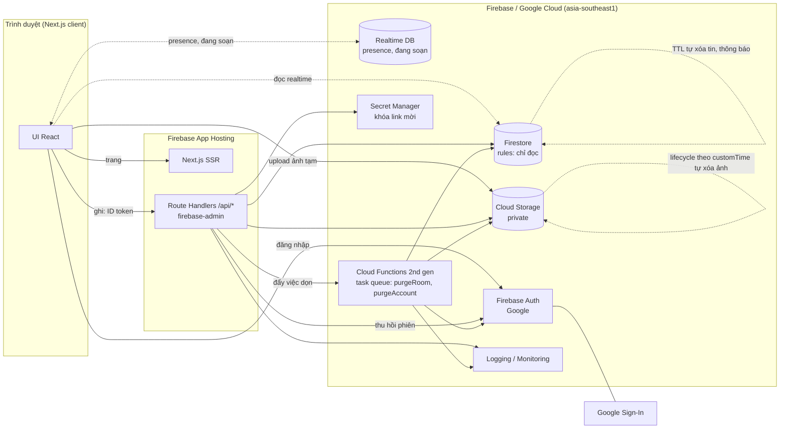

# Tech Stack

> Nguồn: `idea/business.md`, `idea/business-flows.md` (NFR, SUP) · Quyết định: Q-038, Q-040 → Q-042 · Cập nhật: 2026-11-12

## 1. Ràng buộc đầu vào
| Ràng buộc | Giá trị | Nguồn (Q-xxx / NFR-xx) |
|---|---|---|
| Kỹ năng team | TypeScript / Node.js | Q-040 |
| Ngân sách / hạ tầng | Firebase: Firestore, Firebase Storage, Firebase App Hosting (dịch vụ quản lý sẵn, ít tự vận hành) | Q-040 |
| Nền tảng client | Web responsive, ưu tiên điện thoại (từ 360px); Chrome/Edge/Firefox/Safari 2 bản mới nhất, Safari iOS 16+ | Q-038, NFR-22, NFR-25 |
| Quy mô user / tải | 1k–10k người dùng, 1k online cùng lúc, 200k tin/ngày; mở rộng tới 100k không đổi kiến trúc | Q-038, NFR-07 |
| Deadline / time-to-market | Cân bằng: ra MVP nhanh nhưng đủ sạch để mở rộng và thêm phần game sau | Q-040 |
| Bảo mật | Ghi qua server; mã hóa mặc định của Google + TLS; không mã hóa đầu-cuối | Q-041, NFR-12 |
| Tích hợp ngoài | Chỉ Google Sign-In | BR-01 |
| Ngôn ngữ | Chỉ tiếng Việt | NFR-24 |

### Đặc điểm kỹ thuật rút ra từ nghiệp vụ
| Đặc điểm | Nguồn | Hệ quả kỹ thuật |
|---|---|---|
| Realtime: tin mới, thu hồi, đã xem, đang soạn, online | SUP-09, NFR-01, NFR-02 | Firestore realtime listener cho dữ liệu; Realtime Database cho presence / đang soạn (có `onDisconnect`) |
| Xóa theo thời gian: tin hết hạn, thông báo 30 ngày | SUP-05, SUP-06, NFR-19, NFR-21 | Firestore TTL policy (tin, thông báo) + Storage lifecycle theo `customTime` (ảnh) + client lọc theo `expireAt` để biến mất ≤1 phút |
| Ảnh ≤10 ảnh / 10MB mỗi tin, riêng tư | SUP-08, NFR-05, NFR-13 | Cloud Storage private; upload tạm + server duyệt; đọc bằng signed URL ≤1 giờ |
| Logic quyền phức tạp (BR-04, BR-13, BR-14, BR-18) | business.md | Logic tập trung ở server (Admin SDK), Security Rules chỉ cho đọc |
| Hệ quả dây chuyền (chặn, xóa tài khoản) | FLOW-07, FLOW-11 | Firestore transaction / batched write; xóa tài khoản xử lý nền theo lô |
| Dữ liệu quan hệ vừa phải, không có tiền | business.md | Document DB (Firestore) đủ; không cần ACID đa bảng phức tạp ngoài transaction của Firestore |
| Không lộ sự tồn tại tài khoản | BR-04, NFR-15 | Tra email chỉ qua server, thời gian phản hồi được làm đều |
| Link mời tự chứa | SUP-07, NFR-14 | Mã hóa có xác thực (AES-256-GCM), khóa ở Secret Manager |

## 2. Stack đã chọn
Phiên bản: dùng bản ổn định mới nhất trong nhánh ghi dưới đây lúc khởi tạo repo, **pin chính xác trong `package.json`**.

| Layer | Công nghệ | Phiên bản | Lý do (ADR) |
|---|---|---|---|
| Ngôn ngữ | TypeScript | 5.x | ADR-02 |
| Runtime | Node.js | 22 LTS (runtime được App Hosting và Cloud Functions 2nd gen hỗ trợ) | ADR-02 |
| Frontend | Next.js (App Router) + React | Next.js 16.x, React 19.x | ADR-02 |
| UI | Tailwind CSS + shadcn/ui (Radix) | Tailwind 4.x | ADR-02, NFR-22, NFR-23 |
| Validation | Zod (dùng chung client & server) | 3.x | ADR-03 |
| Backend (ghi) | Next.js **Server Actions** (mặc định) chạy trên App Hosting + `firebase-admin`; Route Handlers `/api/*` chỉ khi cần endpoint HTTP | firebase-admin 13.x | ADR-03 |
| Backend (nền) | Cloud Functions for Firebase 2nd gen — **chỉ 2 task queue function**: `purgeRoom`, `purgeAccount` | firebase-functions 6.x | ADR-11 |
| Database | Cloud Firestore (Native mode), region `asia-southeast1` | — | ADR-04 |
| Presence / đang soạn | Firebase Realtime Database, region `asia-southeast1` | — | ADR-05 |
| Client SDK | Firebase JS SDK (modular) | 12.x | ADR-03 |
| Auth | Firebase Authentication — Google provider | — | ADR-06 |
| Storage | Cloud Storage for Firebase (bucket private, cùng region) | — | ADR-10 |
| Bí mật | Google Secret Manager (khóa link mời) | — | ADR-08 |
| Hosting / Deploy | Firebase App Hosting (nối GitHub, tự build & deploy nhánh `main`) | — | ADR-02 |
| CI | GitHub Actions: lint, typecheck, Vitest, test Security Rules trên Firebase Emulator Suite, Playwright e2e | — | ADR-12 |
| Theo dõi | Cloud Logging, Error Reporting, Cloud Monitoring alert | — | ADR-12, NFR-26 |
| Sao lưu | Firestore scheduled backup hằng ngày, giữ 7 ngày | — | ADR-12, NFR-20 |
| Supporting | Thông báo in-app = collection Firestore (SUP-01→03); push sau này = Firebase Cloud Messaging (SUP-10) | — | mục 5 |

**Ước tính chi phí** ở 10k người dùng / 200k tin mỗi ngày: khoảng 50–150 USD/tháng, chủ yếu là lượt đọc Firestore và tiền chạy App Hosting. Cần đo lại sau khi `db-design` chốt cách đếm tin chưa đọc.

## 3. Kiến trúc tổng quan

**Nguyên tắc:**
1. Client **chỉ đọc** Firestore qua listener, giới hạn bởi Security Rules: thành viên đang tham gia mới đọc được phòng và tin; mỗi người chỉ đọc hồ sơ riêng, bạn bè, lời mời và thông báo của mình.
2. Mọi thao tác **ghi** đi qua `/api/*`. Server xác thực ID token, kiểm BR trong transaction, ghi bằng Admin SDK.
3. Xóa theo hạn do **Firestore TTL** và **Storage lifecycle** tự làm, không cần code. Chỉ 2 việc dài (dọn phòng giải tán, dọn tài khoản đã xóa) do Cloud Functions task queue làm (Q-042).

## 4. Architecture Decision Records

### ADR-01 Nền tảng Firebase
- **Bối cảnh:** Team TypeScript, cần realtime chat, muốn ít vận hành; user chỉ định Firestore + Storage + App Hosting (Q-040).
- **Các phương án:** A. Firebase (managed, realtime sẵn, phụ thuộc Google) · B. Cloud tự dựng: Postgres + WebSocket server (linh hoạt, nhiều vận hành) · C. Supabase (Postgres + realtime, phụ thuộc nhà cung cấp khác).
- **Quyết định:** A — Firebase.
- **Hệ quả:** Realtime và auth có sẵn. Mô hình dữ liệu NoSQL, phải thiết kế theo truy vấn và chấp nhận dữ liệu trùng lặp (vd tóm tắt phòng). Ràng buộc vendor lock-in vào Google Cloud.
- **Ref:** Q-040, NFR-01, NFR-07

### ADR-02 Frontend & hosting: Next.js trên Firebase App Hosting
- **Bối cảnh:** Web responsive, team TS, App Hosting hỗ trợ Next.js chính thức.
- **Các phương án:** A. Next.js App Router (SSR + route handlers cùng một app) · B. React SPA (Vite) + Firebase Hosting + Functions làm API · C. Angular.
- **Quyết định:** A — Next.js App Router + React + Tailwind + shadcn/ui, deploy bằng App Hosting nối GitHub.
- **Hệ quả:** Một repo, một ngôn ngữ cho cả UI lẫn API. Trang công khai (đăng nhập, mở link mời) render ở server để mở nhanh (NFR-06). Toàn bộ chữ giao diện tách ra một file từ điển tiếng Việt (NFR-24).
- **Ref:** Q-038, Q-040, NFR-06, NFR-22

### ADR-03 Đường ghi qua server, client chỉ đọc realtime
- **Bối cảnh:** Nghiệp vụ có nhiều quy tắc chéo: BR-04 không lộ tài khoản, BR-13 chỉ đọc, BR-14 chặn hai chiều, BR-18 quyền host, BR-15 giới hạn 50, hệ quả dây chuyền khi chặn hoặc xóa tài khoản.
- **Các phương án:** A. Ghi qua server · B. Ghi trực tiếp từ client, Security Rules kiểm quyền · C. Lai.
- **Quyết định:** A (Q-041).
  - Ghi qua **Server Actions** (mặc định). Route Handlers `/api/*` chỉ viết khi cần endpoint HTTP (client ngoài Next, webhook) hoặc khi được yêu cầu rõ. Cả hai là adapter mỏng gọi chung một lớp service: xác thực phiên, validate bằng Zod, kiểm BR trong Firestore transaction bằng `firebase-admin`.
  - `specs/api-contract.yml` vẫn là nguồn chuẩn cho operation, schema và mã lỗi. Mỗi `operationId` tương ứng một Server Action `<operationId>Action`, trả `ActionResult<T>` = `{ok:true,data}` hoặc `{ok:false,error:Error}`.
  - Security Rules: **cấm mọi ghi từ client**; chỉ cho đọc theo quyền.
  - *Cập nhật 2026-11-14:* đổi transport mặc định từ Route Handlers sang Server Actions (quyết định khi lập bộ skill coding).
- **Hệ quả:** Logic nghiệp vụ nằm một chỗ, test được bằng unit test và emulator. Gửi tin thêm một chặng mạng (khoảng 50–150ms), vẫn trong NFR-01 ≤1s. Không dùng offline write của Firestore; tin gửi lỗi xử lý theo FLOW-10a E3.
- **Ref:** Q-041, NFR-01, NFR-13

### ADR-04 Database: Cloud Firestore Native, `asia-southeast1`
- **Bối cảnh:** Người dùng ở Việt Nam; cần realtime listener; quy mô vừa.
- **Các phương án:** Region `asia-southeast1` (Singapore, gần VN nhất) · `asia-east1` · multi-region (giá cao, không cần cho 99,5%).
- **Quyết định:** Firestore Native, region `asia-southeast1`. Realtime DB và Storage đặt cùng region.
- **Hệ quả:**
  - Độ trễ mạng từ VN khoảng 30–60ms.
  - Firestore regional có SLA 99,99%, đáp ứng NFR-09.
  - **Lưu ý NĐ 13/2023:** dữ liệu cá nhân lưu ở Singapore là chuyển dữ liệu ra nước ngoài. Phải lập hồ sơ đánh giá tác động chuyển dữ liệu (NFR-17). Đây là việc pháp lý, không chặn thiết kế.
- **Ref:** NFR-07, NFR-09, NFR-17

### ADR-05 Presence & "đang soạn" bằng Realtime Database
- **Bối cảnh:** Firestore không có cơ chế báo mất kết nối, nên không biết chính xác ai offline. Trạng thái "đang soạn" thay đổi rất nhanh, ghi vào Firestore thì tốn tiền.
- **Các phương án:** A. Realtime Database với `onDisconnect` · B. Firestore + heartbeat định kỳ (tốn ghi, trễ) · C. Bỏ presence.
- **Quyết định:** A.
  - Node `status/{uid}` và `typing/{roomId}/{uid}`.
  - Server hoặc client lọc theo quyền xem (BR-25: chỉ bạn bè và người chung phòng) và theo cài đặt hiển thị online.
  - RTDB Security Rules: mỗi người chỉ ghi node của chính mình; chỉ đọc `typing` của phòng mình là thành viên. Danh sách phòng của user được đồng bộ sang RTDB, đây là ngoại lệ có kiểm soát của ADR-03.
- **Hệ quả:** Thêm một dịch vụ nữa. `typing` là dữ liệu tạm, không cần đi qua server; client ghi trực tiếp vào node của mình.
- **Ref:** SUP-09, NFR-02, BR-25

### ADR-06 Xác thực: Firebase Authentication (Google) + phiên 30 ngày
- **Bối cảnh:** BR-01 chỉ Google; NFR-11 phiên hết sau 30 ngày không dùng; đăng xuất / xóa tài khoản kết thúc phiên ngay.
- **Quyết định:**
  - Firebase Auth với Google provider, đăng nhập bằng popup trên desktop, redirect trên điện thoại.
  - Server lưu `lastActiveAt` của người dùng. Quá 30 ngày → `revokeRefreshTokens` và bắt đăng nhập lại.
  - Đăng xuất và xóa tài khoản gọi `revokeRefreshTokens`.
  - *Cập nhật 2026-11-14 (theo ADR-03):* Server Action không có header `Authorization` → dùng **Firebase session cookie** tên `__session` (App Hosting chỉ forward cookie này), `httpOnly`, `secure`, `sameSite=lax`. Đăng nhập: client lấy ID token → action `createSession` → `createSessionCookie` (tối đa 14 ngày). Mỗi request server kiểm `verifySessionCookie(cookie, checkRevoked=true)`. Cookie hết hạn nhưng Firebase client còn đăng nhập → client tự tạo lại phiên. Mốc 30 ngày không dùng vẫn tính theo `users.last_active_at`. Route Handler (nếu có) chấp nhận cookie hoặc `Authorization: Bearer <idToken>`.
  - Lần đầu đăng nhập: bắt đồng ý chính sách quyền riêng tư trước khi tạo hồ sơ (NFR-17).
- **Hệ quả:** Không tự quản lý mật khẩu. Tài khoản Firebase Auth bị xóa khi xóa tài khoản Buddio; đăng nhập lại tạo `uid` mới, đúng với BR-28.
- **Ref:** BR-01, BR-28, NFR-11, NFR-17

### ADR-07 Mã hóa: mặc định của Google + TLS
- **Bối cảnh:** BR-23 / NFR-12 yêu cầu mã hóa khi lưu và khi truyền, không cần đầu-cuối.
- **Các phương án:** A. Mã hóa mặc định của Google (AES-256, khóa Google quản lý) + TLS · B. Thêm mã hóa cấp ứng dụng bằng Cloud KMS · C. CMEK.
- **Quyết định:** A (Q-041).
- **Hệ quả:**
  - Giữ được realtime listener trực tiếp. Khóa tách biệt khỏi dữ liệu do Google quản lý; bản sao dữ liệu đánh cắp từ ổ đĩa không đọc được.
  - Người có quyền IAM trên project vẫn đọc được nội dung → **giới hạn IAM tối thiểu**, bật Cloud Audit Logs cho truy cập dữ liệu.
  - Nâng lên CMEK sau này không phải đổi mô hình dữ liệu.
- **Ref:** Q-038, Q-041, NFR-12, NFR-27

### ADR-08 Link mời tự chứa: AES-256-GCM, khóa ở Secret Manager
- **Bối cảnh:** SUP-07 / Q-033 / Q-036 yêu cầu link chứa người mời, email và hạn dùng; tạo link không lưu gì; email không đọc được; link không sửa hay giả mạo được (NFR-14).
- **Các phương án:** A. AES-256-GCM (mã hóa + xác thực trong một bước) · B. JWT ký HMAC (email phải mã hóa thêm, JWE phức tạp) · C. Lưu link vào DB (trái Q-033).
- **Quyết định:** A.
  - Payload `{v, inviterUid, emailNorm, exp}` → AES-256-GCM với nonce ngẫu nhiên 96-bit → base64url → `/invite/{token}`.
  - Khóa lấy từ Secret Manager, có `v` (phiên bản khóa) để xoay khóa.
- **Hệ quả:**
  - Server giải mã khi mở link; sai khóa hoặc bị sửa → coi như "Link không còn hiệu lực".
  - Hiệu lực còn lại (bạn bè, chặn, người mời còn hoạt động) kiểm lúc mở (FLOW-05).
  - Link dài khoảng 120–150 ký tự, chấp nhận được.
- **Ref:** Q-033, Q-036, SUP-07, NFR-14

### ADR-09 Xóa theo hạn: Firestore TTL (tin, thông báo) + Storage lifecycle theo `customTime` (ảnh)
- **Bối cảnh:** Tin hết hạn phải biến mất khỏi màn hình ≤1 phút và xóa hẳn ≤24h (NFR-19); thông báo xóa sau 30 ngày (NFR-21); ảnh phải xóa cùng tin.
- **Các phương án:** A. Firestore TTL + trigger `onDocumentDeleted` xóa ảnh · B. Firestore TTL + Storage lifecycle theo `customTime` (đề xuất của user, Q-042) · C. Function chạy theo lịch quét và xóa (tốn lượt đọc, phức tạp).
- **Quyết định:** B.
  - **Tin:** TTL policy trên `messages.expireAt`. **Thông báo:** TTL trên `notifications.expireAt = createdAt + 30 ngày`.
  - **Ảnh phòng ngắn hạn:** khi chuyển ảnh vào `rooms/{roomId}/messages/{messageId}/`, API đặt metadata `customTime = expireAt` của tin. Bucket có lifecycle rule `{action: Delete, condition: {daysSinceCustomTime: 0, matchesPrefix: ["rooms/"]}}`. Phòng lâu dài không đặt `customTime`, ảnh được giữ.
  - **Client:** truy vấn `expireAt > now` và hẹn giờ ẩn tin đúng lúc hết hạn → biến mất ≤1 phút.
  - **Signed URL** đọc ảnh hết hạn tại `min(1 giờ, expireAt)`; API không cấp URL cho tin đã quá hạn.
  - **Ngoại lệ phải xóa chủ động** (vì `customTime` không lùi được): thu hồi tin → API xóa ảnh ngay; giải tán phòng / xóa tài khoản → `purgeRoom` / `purgeAccount` (ADR-11).
- **Hệ quả:** Không cần trigger hay job xóa theo hạn, Google tự xóa trong ≤24h (đúng NFR-19). TTL và lifecycle độc lập với nhau: nếu một bên trễ thì vẫn không lộ dữ liệu vì client lọc và URL hết hạn.
- **Ref:** Q-042, SUP-05, SUP-06, SUP-08, NFR-19, NFR-21

### ADR-10 Ảnh: Storage private, upload tạm, đọc bằng signed URL
- **Bối cảnh:** Ảnh chỉ thành viên đang tham gia được xem (NFR-13); ≤10 ảnh và ≤10MB mỗi tin, chỉ chấp nhận ảnh (BR-21).
- **Quyết định:**
  - Client upload vào `uploads/{uid}/{uuid}`. Storage Rules: chỉ chủ sở hữu, `contentType` là `image/*`, mỗi tệp ≤10MB.
  - API gửi tin kiểm tra tổng ≤10MB, ≤10 ảnh, đúng định dạng ảnh, rồi chuyển ảnh sang `rooms/{roomId}/messages/{messageId}/`.
  - Đọc ảnh: API cấp signed URL hết hạn sau 1 giờ, chỉ cho thành viên đang tham gia. Ảnh tạm không dùng tự xóa sau 1 ngày bằng lifecycle rule `{age: 1, matchesPrefix: ["uploads/"]}`.
- **Hệ quả:** Không có link ảnh công khai. Ảnh xem trước (NFR-05) tạo phía client trước khi upload; (Q-042) chưa cần dịch vụ resize ảnh ở MVP.
- **Ref:** SUP-08, BR-21, NFR-05, NFR-13

### ADR-11 Xử lý nền: 2 Cloud Functions task queue
- **Bối cảnh:** Xóa tài khoản (FLOW-11) và giải tán phòng (FLOW-09f) có thể đụng hàng nghìn tài liệu và ảnh, vượt giới hạn 500 ghi mỗi transaction và thời gian của một request. Xóa theo hạn đã giao cho TTL và lifecycle (ADR-09), nên không cần trigger.
- **Các phương án:** A. Cloud Functions task queue · B. Cloud Tasks gọi `/api/tasks/*` trên App Hosting (tự cấu hình queue, xác thực OIDC).
- **Quyết định:** A (Q-042). Chỉ 2 function:
  | Function | Được đẩy bởi | Việc |
  |---|---|---|
  | `purgeRoom` | API giải tán phòng; host duy nhất rời phòng; `purgeAccount` | Xóa theo lô: tin, thành viên, ảnh dưới prefix `rooms/{roomId}/` |
  | `purgeAccount` | API xóa tài khoản | Theo FLOW-11: rời từng phòng (chuyển host cho người vào sớm nhất, tạo tin hệ thống, thông báo SUP-02), hủy bạn bè, đóng lời mời, xóa quan hệ chặn, xóa Firebase Auth user |
  - API làm phần tức thì trong transaction (đổi trạng thái người dùng / phòng thành Đã xóa, thu hồi phiên), rồi đẩy task.
  - Task idempotent, xử lý theo lô ≤500, có retry và giới hạn tốc độ.
- **Không dùng Functions cho:** mọi thao tác người dùng (ADR-03); phiên quá 30 ngày được kiểm tra ngay trong API (`lastActiveAt`).
- **Hệ quả:** Người dùng thấy kết quả ngay; dọn dẹp xong trong vài phút (NFR-18 ≤24h).
- **Ref:** Q-042, FLOW-09f, FLOW-11, NFR-18

### ADR-12 Vận hành: CI, sao lưu, theo dõi
- **Quyết định:**
  - **CI:** GitHub Actions chạy lint, typecheck, Vitest, test Security Rules trên Emulator Suite, Playwright e2e. App Hosting tự deploy từ `main`; Functions và Rules deploy bằng `firebase deploy` trong CI.
  - **Sao lưu:** Firestore scheduled backup hằng ngày, giữ 7 ngày (RPO 24h). Tài liệu khôi phục về database mới trong ≤4h (RTO). Dữ liệu đã xóa sẽ hết khỏi backup sau ≤7 ngày (NFR-18, NFR-19).
  - **Theo dõi:** log có cấu trúc, **không ghi nội dung tin / email dạng đọc được** (NFR-27). Error Reporting. Cloud Monitoring alert cho các ngưỡng ở NFR-26.
  - **Uptime:** uptime check endpoint `/api/health`.
- **Ref:** NFR-09, NFR-18, NFR-20, NFR-26, NFR-27

## 5. Map Supporting → giải pháp kỹ thuật
| SUP | Giải pháp |
|---|---|
| SUP-01 Thông báo kết bạn | API tạo document `notifications` cùng transaction với lời mời / phản hồi; client nghe realtime |
| SUP-02 Thông báo sự kiện phòng | API (thêm, kick, chuyển host, giải tán) và function `purgeAccount` (tự chuyển host) tạo `notifications` |
| SUP-03 Danh sách thông báo & đã đọc | Listener `notifications` của user sắp theo thời gian; badge = count chưa đọc; API đánh dấu đã đọc |
| SUP-04 Tóm tắt phòng & số chưa đọc | Tin cuối ghi vào phòng cùng transaction gửi tin; số chưa đọc tính từ thời điểm đọc cuối của từng thành viên (chi tiết ở `db-design`) |
| SUP-05 Tự xóa tin & ảnh hết hạn | Firestore TTL `expireAt` (tin) + Storage lifecycle `daysSinceCustomTime: 0` (ảnh) + client lọc / hẹn giờ ẩn (ADR-09) |
| SUP-06 Dọn thông báo cũ | Firestore TTL `expireAt = createdAt + 30 ngày` (ADR-09) |
| SUP-07 Link mời tự chứa | AES-256-GCM, khóa ở Secret Manager (ADR-08) |
| SUP-08 Lưu trữ ảnh | Cloud Storage private, upload tạm, signed URL `min(1h, expireAt)`; xóa: lifecycle theo `customTime`, thu hồi → API xóa, giải tán → `purgeRoom` (ADR-09, ADR-10, ADR-11) |
| SUP-09 Cập nhật tức thời | Firestore listener (tin, thu hồi, đã xem, thành viên, phòng) + Realtime Database (online, đang soạn) (ADR-05) |
| SUP-10 Push (sau MVP) | Firebase Cloud Messaging; thông báo đã là document riêng nên chỉ cần thêm trigger gửi push, không sửa SUP-01/02 |
| NFR-15 / NFR-16 | API tra email: phản hồi được làm đều về thời gian tối thiểu cố định; bộ đếm tra theo giờ của từng người dùng |
