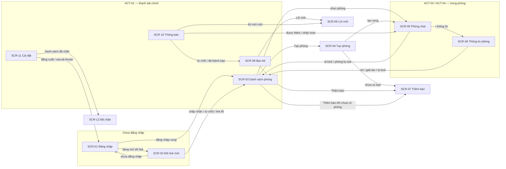

# Wireframe — Danh sách màn hình & điều hướng

> Nguồn: `idea/business-flows.md`, `specs/tech-stack.md` (web responsive, mobile-first – NFR-22), `specs/database.md` · Cập nhật: 2026-11-12

## 1. Danh sách màn hình
| ID | Tên màn | Actor | BIZ / SUP thể hiện | FLOW | Chi tiết |
|---|---|---|---|---|---|
| SCR-01 | Đăng nhập | ACT-01, ACT-02 | BIZ-01 | FLOW-01 | [scr-01-login.md](./scr-01-login.md) |
| SCR-02 | Mở link mời | ACT-02, ACT-01 | BIZ-05, BIZ-04, BIZ-07 | FLOW-05, FLOW-04 | [scr-02-invite-link.md](./scr-02-invite-link.md) |
| SCR-03 | Danh sách phòng (trang chính) | ACT-01 | BIZ-10, SUP-04, SUP-09 | FLOW-10a | [scr-03-room-list.md](./scr-03-room-list.md) |
| SCR-04 | Tạo phòng | ACT-01 → ACT-03 | BIZ-08 | FLOW-08 | [scr-04-create-room.md](./scr-04-create-room.md) |
| SCR-05 | Phòng chat | ACT-03, ACT-04 | BIZ-10, SUP-05, SUP-08, SUP-09 | FLOW-10a/b/c | [scr-05-chat-room.md](./scr-05-chat-room.md) |
| SCR-06 | Thông tin phòng & thành viên | ACT-03, ACT-04 | BIZ-09, BIZ-07 | FLOW-09a–f, FLOW-07a | [scr-06-room-info.md](./scr-06-room-info.md) |
| SCR-07 | Thêm bạn (tra email) | ACT-01 | BIZ-03, SUP-07 | FLOW-03 | [scr-07-add-friend.md](./scr-07-add-friend.md) |
| SCR-08 | Bạn bè | ACT-01 | BIZ-06, BIZ-07 | FLOW-06, FLOW-07a | [scr-08-friends.md](./scr-08-friends.md) |
| SCR-09 | Lời mời kết bạn (Đã nhận / Đã gửi) | ACT-01 | BIZ-04, BIZ-03, BIZ-07 | FLOW-04, FLOW-03 A3/A6, FLOW-07a | [scr-09-friend-requests.md](./scr-09-friend-requests.md) |
| SCR-10 | Thông báo | ACT-01 | SUP-01, SUP-02, SUP-03 | FLOW-12 | [scr-10-notifications.md](./scr-10-notifications.md) |
| SCR-11 | Cài đặt tài khoản | ACT-01 | BIZ-02, BIZ-11, BIZ-01 (đăng xuất) | FLOW-02, FLOW-11, FLOW-01 A1 | [scr-11-settings.md](./scr-11-settings.md) |
| SCR-12 | Danh sách đã chặn | ACT-01 | BIZ-07 | FLOW-07b | [scr-12-blocked-users.md](./scr-12-blocked-users.md) |

**Dialog / modal (không tách màn):**
- Đồng ý chính sách (SCR-01).
- Xác nhận hủy kết bạn / chặn (SCR-06, SCR-08, SCR-09).
- Thêm thành viên, chuyển quyền host, rời phòng (host chọn người nhận), giải tán (SCR-06).
- Xem ảnh lớn (SCR-05).
- Xác nhận xóa tài khoản (SCR-11).

## 2. Sơ đồ điều hướng

## 3. Bảng chuyển màn
| Từ | Hành động | Đến | Điều kiện |
|---|---|---|---|
| (vào app) | Mở Buddio | SCR-01 / SCR-03 | Chưa đăng nhập → SCR-01; đã đăng nhập → SCR-03 (**landing của ACT-01**) |
| (link ngoài) | Mở `/invite/{token}` | SCR-02 | **Landing của ACT-02** |
| SCR-01 | Đăng nhập xong | SCR-03 | Không có link đang mở dở |
| SCR-01 | Đăng nhập xong | SCR-02 | Đang mở dở link mời (FLOW-01 bước 9) |
| SCR-02 | Bấm "Đăng nhập với Google" | SCR-01 | Chưa đăng nhập (giữ `token` để quay lại) |
| SCR-02 | Chấp nhận / Từ chối / "Vào Buddio" | SCR-03 | — |
| SCR-02 | Chặn | SCR-03 | Sau xác nhận |
| SCR-03 | Chọn một phòng | SCR-05 | — |
| SCR-03 | Bấm "Tạo phòng" | SCR-04 | — |
| SCR-03 | Trạng thái rỗng → "Thêm bạn" | SCR-07 | Chưa có phòng nào |
| SCR-04 | Tạo thành công | SCR-05 | — |
| SCR-04 | Chưa có bạn → "Mời bạn" | SCR-07 | FLOW-08 E1 |
| SCR-05 | Bấm tên phòng / ℹ | SCR-06 | — |
| SCR-05 | Bị kick / phòng bị giải tán (realtime) | SCR-03 | Kèm thông báo (FLOW-10a E2) |
| SCR-06 | Rời phòng / giải tán thành công | SCR-03 | — |
| SCR-06 | Quay lại | SCR-05 | — |
| SCR-08 | Bấm "Thêm bạn" | SCR-07 | — |
| SCR-08 | Bấm "Lời mời" (có badge số đang chờ) | SCR-09 | — |
| SCR-07 | Trường hợp c (đang chờ) → "Xem lời mời đã gửi" | SCR-09 | Tab Đã gửi |
| SCR-09 | Từ chối nhưng đã là bạn → "Hủy kết bạn" | SCR-08 | FLOW-04 A1 (mở dialog hủy kết bạn) |
| SCR-10 | Chọn thông báo lời mời mới | SCR-09 | Tab Đã nhận |
| SCR-10 | Chọn "được thêm vào phòng" / "nhận quyền host" | SCR-05 | Phòng còn và mình còn là thành viên; ngược lại báo "Nội dung không còn hiệu lực" |
| SCR-10 | Chọn "bị từ chối" / "đã thành bạn" | SCR-08 | — |
| SCR-11 | Bấm "Danh sách đã chặn" | SCR-12 | — |
| SCR-11 | Đăng xuất / xóa tài khoản xong | SCR-01 | — |

**Kiểm tra:** mọi màn của ACT-01 đến được từ SCR-03 qua thanh tab; SCR-02 là điểm vào riêng của ACT-02. 11/11 BIZ có actor là người đều có ≥1 màn.

## 4. Thao tác trên từng màn (nguồn chung cho API & UI)
Cột **Kênh** cho biết thao tác đi đường nào theo ADR-03 / ADR-05 / ADR-10:
- `API`: ghi, hoặc đọc cần server.
- `FS`: client đọc realtime Firestore, không có endpoint.
- `RTDB`: Realtime Database.
- `ST`: upload Cloud Storage.
- `NAV`: chỉ điều hướng.

| SCR | Mã thao tác | Thao tác | Kênh | Dữ liệu cần (đọc/ghi) | BIZ | operationId (điền ở api-contract) |
|---|---|---|---|---|---|---|
| LAYOUT | LAYOUT.A1 | Tải hồ sơ của tôi + giới hạn cấu hình (khởi động app) | API | đọc: TBL-01, TBL-02, TBL-11; ghi: `users.last_active_at`, kiểm phiên 30 ngày | BIZ-01, BIZ-02 | `getMe` |
| LAYOUT | LAYOUT.A2 | Badge số thông báo chưa đọc | FS | đọc: TBL-10 (`read = false`) | SUP-03 | — (FS) |
| LAYOUT | LAYOUT.A3 | Badge tổng tin chưa đọc + số lời mời đang chờ | FS | đọc: TBL-07, TBL-08, TBL-09 (count), TBL-04 (`to_uid = me, pending`) | SUP-04, BIZ-04 | — (FS) |
| LAYOUT | LAYOUT.A4 | Ghi trạng thái online (nếu `show_online`) | RTDB | ghi: TBL-12 | BIZ-02, SUP-09 | — (RTDB) |
| SCR-01 | SCR-01.A1 | Đăng nhập với Google | API | Google ID token → ghi TBL-01, TBL-02, TBL-03 (lần đầu) / cập nhật ảnh, `last_active_at` | BIZ-01 | `createSession` |
| SCR-01 | SCR-01.A2 | Đồng ý chính sách quyền riêng tư (lần đầu) | API | ghi: `users.consent_at`, tạo TBL-01/02/03 | BIZ-01 | `createAccount` |
| SCR-02 | SCR-02.A0 | Kiểm tra link & lấy / tạo lời mời | API | đọc: token, TBL-01, TBL-05, TBL-06, TBL-04; ghi: TBL-04 (`link`, pending), TBL-10 | BIZ-05 | `openInviteLink` |
| SCR-02 | SCR-02.A1 | Đăng nhập với Google | NAV | → SCR-01.A1 | BIZ-01 | — (NAV) |
| SCR-02 | SCR-02.A2 | Chấp nhận lời mời | API | ghi: TBL-04, TBL-05, TBL-07 (`read_only`), TBL-10 | BIZ-04 | `acceptFriendRequest` |
| SCR-02 | SCR-02.A3 | Từ chối lời mời | API | ghi: TBL-04, TBL-10 | BIZ-04 | `rejectFriendRequest` |
| SCR-02 | SCR-02.A4 | Chặn người mời | API | ghi: TBL-06, TBL-05, TBL-04, TBL-07 | BIZ-07 | `createBlock` |
| SCR-02 | SCR-02.A5 | Đăng nhập tài khoản khác (link sai email) | API | thu hồi phiên → SCR-01 | BIZ-05 | `deleteCurrentSession` |
| SCR-03 | SCR-03.A0 | Tải danh sách phòng (realtime) | FS | đọc: TBL-07 (`member_uids ∋ me`, active, theo `last_message_at`), TBL-02 | BIZ-10 | — (FS) |
| SCR-03 | SCR-03.A1 | Đếm tin chưa đọc mỗi phòng | FS | đọc: TBL-08 (`last_read_at`), TBL-09 (count) | SUP-04 | — (FS) |
| SCR-03 | SCR-03.A2 | Mở phòng / Tạo phòng / Thêm bạn | NAV | → SCR-05 / SCR-04 / SCR-07 | — | — (NAV) |
| SCR-04 | SCR-04.A0 | Tải danh sách bạn bè để chọn | FS | đọc: TBL-05, TBL-02 | BIZ-08 | — (FS) |
| SCR-04 | SCR-04.A1 | Tạo phòng | API | ghi: TBL-07, TBL-08, TBL-09 (system), TBL-10, TBL-14 | BIZ-08 | `createRoom` |
| SCR-05 | SCR-05.A0 | Tải phòng, thành viên, 50 tin mới nhất (realtime) | FS | đọc: TBL-07, TBL-08, TBL-09, TBL-02 | BIZ-10 | — (FS) |
| SCR-05 | SCR-05.A1 | Tải tin cũ hơn khi cuộn | FS | đọc: TBL-09 (`created_at < cursor`) | BIZ-10 | — (FS) |
| SCR-05 | SCR-05.A2 | Đánh dấu đã xem | API | ghi: `members.last_read_at` | BIZ-10 | `markRoomAsRead` |
| SCR-05 | SCR-05.A3 | Báo đang soạn | RTDB | ghi: TBL-13 | BIZ-10 | — (RTDB) |
| SCR-05 | SCR-05.A4 | Xem online / đang soạn của thành viên | RTDB | đọc: TBL-12, TBL-13 | BIZ-10 | — (RTDB) |
| SCR-05 | SCR-05.A5 | Chọn & upload ảnh tạm | ST | ghi: Storage `uploads/{uid}/` | BIZ-10 | — (ST) |
| SCR-05 | SCR-05.A6 | Gửi tin (chữ / ảnh) | API | ghi: TBL-09, `rooms.last_message*`, `members.last_read_at`, chuyển ảnh + `customTime` | BIZ-10 | `createMessage` |
| SCR-05 | SCR-05.A7 | Gửi lại tin lỗi | API | như A6, cùng `messageId` (idempotent) | BIZ-10 | `createMessage` |
| SCR-05 | SCR-05.A8 | Thu hồi tin của mình | API | ghi: TBL-09 (`recalled`), xóa ảnh, `rooms.last_message` | BIZ-10 | `recallMessage` |
| SCR-05 | SCR-05.A9 | Xem ảnh (lấy link xem) | API | đọc: TBL-08, TBL-09 → signed URL `min(1h, expire_at)` | BIZ-10 | `listMessageImageUrls` |
| SCR-05 | SCR-05.A10 | Mở thông tin phòng | NAV | → SCR-06 | — | — (NAV) |
| SCR-06 | SCR-06.A0 | Tải thông tin phòng & thành viên (tên, ảnh, email, online, vai trò) | FS | đọc: TBL-07, TBL-08, TBL-02, TBL-12 | BIZ-09 | — (FS) |
| SCR-06 | SCR-06.A1 | Sửa tên phòng (host) | API | ghi: `rooms.name`, TBL-09 (system) | BIZ-09 | `updateRoom` |
| SCR-06 | SCR-06.A8 | Tải danh sách bạn của host để chọn thêm | FS | đọc: TBL-05, TBL-02 | BIZ-09 | — (FS) |
| SCR-06 | SCR-06.A2 | Thêm thành viên (host, chọn từ bạn của host) | API | đọc: TBL-05; ghi: TBL-07, TBL-08, TBL-09, TBL-10, TBL-14 | BIZ-09 | `addRoomMembers` |
| SCR-06 | SCR-06.A3 | Kick thành viên (host) | API | ghi: TBL-07, TBL-08, TBL-09, TBL-10, TBL-14 | BIZ-09 | `kickRoomMember` |
| SCR-06 | SCR-06.A4 | Chuyển quyền host (host) | API | ghi: TBL-07 (`host_uid`), TBL-08 (`role`), TBL-09, TBL-10 | BIZ-09 | `transferRoomHost` |
| SCR-06 | SCR-06.A5 | Rời phòng (host: chọn người nhận quyền) | API | ghi: TBL-07, TBL-08, TBL-09, TBL-10, TBL-14; host cuối → `purgeRoom` | BIZ-09 | `leaveRoom` |
| SCR-06 | SCR-06.A6 | Giải tán phòng (host) | API | ghi: `rooms.status = deleted`, TBL-10; → `purgeRoom` | BIZ-09 | `deleteRoom` |
| SCR-06 | SCR-06.A7 | Chặn một thành viên | API | ghi: TBL-06, TBL-05, TBL-04, TBL-07 | BIZ-07 | `createBlock` |
| SCR-07 | SCR-07.A1 | Tra email | API | đọc: TBL-03, TBL-01, TBL-02, TBL-05, TBL-06, TBL-04; ghi: `users.lookup_window` → kết quả a–f | BIZ-03 | `createEmailLookup` |
| SCR-07 | SCR-07.A2 | Gửi lời mời (trường hợp e) | API | ghi: TBL-04, TBL-10 | BIZ-03 | `createFriendRequest` |
| SCR-07 | SCR-07.A3 | Thu hồi lời mời (trường hợp c) | API | ghi: TBL-04 | BIZ-03 | `withdrawFriendRequest` |
| SCR-07 | SCR-07.A4 | Tạo & copy link mời (trường hợp f) | API | đọc: khóa Secret Manager; không ghi | BIZ-03 | `createInviteLink` |
| SCR-08 | SCR-08.A0 | Tải danh sách bạn bè (tên, ảnh, email, online) | FS | đọc: TBL-05, TBL-02, TBL-12 | BIZ-06 | — (FS) |
| SCR-08 | SCR-08.A1 | Hủy kết bạn | API | ghi: xóa TBL-05, TBL-07 (`read_only`) | BIZ-06 | `deleteFriend` |
| SCR-08 | SCR-08.A2 | Chặn một người bạn | API | ghi: TBL-06, TBL-05, TBL-04, TBL-07 | BIZ-07 | `createBlock` |
| SCR-08 | SCR-08.A3 | Thêm bạn / Lời mời | NAV | → SCR-07 / SCR-09 | — | — (NAV) |
| SCR-09 | SCR-09.A0 | Tải lời mời đã nhận đang chờ | FS | đọc: TBL-04 (`to_uid = me, pending`), TBL-02 | BIZ-04 | — (FS) |
| SCR-09 | SCR-09.A1 | Tải lời mời đã gửi đang chờ | FS | đọc: TBL-04 (`from_uid = me, pending`), TBL-02 | BIZ-03 | — (FS) |
| SCR-09 | SCR-09.A2 | Chấp nhận | API | ghi: TBL-04, TBL-05, TBL-07, TBL-10 | BIZ-04 | `acceptFriendRequest` |
| SCR-09 | SCR-09.A3 | Từ chối | API | ghi: TBL-04, TBL-10 | BIZ-04 | `rejectFriendRequest` |
| SCR-09 | SCR-09.A4 | Chặn người gửi | API | ghi: TBL-06, TBL-05, TBL-04, TBL-07 | BIZ-07 | `createBlock` |
| SCR-09 | SCR-09.A5 | Thu hồi lời mời đã gửi | API | ghi: TBL-04 | BIZ-03 | `withdrawFriendRequest` |
| SCR-10 | SCR-10.A0 | Tải danh sách thông báo (realtime) | FS | đọc: TBL-10, TBL-02 | SUP-03 | — (FS) |
| SCR-10 | SCR-10.A1 | Đánh dấu một thông báo đã đọc | API | ghi: `notifications.read, read_at` | SUP-03 | `updateNotification` |
| SCR-10 | SCR-10.A2 | Đánh dấu tất cả đã đọc | API | ghi: TBL-10 (batch) | SUP-03 | `markAllNotificationsAsRead` |
| SCR-10 | SCR-10.A3 | Mở đối tượng của thông báo | NAV | → SCR-09 / SCR-05 / SCR-08 (kiểm tra còn hiệu lực: TBL-04 / TBL-07) | SUP-03 | — (NAV) |
| SCR-10 | SCR-10.A4 | Chấp nhận lời mời ngay trên thông báo | API | ghi: TBL-04, TBL-05, TBL-07, TBL-10 | BIZ-04 | `acceptFriendRequest` |
| SCR-10 | SCR-10.A5 | Từ chối lời mời ngay trên thông báo | API | ghi: TBL-04, TBL-10 | BIZ-04 | `rejectFriendRequest` |
| SCR-10 | SCR-10.A6 | Chặn người gửi ngay trên thông báo | API | ghi: TBL-06, TBL-05, TBL-04, TBL-07 | BIZ-07 | `createBlock` |
| SCR-11 | SCR-11.A0 | Tải hồ sơ & cài đặt | FS | đọc: TBL-01, TBL-02 | BIZ-02 | — (FS) |
| SCR-11 | SCR-11.A1 | Đổi tên hiển thị | API | ghi: `profiles.display_name, display_name_custom` | BIZ-02 | `updateMe` |
| SCR-11 | SCR-11.A2 | Bật / tắt ẩn danh | API | ghi: `users.anonymous` | BIZ-02 | `updateMe` |
| SCR-11 | SCR-11.A3 | Bật / tắt hiển thị online | API | ghi: `users.show_online` (+ client cập nhật TBL-12) | BIZ-02 | `updateMe` |
| SCR-11 | SCR-11.A4 | Đăng xuất | API | thu hồi phiên | BIZ-01 | `deleteCurrentSession` |
| SCR-11 | SCR-11.A5 | Xóa tài khoản | API | ghi: TBL-01, TBL-02, TBL-03; thu hồi phiên; → `purgeAccount` | BIZ-11 | `deleteMe` |
| SCR-12 | SCR-12.A0 | Tải danh sách đã chặn | FS | đọc: TBL-06 (`blocker_uid = me`), TBL-02 | BIZ-07 | — (FS) |
| SCR-12 | SCR-12.A1 | Bỏ chặn | API | ghi: xóa TBL-06 | BIZ-07 | `deleteBlock` |

## 5. Layout chung
- **Mobile (360–767px, ưu tiên):**
  - Thanh tab dưới gồm 4 tab: **Phòng** (SCR-03, badge tổng chưa đọc), **Bạn bè** (SCR-08, badge lời mời đang chờ), **Thông báo** (SCR-10, badge chưa đọc), **Cài đặt** (SCR-11).
  - SCR-04, SCR-05, SCR-06, SCR-07, SCR-09, SCR-12 mở toàn màn hình, có nút quay lại, ẩn thanh tab.
  - Vùng chạm ≥ 44×44px (NFR-23).
- **Desktop (≥ 1024px):**
  - Sidebar trái với 4 mục như tab.
  - Ở mục Phòng: cột danh sách phòng (SCR-03) + khung chat (SCR-05). SCR-06 là panel trượt bên phải.
  - SCR-04, SCR-07 dạng dialog lớn.
- **Tablet (768–1023px):** như mobile, nội dung giới hạn chiều rộng 720px.
- **SCR-01, SCR-02:** trang công khai, không có tab / sidebar, render ở server (NFR-06).
- **Chữ giao diện:** tiếng Việt, tách trong file từ điển (NFR-24). Thời gian hiển thị theo múi giờ thiết bị.
- **Trạng thái chung:** skeleton khi tải; banner "Mất kết nối – đang thử lại" (NFR-10); toast cho kết quả thao tác.
